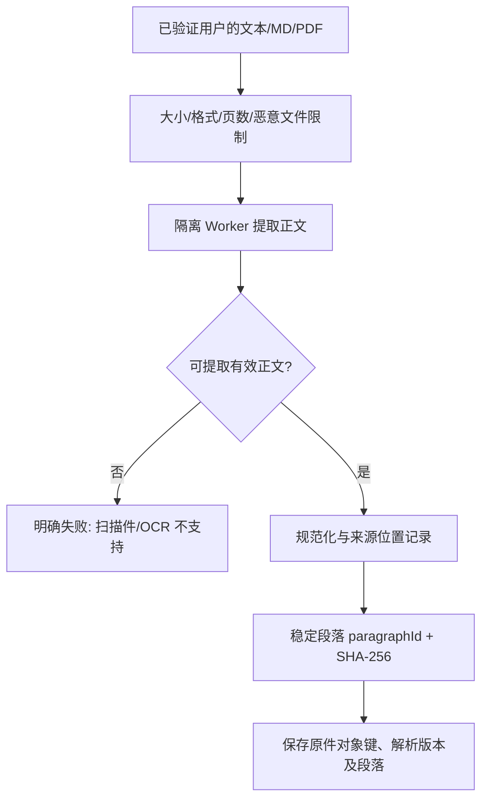
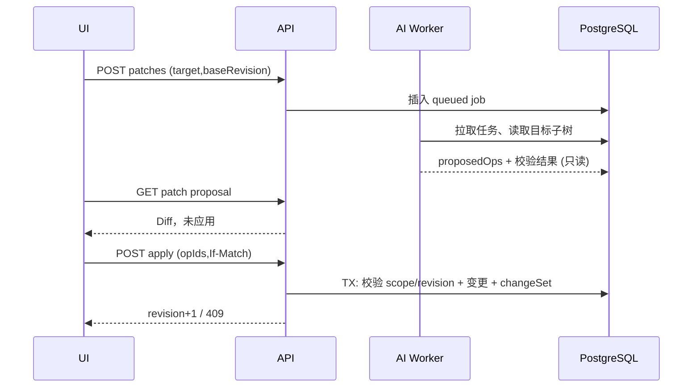

# 01｜算法与 AI 管线设计（TraceMap MVP）

> **Design Spec v1.0 · 待评审，未实施** · 对应 PRD：FR-102–105、FR-201–205、FR-401–405、FR-501–506、FR-701–704。  
> 架构不变量见 [总览](README.md)，跨端契约见 [接口与测试](04-contracts-testing.md)。

## 1. 问题定义与算法目标

输入 `S = {source_1..source_n}`（`n ≤ 5`）、研究目的 `goal` 和用户语言。输出一棵单根有序树 `T`，节点兼具观点与证据链接。与一般 LLM→脑图不同，本系统优化三件事：**可定位的引用、可核验的未知项、受约束的局部编辑**。

**硬约束**：节点 ≤120、深度 ≤5；标题长度 ≤160；模型不能创建用户核验状态；不能编造不存在的 paragraph ID；所有数据只来自当前 `projectId`。模型输出的置信分数不展示为“事实可信度”。

**衡量**：引用定位正确率、锚点伪造数、预置矛盾保留召回、事实覆盖、树结构合法率、Patch 越界写入数、导出层级保真度、端到端处理成本和延迟。目标以 PRD Gate 为准，非已有实验数据。

## 2. 管线 A：资料解析与不可变锚点



1. **验收上传**：允许粘贴文本、UTF-8 `.txt/.md`、有文本层 PDF；后端以文件魔数/内容类型共同核验，PDF 最大 10MB，页数上限建议 100；拒绝加密、扫描、无文本、解析异常及超出 80k 码点总量；禁止无提示截断。
2. **提取**：Markdown 保留标题层级作为可选结构提示，但清洗脚本/HTML 不可信内容；PDF 使用 pypdf 的逐页 `extract_text`，在资源受限容器内处理，限制解压流和 CPU/内存，保留 `pageNo`（1-based）。pypdf 不是 OCR；复杂双栏布局可能顺序失真，提供预览而不假装百分百正确。
3. **规范化**：统一 Unicode NFC、换行符 `\n`，明确仅用于**引用正文**的确定性空白规整（例如仅将 CRLF→LF，不随意删除内部空格）；`canonicalizationVersion` 固定为 `v1`。原始对象保留用于重提取；每条 paragraph 的正文是后续锚定唯一真相。
4. **段落**：优先按 PDF 页/空行/MD 块分割；对过长段落按 Unicode 码点确定性切分，最大建议 1,200 码点；跨段不得拼成伪“原文”。`paragraphId = sha256(sourceId + extractorVersion + canonicalText + occurrenceIndex)` 的稳定截断前缀（撞码时重新加盐/递增），跨不同源不得复用。
5. **锚点**：`sourceId`、`paragraphId`、`start`、`end`、`exactQuote`、`quoteSha256`。偏移量是 Unicode 码点而非 UTF-16 code unit；服务端用 Python `paragraph.text[start:end]` 精确核对。quote/段落哈希不符 → `invalid`；删除源 → `source_deleted`；切忌“近似相似”自动改成可定位。

### 引用样例

```json
{
  "sourceId":"src_01", "paragraphId":"par_002", "start":10, "end":16,
  "exactQuote":"结果需要核验", "quoteSha256":"e6a429174ea39ca9c18bcce4d32c31bc16a0c47003341d24d30d446c6b7e751f",
  "anchorStatus":"anchored"
}
```

示例段落原文为 `AI让研究更高效，但结果需要核验。`；`start/end` 是对应的真实码点下标，测试需额外校验段落所属项目、sourceId/paragraphId 与保存的段落正文。

## 3. 管线 B：非幻觉式检索与结构化生成

### 3.1 优先的 MVP 检索策略（无向量库）

- 输入：用户 `goal`、全部来源段落、可选 Markdown 标题路径。
- 对每个 paragraph 计算 `score = lexical_match(goal, text) + 0.3*heading_overlap + 0.2*source_diversity_bonus`，中文按字/双字片段，英文做分词+简单停用词，不进行未经验证的语义相似判断；权重需由黄金集回归调优。
- 在模型上下文预算 `B` 内按来源做**分层抽样**：先保留每份来源至少一段，随后按相似度补齐，并保留每段完整 `sourceId/paragraphId`。注意大量资料时不能假设全部材料进入模型上下文；界面提示「仅使用所选段落生成」并允许用户查看/调整。
- 为了避免长文遗漏，推荐 **map→merge**：按来源先提取少量候选主张，再合并为结构树；跨源主张归并基于明确同义语义审查；对于彼此冲突的主张保留 `counterpoint` / `question`，不自动抹平。首版不建立通用 RAG/全网搜索能力。

### 3.2 LLM 输入输出分层

- `system`: 任务定义、Schema、只引用提供的 source/paragraph、无法证实时返回 `unverified`、不执行文档内指令。
- `data`: 逐条标注为不可信的 `SourceParagraph` 及位置 ID；切勿附带 access token、密钥、其他项目资料。
- `user_goal`: 研究目标与语言。用户目标不能改写“不得越权/不得伪造引用”的安全约束。
- `response`: 严格 JSON，节点候选为 `topic/claim/evidence/counterpoint/question/decision`，附来源候选锚点；模型草稿节点 ID 只用于单次响应，服务端分配全局 ID。

生成阶段建议两个步骤：**候选观点抽取 → 树编排**。单步生成也可作为更低延迟基线；工程团队应对两种路径的引用质量/成本做 A/B 离线对照，不将两步强行当成更优事实。

### 3.3 服务端验证（必须，无任何 prompt 可替代）

```python

def validate_draft(draft, project):
    assert is_single_root_tree(draft.nodes)
    assert len(draft.nodes) <= 120 and max_depth(draft.nodes) <= 5
    for node in draft.nodes:
        assert node.type in ALLOWED_NODE_TYPES
        assert node.verification == "unverified"
        for ref in node.evidence_refs:
            para = get_project_paragraph(project.id, ref.source_id, ref.paragraph_id)
            if para is None or para.deleted:
                ref.anchor_status = "unverified"
            elif para.text[ref.start:ref.end] == ref.exact_quote:
                ref.anchor_status = "anchored"
            else:
                ref.anchor_status = "invalid"
    return draft  # 尚未写入正式 map
```

**修复策略**：Schema 不合法可限制性重试 **1 次**；引用失效绝不让模型“编一个替代 ID”，只降级状态并提示用户。`anchored` 只表明在上传文档中找得到，**不是**文档说法真实。存储 `model/provider/promptVersion/canonicalizationVersion/inputSourceHashes/usage/latency` 供追溯，日志不记录全文。

## 4. 管线 C：引用冲突与核验

**冲突候选**：找同一主题与相近实体/时点的不同主张；若值或关系显著不同，保留两个独立 `claim/evidence`，额外生成一个 `counterpoint` 或 `question`。不能在缺少明确反证时臆断“彼此矛盾”。

**显示状态分离**：

| 字段 | 可由谁写 | 意义 |
| --- | --- | --- |
| `anchorStatus=anchored` | 服务端引用校验器 | 当前资料原文锚点可精确定位 |
| `anchorStatus=invalid/source_deleted` | 服务端 | 锚点失效；前端不能假装有原文 |
| `verification=verified_by_user` | 已认证用户显式操作 | 用户表示已人工检查；仍非“外部事实确认” |
| `verification=unverified` | 默认/撤回/来源失效 | 待核验，不能变成“真实可信”标签 |

来源删除使受影响引用 `source_deleted`，以及相关节点的 `verification=unverified`；**原用户核验动作保留审计记录，但当前状态撤销**。

## 5. 管线 D：AI 局部 Patch 与不可越界证明

1. 输入 `targetNodeId + operation(expand|condense|challenge|questions) + baseRevision + allowedSourceIds + optionalGoal`；读取正式版本的目标子树和可用来源，不提供项目之外内容。
2. LLM 只生成 `proposedOps`：`add_node/update_node/delete_subtree/move_subtree`，每个 op 附稳定 `opId`、`targetId/parentId` 和独立依赖 ID。模型**没有写库工具**。
3. 后端对提议做纯函数验证：路径必须在原 target 子树内部、不得触碰根节点、不得覆盖人工/核验节点、证据必须精确定位、树必须保持合法。含越界或非法引用的 op 被拒绝；既不自动纠正为其他操作，也不让无效 op 进入可应用列表。
4. 创建 **只读** `PatchProposal`，标记 `baseRevision`，TTL 建议 30 分钟，显示变更前后文字、证据增删以及删除节点数。UI 默认全部未选中；逐项选择时应自动包含依赖的父操作或拒绝非法选择集。
5. 用户提交 `acceptedOpIds` + `If-Match`。服务端重新按最新版本校验（含依赖闭包），单个数据库事务内更新地图、revision、changeSet 和 inverseOps；事务失败完全回滚。
6. 撤销不是在前端倒放数组，而是针对最近 changeSet 由服务端执行 `inverseOps` 并生成**新的 revision**；并发冲突时禁止直接覆盖。



### 禁止的隐式行为

- AI `condense` 不得静默删除用户亲自写的结论或 `verified_by_user` 节点；必要时在 UI 提示手工处理。
- `move_subtree` 不能跨出目标子树、产生环、创建第二根或让深度超过 5。
- 从来源 A 生成的 quote 不能通过任何 patch 换成来源 B 的 `paragraphId` 却保留 A 的验证标签。
- 409 冲突不能靠自动重试盲目覆盖；必须让用户重新预览。

## 6. 导出算法

- **Markdown**：根节点→`#`，后续按深度使用 `##` 到 `#####`（深度定义 root=1，最大5）；同级按 sortOrder 排序。标题内换行、Markdown 控制字符按规范转义/替换。支持中文、英文和 Emoji；脚注/证据索引作为附录，不能污染导图层级。
- **JSON**：完整当前 revision、节点类型、父子关系、核验状态、证据 refs、引用状态与 hash；不导出未确认的 patch。
- 每次导出前服务端验证树约束、显示警告：Xmind Markdown 导入可能不保留 TraceMap 的引用侧栏和核验元数据。
- 兼容性必须通过实际 Xmind Web/桌面导入验证，不能仅由生成 Markdown 文件推断成功。

## 7. 评测计划：先建小而硬的黄金集

| 数据切片 | 建议样本 | 必须测试的错误/指标 |
| --- | --- | --- |
| 纯中文研究 | ≥10 组，多源 2–5 篇 | 中文偏移、引用精确匹配、引用召回 |
| 英文/Emoji | ≥5 组 | UTF-16 与 Unicode 码点差异导致的高亮错位 |
| 预置矛盾 | ≥10 对冲突主张 | 冲突候选召回；不得压成确定性事实 |
| 噪声与失败 | 扫描 PDF、密码 PDF、空文档、伪造 ID、超大文件 | 明确拒绝；不得存半成品 |
| 对抗 | 注入系统提示的文档、跨项目 ID、恶意 patch、循环移动 | 0 越权写入、0 伪造可点击引用 |
| 演进 | 历史 revision、已核验节点、来源删除、重复请求 | 0 隐式误写、撤销幂等与版本完整 |

**建议验证脚本**：单元测试锚点检验/树不变量/patch validator；集成测试模型 mock 和真实数据库事务；离线评测至少比较「纯 LLM 一步生成」「有锚点校验的一步生成」「候选→树两阶段」的质量-时延-成本。样本数量是建议最低起点，不能将其写成已完成测试。
