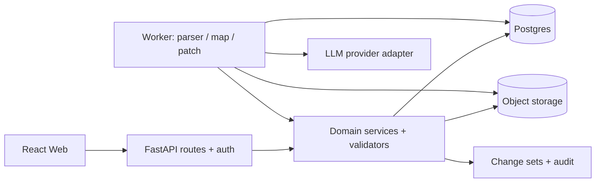

# 02｜后端架构与数据一致性设计（TraceMap MVP）

> **Backend Design v1.0 · 待评审，未实施** · 对应 FR-101–704。  
> 先读 [统一架构与不变量](README.md)；HTTP 结构以 [OpenAPI 契约](contracts/openapi.yaml) 为准。

## 1. 为什么选择模块化单体

**选择**：Python 3.12+、FastAPI、Pydantic v2、SQLAlchemy 2.x + Alembic、PostgreSQL 16+、S3 兼容私有对象存储、容器化独立 Worker、外部模型 API 适配层。初期一个 repo、一套 schema、两个运行角色（HTTP API 与 Worker），无 Kubernetes/微服务/事件总线/专用向量库。部署时采用托管 PostgreSQL 与对象存储；基础设施细节需要按预算选择。

**为何 API 不直接跑模型任务**：生成/解析可能超时或占用大量 CPU/RAM，不能把这些任务交给 HTTP 进程中的 FastAPI `BackgroundTasks` 当作可靠队列。使用 PostgreSQL `jobs` 表 + Worker + `FOR UPDATE SKIP LOCKED` 租约轮询，实现可恢复、可重试、可观察的异步任务。负载验证后再决定是否迁移 Redis/Celery。



### 未来应用代码建议布局（规划，不表示已建代码）

```text
tracemap-app/
├── apps/web/                 # React / TypeScript (前端规格见 03)
├── services/api/app/
│   ├── api/v1/              # REST 路由、鉴权依赖、错误映射
│   ├── domain/              # project/tree/evidence/patch 不变量
│   ├── models/              # ORM 与 Pydantic DTO
│   ├── repositories/        # SQL 访问
│   ├── integrations/        # object-store, llm-provider, auth
│   └── exports/             # Markdown / JSON renderer
├── services/worker/         # job claim, parse, generate, patch
├── migrations/              # Alembic
├── contracts/               # OpenAPI/JSON Schema 由 CI 校验
└── tests/                   # unit, integration, contract, security
```

## 2. 领域对象与数据库建议

下表为**逻辑模型**，具体 SQL DDL 需由迁移生成并测试。每个项目以 `owner_id` 做强制隔离；来自请求的 `projectId/sourceId/nodeId` 均要通过关联关系二次认证。

| 表 | 关键字段（建议类型） | 约束 / 索引 |
| --- | --- | --- |
| `users` | `id uuid`, `identity_subject text unique`, timestamps | 只存 OIDC subject 等最少认证映射 |
| `projects` | `id uuid`, `owner_id`, `title varchar(80)`, `goal text`, `revision bigint default 0`, `root_node_id`, `deleted_at` | 索引 `(owner_id, updated_at DESC)`；revision 单调递增 |
| `sources` | `id uuid`, `project_id`, `kind`, `object_key`, `sha256`, `status`, `extracted_codepoints`, `parse_version` | `(project_id,id)`；`object_key` 不暴露给用户 |
| `paragraphs` | `id uuid`, `source_id`, `ordinal`, `page_no`, `text`, `sha256`, `canonicalization_version` | 唯一 `(source_id,ordinal)`；段落一经 ready 默认不可变 |
| `nodes` | `id uuid`, `project_id`, `parent_id`, `sort_key`, `node_type`, `title`, `note`, `origin`, `verification`, `verified_by`, `verified_at` | `(project_id,parent_id,sort_key)`；单根/深度/无环由事务内服务校验 |
| `evidence_refs` | `id uuid`, `node_id`, `source_id`, `paragraph_id`, `start_cp`, `end_cp`, `exact_quote`, `quote_sha256`, `anchor_status` | 关联节点与来源必须在同一项目；防止跨租户 IDOR |
| `jobs` | `id uuid`, `project_id`, `kind`, `status`, `payload_jsonb`, `result_jsonb`, `lease_until`, `attempt`, `idempotency_key`, `error_code` | `(status,lease_until,created_at)`；受限重试 |
| `generation_drafts` | `id`, `project_id`, `job_id`, `base_revision`, `tree_jsonb`, `expires_at` | 只读草稿；提交后才成为正式 nodes |
| `patch_proposals` | `id`, `project_id`, `job_id`, `target_node_id`, `base_revision`, `ops_jsonb`, `status`, `expires_at` | 预览候选与正式地图物理分离 |
| `change_sets` | `id`, `project_id`, `revision_before`, `revision_after`, `actor_id`, `kind`, `inverse_ops_jsonb`, `created_at` | 唯一 `(project_id,revision_after)`；保留至少最近 20 次 |
| `idempotency_records` | `actor_id`, `method`, `route_key`, `key`, `request_sha256`, `response_jsonb`, `status` | 组合唯一；同键异 payload → 409 |
| `audit_events` | `project_id`, `actor_id`, `action`, `metadata_jsonb`, `created_at` | 不存全文、token、密钥；核验事件可审计 |

### 不变量与关系校验

- 所有 ORM 写操作必须经领域服务；不能直接让通用 CRUD API 改 `nodes`/`evidence_refs`。
- 根 `parent_id IS NULL` 且仅一个；child `parent_id` 引用本项目；禁止自引用和祖先回环；最大深度5、总节点≤120。深度/环由事务中读取并计算（或递归 CTE）校验，不能依赖前端阻止。
- `verification=verified_by_user` 只能由显式认证用户动作写入，必须记录操作者/时间；AI生成默认 unverified。
- `anchor_status=anchored` 必须与当前 paragraphs 正文精确相符；删除来源后的所有引用标记为 `source_deleted`，对应核验状态降级。
- 资料解析就绪后 paragraph 不可就地修改；重解析创建新 parse revision/新 paragraph IDs，并使旧引用失效。
- ID 使用 UUIDv7/UUIDv4 之一，全栈统一；不要把 UUID 中的信息当授权依据。

## 3. 请求生命周期与事务设计

### 3.1 认证授权与租户边界

采用托管 OIDC 登录，API 检查 JWT audience、issuer、过期和必要 scope，映射 `subject → user_id`，所有查询按 `owner_id` 过滤；跨用户资源返回 `404` 以降低资源存在性泄露。浏览器优先使用 **BFF 或 HttpOnly/Secure/SameSite Cookie**，若采用 Cookie 写接口须部署 CSRF token、防跨站请求机制；不要把长期访问令牌存 `localStorage`。实现选型需要同部署网络架构一起评审。

### 3.2 手工编辑 / 应用 Patch：一笔数据库事务

```text
BEGIN;
 SELECT id, revision FROM projects WHERE id=:projectId AND owner_id=:userId
 FOR UPDATE;                        -- 锁住项目写入序列
 assert If-Match == current revision;
 assert idempotency record not conflicting;
 load affected nodes, references & sources;
 validate allowed operation/ancestor scope/quote anchors;
 apply all selected operations;
 validate single root / no cycles / depth<=5 / nodeCount<=120;
 INSERT change_sets (inverseOps, revision_before, revision_after...);
 UPDATE projects SET revision=revision+1, updated_at=now();
 store idempotent response;
COMMIT;
```

手工编辑也走同一命令引擎。`PatchProposal` 的创建和 LLM 请求在事务外；事务内只做有界的校验与数据库写入，不调用模型/网络。失败 → ROLLBACK；`409` 时客户端展示差异/重新加载，不自动覆盖。

**撤销**：`POST /undo` 要求最新 revision 和最近可撤销 changeSet；服务端执行 inverseOps 并产生**新版本**，而不是递减 revision。建议最近 20 个 changeSet 保留；清理时间与隐私条款需协调。Undo 也需要幂等键。

### 3.3 幂等机制

请求头 `Idempotency-Key: <uuid>`；每个写请求按 `(actor, method, routeKey, key)` 记录 `sha256(canonical_request)`，状态 `processing|completed`。相同键相同 body 返回历史响应；不同 body → `409 IDEMPOTENCY_KEY_REUSED`；并发重复请求要由唯一键和行锁阻止双写。幂等记录保留建议 ≥24h，具体按成本和客户端离线重试窗口设定。

### 3.4 Revision 冲突

所有改变正式 map/来源的写操作发送 `If-Match: "rev-N"`，并返回 `ETag: "rev-N+1"`。这里用**全项目 revision** 来换取正确性与简化实现；哪怕用户只修改无关分支，也可能让旧 Patch 失效（安全但可能过度拒绝）。未来若事实表明冲突过多，再讨论目标子树 hash/revision。

## 4. 异步 Worker 与状态机

```sql
-- 示意 SQL；需要事务隔离级别与并发测试
WITH next_job AS (
  SELECT id FROM jobs
  WHERE status = 'queued' OR (status = 'running' AND lease_until < now())
  ORDER BY created_at LIMIT 1 FOR UPDATE SKIP LOCKED
)
UPDATE jobs SET status='running', attempt=attempt+1,
  lease_until=now() + interval '2 minutes'
WHERE id IN (SELECT id FROM next_job)
RETURNING *;
```

- Worker claim job 后启动 `heartbeat` 延长租约，调用 parser/LLM 时设置绝对超时、取消标记及外部调用并发上限。**租约超时表示可重试，不表示上次执行一定没发生**，因此任务结果提交需要 job ID 唯一/compare-and-set 防重复持久化。
- `queued → running → succeeded | failed | cancelled`；网络/429/5xx 只重试可重试错误，指数退避 + 抖动，上限建议2次；bad schema 仅修复一次；用户取消后不得生成新正式地图。
- 生成 `succeeded` 后仅写入 `generation_drafts`；Patch 任务仅写 `patch_proposals`，**绝不直接更新正式 nodes**。
- `GET /jobs/{jobId}` 需先鉴权 `job.project.owner`，返回 `status,progressStage,resultRef,error`，不要回显 prompts 或原文。首版每 1–2 秒轮询，后续再考虑 SSE/WebSocket。
- 异常/宕机恢复：过期 lease 可重新 claim；成功提交前进行 job status CAS；生成返回的同一 draft/patch 具唯一 jobId 防重复。

**建议状态**：上传返回 `sourceId+jobId`（202），解析成功显示 `ready`；生成返回 `jobId`（202），成功返回 `draftId`，用户再单独 `commit`；Patch 同理先生成 `patchId` 再 `apply`。

## 5. REST API 与错误契约

正式设计基准在 [OpenAPI](contracts/openapi.yaml)，本章节强调语义。

| 方法 / 路径（前缀 `/api/v1`） | 权限 / 目的 | 幂等与并发 |
| --- | --- | --- |
| `POST /projects` / `GET /projects` / `GET /projects/{pid}` | 创建/列出/读取个人项目 | POST idempotency |
| `POST /projects/{pid}/sources/text` | 粘贴正文/Markdown | 当前 revision；返回 source/job |
| `POST /projects/{pid}/sources` | multipart 上传 PDF/MD/TXT | body size限制、revision、job |
| `DELETE /projects/{pid}/sources/{sid}` | 删除来源并批量降级锚点与核验 | If-Match + 幂等 |
| `POST /projects/{pid}/generate` | 提交生成作业 | 202 jobId，读取当前 source 版本 |
| `GET /jobs/{jobId}` | 任务状态 | 仅 owner 可读 |
| `GET /projects/{pid}/generation-drafts/{did}` | 获取只读生成草稿 | 到期返回 410 |
| `POST /projects/{pid}/generation-drafts/{did}/commit` | 人确认草稿为正式地图 | If-Match + 幂等 |
| `GET /projects/{pid}/map` | 读取当前 map/revision | 返回 ETag |
| `POST /projects/{pid}/nodes/ops` | 人工操作 | If-Match + 幂等 |
| `POST /projects/{pid}/nodes/{nid}/verify` | 人手核验/撤回 | If-Match + 记录审计 |
| `POST /projects/{pid}/patches` | 产生只读 Patch 预览 | 202 jobId |
| `GET /projects/{pid}/patches/{patchId}` | 获取 Patch 候选 | 不包含未授权数据 |
| `POST /projects/{pid}/patches/{patchId}/apply` | 应用用户选择的合法 opId 集 | If-Match + 幂等 |
| `POST /projects/{pid}/undo` | 撤销最近更改 | If-Match + 幂等 |
| `GET /projects/{pid}/export?format=md|json` | 导出已确认地图 | 内容类型/文件名固定 |
| `DELETE /projects/{pid}` | 删除在线项目与资料（包括对象） | If-Match + 幂等，清理作业 |

**响应**：统一 JSON 错误 `{error:{code,message,retryable,requestId,details?}}`。常见：`400 BAD_REQUEST`、`401 UNAUTHENTICATED`、`404 NOT_FOUND`、`409 REVISION_CONFLICT|PATCH_EXPIRED|IDEMPOTENCY_KEY_REUSED`、`413 PAYLOAD_TOO_LARGE`、`415 UNSUPPORTED_MEDIA_TYPE`、`422 SCHEMA_INVALID|NO_EXTRACTABLE_TEXT|QUOTE_ANCHOR_INVALID`、`429 LIMIT_REACHED`、`503 MODEL_UNAVAILABLE`。服务端不暴露 stack trace；日志基于 requestId 追踪。

## 6. 安全、隐私和数据生命周期

- **上传**：文件类型白名单 + magic bytes、PDF 页数/压缩内容流限制、恶意文件扫描、进程资源限制、对象私有 ACL、TLS、短期签名下载；解析服务不信任任意脚本/HTTP URL，禁止外链抓取和 SSRF。
- **越权**：单用户项目隔离不仅在项目查询，也在 `paragraphId`、`nodeId`、`patchId`、`jobId`、导出接口逐级校验；每次引用都要交叉检查项目关系。
- **模型与日志**：用户资料作为不可信数据，不赋予系统指令权限；模型 API 密钥留在服务端；日志仅存模型名称/版本/时延/成本估计/状态/错误码，不存论文正文或引文全文；外部模型是否可用于训练需核实供应商条款并做产品披露。
- **删除**：删除项目时先标记 `deleting` 阻止查询/任务，再在事务中清除在线元数据，触发对象清理 outbox/job，重试直到完成；在线对象删除的最终一致窗口要披露。备份保留期、软删除策略、对象版本化设置需上线前确定。
- **审计**：核验者 ID、时间、此前状态和来源版本需要记录；管理员调试不能默认访问用户文件。
- **运维**：迁移备份/恢复演练、错误率与 job 队列监控、资源限额与费用封顶；告警至少覆盖 queue age、LLM 失败率、quote invalid、409 冲突率与 API 5xx。

## 7. 质量目标与容量初算（均非现有实测）

| 层面 | 建议验收阈值 | 方法 |
| --- | --- | --- |
| API 读取 | p95 ≤300ms（不含大文件/模型） | 固定测试数据和 20–50 并发用户压测 |
| 手工节点写入 | p95 ≤500ms；原子性100% | 120 节点场景，随机乱序/重复调用 |
| 解析/生成 | 异步可取消；超时不影响已确认地图 | 故障注入、Worker 重启/lease 过期 |
| 隔离 | 越权读取/写入 0 次成功 | 跨用户 `project/source/paragraph/patch/job` 枚举 |
| 引用 | 假锚点不得返回 `anchored` | Unicode、同文重复、删除/重解析测试 |
| 灾备 | 恢复点目标 RPO ≤24h、恢复时间目标 RTO ≤4h（需按服务等级最终评审） | 从备份演练恢复测试 |

## 8. 推荐实现顺序

**B0** 项目/认证/迁移；**B1** 资料上传与解析 Worker；**B2** 正式地图读取与手工事务操作；**B3** 引用锚点及核验；**B4** 生成草稿与提交；**B5** Patch 预览/应用/撤销；**B6** Markdown/JSON 导出；**B7** 隐私清理、压测、审计与运维。

**前置风险**：模型供应商安全条款、文本 PDF 兼容性、不同语言的引用锚点计算、任务取消的语义、合法的长文拆分、原文存储的数据地区与合规责任。未解决则不得以“生产就绪”标记。
