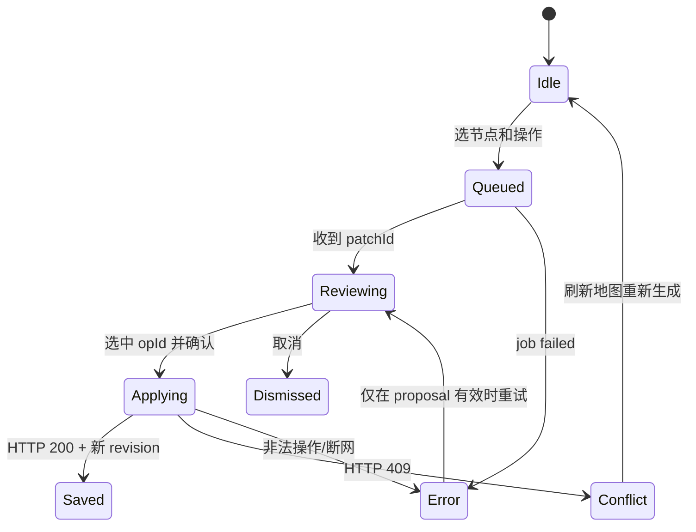

# 03｜前端架构、交互与状态设计（TraceMap MVP）

> **Frontend Design v1.0 · 待评审，未实施** · 对应 PRD E1/E3/E4/E5/E6/E7。  
> 这是未来 TraceMap 应用的前端，不是当前 GitHub Pages 展示站的前端重构。

## 1. 设计目标与技术栈

首版是一款**桌面优先**、具有清晰“来源→结构→判断”关系的研究编辑器，要求用户能在一次研究会话内：导入 → 检查抽取 → 生成 → 找回原文 → 局部改图 → 撤销 → 导出。设计优先级：**正确性 > 可恢复性 > 可理解性 > 视觉动效**。

| 层 | 推荐方案 | 选型条件 |
| --- | --- | --- |
| 渲染 | React + TypeScript (strict) + Vite | 单页工作台，无首屏 SEO 需求，缩减 SSR 复杂度 |
| 导图 | `@xyflow/react` + 自定义树布局函数（或按需接入 dagre） | 画布、缩放/拖动成熟；树形关系仍由领域模型决定 |
| 路由 | React Router | `/projects/:id/...` 清晰分页面 |
| 服务端状态 | TanStack Query | 查询缓存、轮询与精确失效，不把远端 map 当本地唯一真相 |
| 交互本地状态 | Zustand（或简单 Context） | 选中节点、侧栏标签、画布位置、未提交 Diff；不保存服务端主数据的另一份拷贝 |
| 表单/验证 | React Hook Form + Zod | 与 OpenAPI DTO 对齐，展示准确校验错误 |
| UI | Tailwind + 少量封装组件 / headless primitives | 视觉一致性、键盘可达；具体组件库可替换 |
| 测试 | Vitest + React Testing Library + Playwright + axe-core | 单元、交互、E2E 和可访问性闭环 |

依赖版本在应用建立时锁定并通过 CI 安全扫描，不在设计文档硬编码未经安装验证的具体版本。

## 2. 信息架构（与 PRD 对齐）

| Route | 屏幕 | 必需区块 |
| --- | --- | --- |
| `/login` | 登录 | OIDC 跳转 / 错误与隐私提示 |
| `/projects` | 项目总览 | 最近研究、创建、删除、空态 |
| `/projects/:projectId/sources` | 导入/来源 | 上传、粘贴、文件状态、可复制正文预览 |
| `/projects/:projectId/map` | 研究地图（主工作台） | 左 SourcePanel / 中 MapCanvas / 右 Inspector / 顶部版本与导出 |
| `/projects/:projectId/history` | 最近更改 | 时间、动作、当前版本、可撤销状态 |
| `/settings/privacy` | 隐私与删除 | 供应商数据使用说明、删除项目入口 |

**桌面布局（推荐宽度 1280+）**：顶部 64px 项目导航与保存状态；左 260–300px 来源与搜索；中央 `minmax(0,1fr)` 画布；右 320–380px 检查器，Tab 切换 `证据 / 节点 / AI 修改`。缩窄窗口可折叠左栏；宽度 <768px 不承诺地图完整编辑，但提供只读结构列表、引用查看和导出入口。

```text
┌ 项目 / 资料 / 地图 / 历史           revision 7 · 已保存  [导出] ┐
│ 来源面板 280 │       地图画布（缩放 / 聚焦 / 折叠）       │ 右检查器 360  │
│ Source A    │                  [主题]                  │ 结论类型 / 状态│
│ Source B    │       ┌────[主张 A]──[证据 1]            │ [证据] [AI]   │
│ 段落搜索    │       └────[反例 B]──[?待查]             │ 原文高亮/页码  │
│ 提取预览    │                                        │ [核验] [展开] │
└──────────────┴────────────────────────────────────────┴───────────────┘
```

## 3. 组件树与职责

```text
AppProviders
├── AuthBoundary
├── QueryClientProvider
└── AppRouter
    ├── ProjectsPage / CreateProjectDialog
    ├── SourcesPage / SourceUploader / ExtractPreview
    └── MapWorkbench
        ├── MapTopbar / SaveStatus / ExportMenu
        ├── SourceSidebar / SourceParagraphViewer
        ├── MapCanvas (@xyflow/react)
        │   ├── ClaimNode / EvidenceNode / QuestionNode / TopicNode
        │   └── ViewportControls / MiniMap（按需）
        ├── NodeInspector
        │   ├── NodeDetailsTab
        │   ├── EvidenceTab / QuoteAnchor / VerifyAction
        │   └── AiPatchTab / PatchActionMenu
        ├── PatchReviewDialog / DiffRow / SelectedOpsCounter
        ├── RevisionConflictDialog
        └── ToastRegion / ShortcutHelp / UndoAction
```

### 组件层不变量

- 组件**只发结构化 Command**，不直接将本地对象拼成服务端地图写回。服务器返回 `revision` 才视为保存成功。
- 画布 `<ReactFlow>` 内节点视图是**投影**，真正的父子关系来自 `MapDocument.nodes[].parentId/sortOrder`；拖拽屏幕坐标不等于改变树的父节点，必须触发域命令。
- 证据侧栏显示服务端返回的**paragraph 原文**，不得用模型摘要替代；引用 offset 错误时显示“引用失效”，绝不能强行高亮相似文字。
- 所有节点态的彩色标记都配有明确文案、图标及 `aria-label`，避免颜色成为唯一语义通道。

## 4. 服务端状态与交互状态的边界

```ts
// TanStack Query（服务端真相）：
['projects']
['project', projectId]
['map', projectId, revision]   // revision 仅用作版本缓存标识
['sources', projectId]
['paragraphs', sourceId]
['job', jobId]
['patch', patchId]

// Zustand（非真相）：
selectedNodeId: string | null;
activeInspectorTab: 'details' | 'evidence' | 'ai';
sourcePanelOpen: boolean;
selectedPatchOpIds: Set<string>;
viewport: { x: number; y: number; zoom: number };
expandedNodeIds: Set<string>;
localFormDrafts: Record<string, string>;  // 明确的未保存草稿
```

**写入策略**：输入可局部乐观展示，但 SaveStatus 必须先显示 `saving`。保存成功回读服务端 revision、刷新相关 cache；失败还原受影响节点或保留带“未提交”标签的草稿，不显示 `saved`。网络重试必须携带原 `Idempotency-Key`；碰到 409 进入冲突对话框，不自动无条件重试。

**折叠/布局状态**：视图状态可 localStorage（无来源正文）保存，但 PRD 要求隔日重开：需要将每个项目的 `expandedNodeIds + viewport` 作为**显式保存的轻量用户偏好**同步到服务端（例如 `PUT /projects/{pid}/view-preferences`）；该接口与数据应纳入后端契约，偏好变更不修改地图 revision。前端离线暂存应注明“仅此设备”，不能冒充跨设备保存。

## 5. 黄金路径：页面与状态机

### 5.1 导入资料（E1）

| 状态 | 页面行为 | 错误与恢复 |
| --- | --- | --- |
| `idle` | 拖放区+文本粘贴+样例说明 | 文件格式声明清晰 |
| `uploading` | 显示当前文件大小/上传进度，禁止重复提交 | 断开连接保留本地重选指引 |
| `parsing` | 每个 Source 有独立排队/解析状态，可返回项目 | 轮询 `GET /jobs/:id` |
| `ready` | 显示可复制正文、段落边界、页码、字数；可继续添加 | 用户明确选择“生成地图” |
| `failed` | 每文件显示格式/无文本/超限/解析异常 | 无法解析的文件不进入生成队列 |

前端尽早进行扩展名、大小、数量校验，但**服务端必须重复所有检查**。不支持 OCR 的扫描件在提取后明确报错。

### 5.2 地图生成（E2）

`empty → generating → draft_ready | failed → confirmed`：生成成功后先显示**只读草稿对比/摘要**，用户确认才提交到正式地图。模型超时显示真实状态，不显示虚假的百分比；取消仅阻止结果提交，若外部供应商调用已发出，计费可能无法取消。

### 5.3 节点编辑（E3）

- 双击编辑标题：输入态、失焦/Enter 提交、Esc 放弃；目标节点有子树时删除需显示影响的节点数。
- 添加子/同级：键盘操作及屏幕按钮均可达；节点新增后**仅在确认提交成功后**标记保存。
- 拖拽改父：放置目标必须经过 `isDescendant`、maxDepth、节点数初步预检；服务端最终判定。
- 缩放、展开与选中：不应该触发重存整张地图；选择节点后 Inspector 切换相应数据。
- Undo：只有服务端已确认更改可以被 Undo；撤销请求也要 If-Match。未提交编辑的取消应使用本地 Cancel，不冒充服务端 Undo。

### 5.4 证据追溯与用户核验（E4）

1. `claim` 上显示 `来源 2 · 待核验` 或 `无可用锚点` 文案；点击打开 Inspector 的 `EvidenceTab`。
2. 证据表格：文件名、页码、原文 quote、周围上下文、服务端锚点状态；用户可用上一条/下一条导航。
3. 选中 quote 后滚动定位当前 paragraph，**高亮的是原始提取正文**。
4. `anchored` 意味着可定位，不暗示事实真；点击“我已核验”时弹出说明，再发送 verify 请求，并记录用户 ID/时间。
5. 任何 `source_deleted/invalid` 强制显示“来源不可用/锚点失效”，原有 `verified_by_user` 显示被撤销，而非悄悄保持绿色。

**Unicode 实现细节**：后端 offset 是 Unicode 码点，JavaScript 字符串索引是 UTF-16 单元。对 `paragraphText` 用 `Array.from(paragraphText)` 生成码点数组，然后 `slice(start,end).join('')` 检查 exactQuote；不能直接 `paragraphText.slice(start,end)`，否则中文 BMP 之外的 Emoji 会使偏移错位。

### 5.5 AI Patch 预览、选择与提交（E5）



**Diff 呈现**：新增、删除、替换分区；证据引用的新增/失效**单独列出**；每个 op 显示 `opId` 和受影响节点。默认**零项勾选**，明确按钮 `应用所选 N 项`；没有被选择的操作不发送给后端。依赖其他 op 的项自动提示依赖，无法构成闭包则禁止点击应用；不能在客户端伪造保护规则通过。Patch 过期/当前 revision 变化，禁用提交并提示“重新获取建议”。

**人工保护节点**：若 proposal 试图删除用户已核验或手工节点，UI 显示红色 “保护节点；此项不可由 AI 应用”，不能通过勾选覆写。

### 5.6 保存、重开、导出（E6/E7）

- Save 状态：`saved(rev=N)`、`saving`、`error`、`offline_unsynced`（非已保存），aria-live 温和播报。
- 刷新/隔日继续：读取最新 map、sources、核验状态与 view preferences；对无权限/删除项目明确引导返回。
- 导出：先显示 Markdown 的标题层级与被降级的引文警告；选择 `.md` 或 `.json`，只有已确认地图可导出；文件名安全化、UTF-8 编码。
- 绝不声称“已经 Xmind 无损导入”，直到通过桌面和 Web 的真实兼容矩阵。

## 6. 数据一致性与冲突 UX

| 触发 | UX 指南 | 不允许的行为 |
| --- | --- | --- |
| `409 REVISION_CONFLICT` | `地图已改变`，保留用户草稿，提示重新加载/手动重做 | 盲重试覆盖新版本 |
| `409 PATCH_EXPIRED` | 禁止旧补丁应用，提供重新生成入口 | 用前端缓存直接套用旧 ops |
| `422 QUOTE_ANCHOR_INVALID` | 展示“原文引用无法定位”及 sourceId | 将 AI 改写文本显示为原始 quote |
| `503 MODEL_UNAVAILABLE` | 保留原图、提供重试；成本提示可选 | 称修改已完成 |
| `401/404` | 转到登录/项目列表、清理敏感缓存 | 将其他用户项目信息遗留在界面 |
| 网络中断 | 表单保留未提交草稿且明确“未保存” | 以 localStorage 当作云端成功提交 |

## 7. 性能、可访问性与安全

- **120 节点压力场景**：只投影可见节点并按引用/类型做 memo；布局计算做节流，节点标题变更不要触发无关区域重渲染。测试缩放/拖动时的渲染耗时、FPS 与输入响应；不能只在开发者高性能电脑上测。
- **时延预算（目标，非实测）**：首次稳定 UI ≤3s（不计 LLM），纯本地视觉反馈 ≤100ms、服务端节点提交 p95 ≤500ms、Patch 一定展示任务进度/超时与可取消态。
- **键盘**：Tab 进入工具栏，Enter/Escape 进入/退出标题编辑，删除需确认，焦点在弹层内受控；屏幕阅读器有列表式大纲作为画布替代视图。
- **WCAG 2.2 AA 抽检**：色彩对比、状态不只依赖颜色、焦点圈、语义 label、无障碍 toast、减少动画偏好。
- **安全**：模型生成的标题/说明按纯文本渲染；禁止 `dangerouslySetInnerHTML`；Markdown 预览必须净化（禁 HTML script）；本地 storage 不存原始资料、access token/模型密钥。

## 8. E2E 场景（对应可执行 Playwright 用例）

| Case | Given | When | Then |
| --- | --- | --- | --- |
| FE-01 | 用户有 3 份可用来源 | 导入并点击生成 | 展示只读草稿，确认后 revision 增加 |
| FE-02 | claim 有 Emoji 前缀的段落引用 | 点击来源标签 | 原文高亮与 exactQuote 完全一致 |
| FE-03 | Patch 含 3 项，其中一项改保护节点 | 审阅 Diff | 保护项不可选，未确认前地图不变 |
| FE-04 | 打开 Patch 时 revision=7，保存前变为8 | 点击应用 | 出现冲突对话框，地图 revision8 不被覆盖 |
| FE-05 | 断网时修改标题 | 等待保存失败 | 文案显示“未保存”，恢复后重试可控且不会双写 |
| FE-06 | 删除原文 Source | 打开旧引用 | 显示来源失效且核验状态被撤销 |
| FE-07 | 中文/英文/Emoji 和 5 级导图 | 导出 Markdown 并导入 Xmind | 层级符合测试矩阵；失败则降级产品宣传文案 |
| FE-08 | 120 节点地图 | 键盘导航/折叠/定位 | 无阻断、焦点可见、页面不横向溢出 |

## 9. 交付顺序（不可跳过正确性）

**F0** 设计 Token + 布局+只读 mock；**F1** 导入状态与原文预览；**F2** map 投影+手工编辑；**F3** 证据侧栏/核验；**F4** generation draft 确认；**F5** AI Patch Diff 审阅 + 409；**F6** Save/Undo/导出；**F7** E2E、可访问性与性能。先用契约生成的 mock server 联调，禁止等到模型上线才测试错误流。

## 10. 参考文档

- [Backend](02-backend.md) · [Algorithm](01-algorithm.md) · [Contracts and acceptance](04-contracts-testing.md)
- React Flow：<https://reactflow.dev/learn/concepts/building-a-flow>
- React Flow TypeScript：<https://reactflow.dev/learn/advanced-use/typescript>
- TanStack Query：<https://tanstack.com/query/latest/docs/framework/react/overview>
