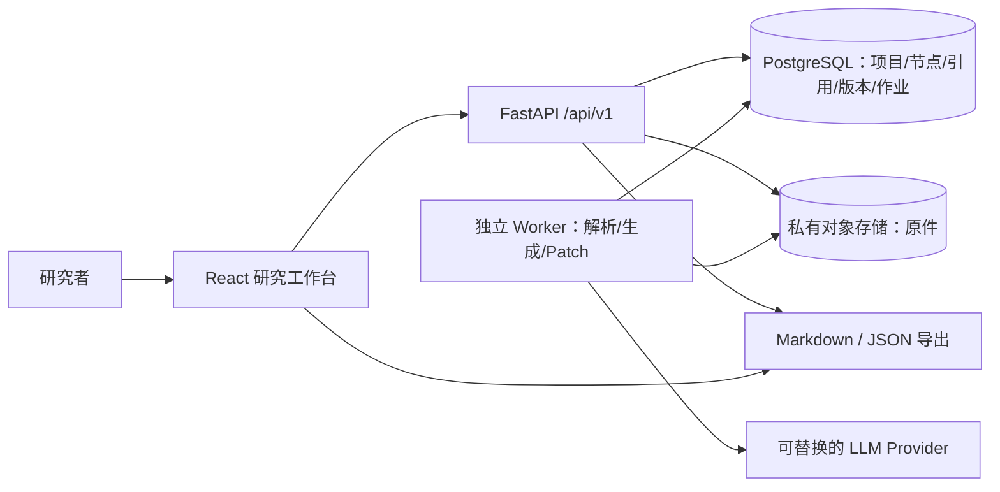

# TraceMap｜MVP 技术设计总览

> **设计稿 v1.0 · 2026-11-09 · 待工程评审，未实施**  
> 依据：[产品 PRD v1.0](../reports/prd-mvp-v1.0.md) · 范围：单用户 Web MVP · 目标：可开发、可验收、可回滚。

## 1. 核心决定（先读）

| 维度 | MVP 决策 | 反对过度设计的理由 |
| --- | --- | --- |
| 产品体验 | 资料 → 证据导图 → 引文核对 → AI Patch 审阅 → 保存 → Xmind Markdown | 验证核心闭环，不复制成熟绘图软件 |
| 算法 | 段落级确定性索引 + 有预算的候选检索 + 结构化 LLM + 引用精确校验 | 首版不引入向量数据库与开放式自治 Agent |
| 后端 | Python 3.12+ / FastAPI + PostgreSQL 16+ + S3 兼容对象存储；独立 Worker | 保持一个业务部署单元，作业与 API 进程隔离 |
| 前端 | React + TypeScript + Vite + `@xyflow/react` + TanStack Query | 复用成熟画布，避免自己造绘图引擎 |
| 写入安全 | 所有修改需认证、`If-Match` revision、幂等键、服务端事务 | 防止越权、陈旧补丁、重复提交和误覆盖 |
| 事实边界 | **引用可定位 ≠ 来源真实**；只有用户能标记 `verified_by_user` | 避免误把模型输出包装成事实 |
| 交付边界 | 可导出 UTF-8 Markdown/JSON；不做原生 `.xmind` 读写 | 官方支持 Markdown 导入，但需要端到端兼容测试 |

## 2. 端到端架构

**重要区分**：此处 React 工作台是未来 **TraceMap 产品**；现有 1998X GitHub Pages 是**静态研究展示站**。Pages 只发布这些设计文稿，不能运行用户数据、Python API 或模型任务。实际 MVP 需要单独部署应用服务。

## 3. 建议阅读顺序与责任边界

| 文档 | 主要责任 | 关联 PRD |
| --- | --- | --- |
| [01 · 算法与 AI 管线](01-algorithm.md) | 文本解析、段落/引文锚点、检索、生成、Patch 校验、评测数据 | E1/E2/E4/E5/E7 |
| [02 · 后端架构](02-backend.md) | 认证授权、数据模型、异步任务、事务、幂等、删除与安全 | E1–E7 |
| [03 · 前端架构](03-frontend.md) | 页面、组件、交互状态机、差异预览、编辑器与可访问性 | E1/E3/E4/E5/E6/E7 |
| [04 · API 契约与测试](04-contracts-testing.md) | 请求/响应示例、统一错误、跨端场景和 P0 验收矩阵 | FR-101–704 |
| [contracts/openapi.yaml](contracts/openapi.yaml) | 初始 OpenAPI 3.1 机器可读契约（**设计接口，不代表已经提供服务**） | FE ↔ BE |

## 4. 统一不变量（不得由单模块改变）

1. `project.revision` 是所有地图/来源变更的**全局单调递增整数**；客户端 `If-Match: "rev-7"` 和当前 revision 不符 → `409 REVISION_CONFLICT`，不提交任何操作。优先保障正确性；未来可细化子树 revision。
2. `node.type ∈ {topic,claim,evidence,counterpoint,question,decision}`；单根、无环、最大深度 **5**、节点数 ≤**120**；根节点不可移动或删除。
3. `EvidenceRef` 必须落在**同一项目**的 source/paragraph，使用原文段落 `text`、**Unicode 码点**半开区间 `[start,end)` 作为引用锚点；`quote === paragraph.text[start:end]`。前端显示时须转换 JS UTF-16 索引。
4. `anchorStatus ∈ {anchored,unverified,invalid,source_deleted}` 是机器对引用定位的判断；`verification ∈ {unverified,verified_by_user}` 是用户对**节点判断**的核对动作。AI 永远不设置 `verified_by_user`。
5. 未确认的 generation draft、Patch proposal **不得影响正式地图**。模型输出是永不直接执行的候选数据。
6. Patch 只能编辑 target 的后代范围；人工创建或用户核验过的节点为保护节点，AI Patch 不可修改/删除/迁移；独立手工编辑可由用户确认执行。
7. `idempotencyKey` 在 **用户 + 方法 + 资源路径** 范围内去重；同键同请求重放同结果，同键不同请求报冲突，不产生重复变更。
8. 删除来源必须使依赖它的引用失效并撤销相关节点的人为核验；项目删除必须按记录的保留/备份策略清理在线数据，不承诺立即抹除不可控历史备份。
9. 所有模型输入文档均标记为不可信，模型不得获得用户身份令牌、数据库写凭据或其他项目的数据。

## 5. 已决与待决定

**已决：** Web 单用户、5 来源/项目、单文件 ≤10MB、合计提取 ≤80,000 Unicode 码点（统一按 Unicode 码点计数）、支持 UTF-8 文本/Markdown/可提取文本 PDF、不做 OCR、前后端同步 schema、Markdown/JSON 导出。

**上线前必须确认：** 身份服务提供商、S3/LLM 供应商合同与数据用途、成本上限和删除期限、客户所在地的数据保留规则、Xmind 导入实际兼容矩阵、封闭测试性能基线。技术选型是建议方案，不是已有基础设施事实。

## 6. 设计阶段质量门槛

- **契约门槛**：OpenAPI 可解析；文档 API 与 schema 路径吻合；前端生成的客户端请求能够通过后端契约测试。
- **安全门槛**：跨用户访问、伪造引文、越界 AI Patch、过期 revision、重复幂等键全部拒绝且数据库不改变。
- **用户门槛**：真实 Xmind Markdown 导入、断网恢复、证据侧栏引用定位、Patch 审阅/撤销测试通过。
- **科学门槛**：预置冲突/多语/无正文 PDF 的黄金样本，评价引用准确率与冲突召回；目标仍待试点验证。

## 7. 外部依据（设计决策，不代表实测表现）

- React Flow 官方：<https://reactflow.dev/learn/concepts/building-a-flow>
- FastAPI 背景作业的限制：<https://fastapi.tiangolo.com/tutorial/background-tasks/>
- PostgreSQL `SKIP LOCKED`：<https://www.postgresql.org/docs/current/sql-select.html>
- pypdf 提取与扫描 PDF 限制：<https://pypdf.readthedocs.io/en/latest/user/extract-text.html>
- Xmind Markdown 官方指南：<https://xmind.com/user-guide/markdown-to-mind-map>
