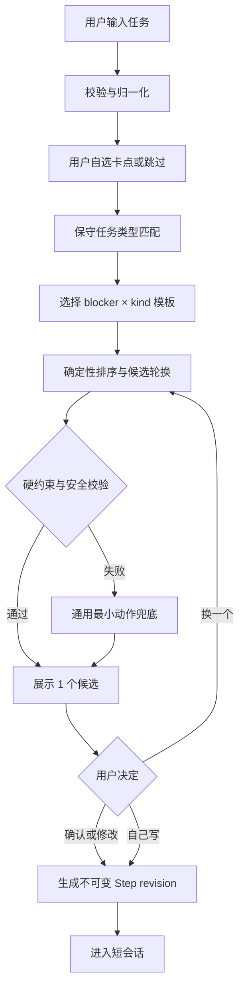

# Start-First｜算法设计文档 v1.0

> **Design status**: Proposed / 尚未实现 · **日期**：2026-11-09 · **Owner**：待指定  
> **关联**：[PRD](prd-mvp-v1.0.md) · [MVP 功能规格](mvp-functional-spec-v1.0.md) · [后端架构](architecture-backend-v1.0.md) · [前端架构](architecture-frontend-v1.0.md)  
> **覆盖范围**：F03 卡点识别、F04 起步动作建议、F06 缩小重试；辅助 F01/F05/F08。算法**不负责**医学诊断、自动完成任务或优先级强制决策。

## 1. 执行摘要：为什么先不用 LLM

核心问题不是“生成更多分步骤”，而是让一个**具体且用户愿意做**的下一动作尽快出现，并允许用户修改。MVP 用 **用户自选卡点 + 保守的任务线索匹配 + 可解释模板库 + 硬约束过滤 + 用户确认**。

- **核心路径离线可运行**：任何请求都不需要提交任务正文到服务器。
- **低复杂度优先**：无需 embedding、向量数据库、推荐模型、任务大模型或行为画像。
- **确定性可回归**：同样输入、相同算法规则版本和同样候选索引，输出必须一致。
- **可撤销**：suggestion 只是一份候选。人工修改后不自动替换；Step 完成也不等于 Task 完成。
- **反向约束**：没有足够任务信息时，必须给“可自由填写的通用第一步”，不能编造任务所需文件、工具、事实。

### 1.1 决策与反方案

| 方案 | 首版选择 | 原因 |
| --- | --- | --- |
| 用户自己选择五类阻力 | **P0** | 显式输入，避免推断敏感心理状态 |
| 规则式任务场景识别 | **P0** | 仅提高建议的具体度；宁可不识别，不猜错 |
| 模板候选 + 校验 + 人工编辑 | **P0** | 单点价值明确、可离线、可测试 |
| 候选质量离线测试集 | **P0** | 发现空泛、不可执行、错误假定 |
| 根据用户历史做性格/精神状态画像 | **禁止** | 不必要且可能伤害用户信任 |
| LLM 生成私人任务建议 | **P1 单独评估** | 提升适配性之前必须先证明增量价值并获得数据授权 |
| 自动识别拖延程度、预测失败概率 | **P2 不做** | 对数据要求高，存在错误标签和操纵风险 |

## 2. 输入、输出与边界契约

### 2.1 输入与归一化

```ts
type Blocker =
  | "too_big" | "unclear" | "perfectionism"
  | "low_energy" | "distraction" | "skipped";

type TaskKind =
  | "writing" | "communication" | "study"
  | "organization" | "preparation" | "generic";

interface SuggestionInput {
  taskTitle: string;          // 已校验 1–200 字
  taskNote?: string;          // 本地可选，不进入遥测
  blocker: Blocker;           // 用户明确选择；skipped 合法
  suggestionIndex: number;    // 0,1,2... 确定性轮换
  rulesVersion: "1.0.0";
}
interface StepCandidate {
  text: string;               // 1–160 字，用户可编辑
  templateId: string;         // 本地模板键
  rulesVersion: string;
  kind: TaskKind;
  source: "template" | "fallback";
  suggestedMinutes: 2 | 5;   // UX 提示，不是模型对任务耗时的承诺
  requiresConfirmation: true;
  explanations: string[];    // UI 可选：“这一步只要求打开并写出标题”
}
```

Normalize 规则：只做 Unicode NFC、前后空格 trim、压缩连续空白用于匹配；保留原始 Task 文本用于展示，不删除标点、不覆写大小写。对中文、英文均做有限可解释关键词匹配。不能把用户个人敏感内容传入 URL、日志、遥测或外部 AI。

### 2.2 输出质量的五条硬约束

1. **可开始**：用户不需要先完成多个未说清的前置步骤；必要时用“找到/打开/写下一个问题”降级。
2. **可观察**：动作目标为“写一行/列三项/打开一个文件”等，而非“保持专注/提高效率”。
3. **足够小**：估计尝试时长 2～5 分钟；若不能可靠估计，描述成“先尝试 2 分钟”，**不得保证完成**。
4. **不过度假定**：不假定客户姓名、邮件内容、文件存在、资源访问权限、具体事实；用条件句或通用入口。
5. **不施压与不诊断**：禁用“必须/立刻做完/你很懒/你患有…”等说法，无羞辱性失败反馈。

候选硬校验失败时走通用兜底并进入手动编辑态。任何建议都不得跳过用户确认直接变成 Step.ready。

## 3. 算法管线



### 3.1 阶段 A：保守任务类型判断

- **不对卡点做自动推断**。卡点来自用户选择；未选即 skipped。
- TaskKind 只用于选择写作/沟通/学习/整理/准备的动作模板，不代表任务真正所属类别。
- 仅匹配明确的动词/动作短语（例如“写报告/写邮件”“回复/联系”“复习/背诵”“整理/收拾”“准备/排练”）。
- **多类别同时强匹配、仅有模糊词或非中英预设语言** → generic；不从任务文本抽取人物、公司、日期作输出变量。
- 可选 note 仅在本地用于明确短语匹配；默认不解析个人备注，避免过度理解敏感内容。
- 不做外部 NER、深度语义分析、敏感人群识别；若标题触及专业领域（医疗/法律/财务），**只提供整理材料或列问题**，不输出行业建议。

| TaskKind | 高置信度文本线索示例 | 适合第一步的结构 |
| --- | --- | --- |
| writing | “写文章”“撰写报告”“draft essay” | 起草一个标题/一个问题/三条要点 |
| communication | “回复邮件”“给客户发消息”“reply email” | 写不发送的两句草稿；检查需回答的问题 |
| study | “复习”“练习题”“study for exam” | 翻开材料，写出第一个概念/疑问 |
| organization | “整理文件”“收拾桌面”“organize files” | 选择一个位置/文件夹，处理一项 |
| preparation | “准备汇报”“准备面试”“prepare presentation” | 写出一个核心问题/演示标题 |
| generic | 没有稳定线索 | 写下一个最小可操作动作 |

### 3.2 阶段 B：卡点 × 场景矩阵

| Blocker | 行动策略 | writing | communication | generic 兜底 |
| --- | --- | --- | --- | --- |
| too_big | 限定一个局部 | 写下三个小标题 | 列出要回复的一个核心点 | 写出这件事的 3 个更小部分 |
| unclear | 找到入口 | 写下要回答的第一个问题 | 写下对方需要你说明的一件事 | 写下第一个还不清楚的问题 |
| perfectionism | 草稿/练习，不发送 | 写三句不需公开的草稿 | 写两句不会发送的回复草稿 | 写一个仅自己看的粗糙版本 |
| low_energy | 低成本准备 | 打开一个可编辑文档 | 打开草稿区，不发送消息 | 准备一个需要的材料或工具 |
| distraction | 单一动作 + 去干扰 | 关闭一个无关页面后写标题 | 先写一句核心回复 | 关闭一个干扰，写下一步 |
| skipped | 最安全的通用入口 | 写一个标题 | 写一个草稿标题 | 写下现在能做的一个动作 |

**模板文本为可编辑的示例**。当模板依赖现实材料（“打开文档”），应提供另一条无需文件存在的候选（“在任意便签写一个标题”）。建议轮换不能制造虚假的确定性。

### 3.3 阶段 C：候选选择与排序

不使用“个体失败概率评分”。模板推荐仅依赖规则匹配结果、用户显式阻力和模板静态质量评分。

```text
eligible = templates where (blocker matches) and (kind matches OR kind=generic)
fallback = templates where blocker=skipped and kind=generic

priority(template) =
  + 40 if exact (blocker, kind) match
  + 20 if blocker exact + kind generic
  + 10 if generic blocker + kind match
  + staticQualityScore  (0..10: 可执行、可观察、简短、无额外依赖)
  - dependencyPenalty   (0/5/15: 需要未知文件、权限或第三方响应)
sort by priority DESC; tie by templateId ASC
candidate = ordered[suggestionIndex mod ordered.length]
if invalid or no eligible: use fallback[0]
```

**解释**：这是人工设计的**静态排序**，不是经过训练、校准的预测模型。分数只用于算法确定性，**不能**解释为完成概率或产品有效性。候选 index 按任务当次草稿维持，刷新后应恢复；用户已编辑候选时，“换一个建议”必须先二次确认覆盖，否则保留编辑。

### 3.4 阶段 D：建议校验

```ts
function validateCandidate(s: string, taskTitle: string) {
  const t = s.trim();
  if (!t || [...t].length > 160) return "invalid_length";
  if (t === taskTitle.trim()) return "same_as_parent";
  if (/^(完成|搞定|解决|提高|变得|保证|彻底)/u.test(t)) return "non_action";
  if (/(你很懒|你有ADHD|你患有|必须今天全部完成)/iu.test(t))
    return "harmful_or_diagnostic";
  return "ok";
}
```

校验器是**最小防线**，不是安全或语义正确性的充分证明。对任意输入仍需让用户最终判断；候选和手工输入均必须做长度、HTML 安全渲染与必要的内容提示，但**不以启发式校验禁用用户合法的手写动作**（手写只做结构与安全约束）。

### 3.5 阶段 E：用户改写与持久化

- Candidate 与 Confirmed Step 分开保存；候选可改变，但确认后用户版本永不被算法“自动纠错”。
- 确认后创建 Step: `stepId`、`revision`、`text`、`source=template|manual`、`templateId?`、`rulesVersion`、`confirmedAt`。
- 每次修改已确认 Step：新 Step revision / 新 stepId；旧 Session 指向旧版本，不迁移历史。
- “没能开始”时，推荐一个**更小版本**；不对用户进行心理推断或降低个人评分。
- 不追求“拆出所有子任务”；首屏始终只有**一个**可执行动作。

## 4. 缩小重试算法（F06）

针对 `not_started` 或 `partial`，仅进行一次轻量缩小建议：减少交付量、降低公开风险、降低切换成本。不能自动生成更多待办、催促或惩罚。

```text
not_started + too_big        -> 从“三项”缩小为“一项”
not_started + unclear        -> “写一个问题”而非“解决问题”
not_started + perfectionism  -> “只写草稿标题”，不发送/提交
not_started + low_energy     -> “准备一个材料”，允许先休息
not_started + distraction    -> “只关一个干扰页面”，然后做一步
partial                     -> 保留原动作，提示“继续剩下一个小点”
repeated not_started        -> 提供手写入口或“今天先放下”，不加提醒
```

**不变量**：回顾结果不会直接修改 Task.done；仅 `task_done` 二次确认才会完成母任务。新建议不覆盖旧 Session；一次点击至多一个新 Step revision。

## 5. 端到端伪代码

```ts
function proposeStep(input: SuggestionInput): StepCandidate {
  const title = normalizeForMatching(input.taskTitle);
  assertValidTitle(input.taskTitle);
  const kind = classifyConservatively(title); // multi-match -> generic
  const candidates = catalog
    .filter(t => t.blocker === input.blocker || t.blocker === "skipped")
    .filter(t => t.kind === kind || t.kind === "generic")
    .map(t => ({ t, score: rank(t, input.blocker, kind) }))
    .sort((a, b) => b.score - a.score || a.t.id.localeCompare(b.t.id));
  const ordered = candidates.map(x => x.t);
  for (let offset = 0; offset < Math.max(1, ordered.length); offset++) {
    const i = (input.suggestionIndex + offset) % Math.max(1, ordered.length);
    const t = ordered[i];
    if (t && validateCandidate(t.text, input.taskTitle) === "ok")
      return toCandidate(t, kind, input.rulesVersion);
  }
  return toCandidate(genericFallback, "generic", input.rulesVersion);
}
```

**注意**：可编辑模板文本应为独立的自然语言字符串；不能把用户标题无条件拼到候选末尾（可能导致不安全内容回显、长度失控或动作不可执行）。

## 6. 质量评估与自动化测试

### 6.1 离线 Golden Set（开发之前构建）

建立至少 120 个**人工合成且不含真实用户数据**的 Task 测例，覆盖：
- 五类卡点 + skipped；writing、communication、study、organization、preparation、generic。
- 中英混合、拼写不规范、空白和 emoji、任务标题接近上限、重复标题、专业场景、看似需要外部权限的任务。
- “担心做错”“没精力”等模糊/情绪性表达，但不创建病理标签。
- 困难示例：`准备明天的投诉回复`、`整理桌面`、`write my thesis`、`做年度报税` 等。

对每条记录人工标注：`actionable`、`observable`、`small_enough`、`assumption_free`、`non_shaming`，以及是否适合直接作为候选。

### 6.2 建议性门槛（预注册，非已达到）

| 指标 | 测试方法 | 建议退出条件 |
| --- | --- | --- |
| 覆盖率 | 120 条输入均得到可编辑候选/明确手写入口 | **100%** |
| 硬约束符合率 | 长度、诊断/羞辱文案、重复母任务校验 | **100%** |
| 可执行性 | 双人独立标注“明确动词 + 可观察输出” | **≥90%**，分歧需复核 |
| 额外依赖假定 | 标注有无“假定已有文件/权限/第三方回复” | **≤5%**，高风险模板必须修 |
| 改写后保护 | 修改候选再切换 blocker/刷新 | **100% 不覆盖** |
| 完成语义 | 任何 suggestion/session 操作 | **0 次自动把母任务标为完成** |

这些是**拟议质量门槛**。实际用户能否因此减少拖延须按 PRD 的对照实验另行评估，不可由离线模板指标推出。

### 6.3 属性测试与变形测试

- `proposeStep(input)` 在相同版本、输入、index 下严格确定；
- 改变 taskTitle 的首尾空格不改变 kind；
- 不论用户任务文字，候选长度不超过 160 字；
- 改变 blocker 但已有 `userEdited=true` 时不会覆盖确认文案；
- suggestionIndex 超出模板数量按 modulo 安全轮换，空库转 fallback；
- 输入疑似注入文本时，不会执行任何 JS 或泄漏到遥测/日志；
- 无网、计时结束、多次刷新不影响算法输出与 Step 版本引用。

## 7. 反馈、实验与算法迭代

**可以统计（必须自愿同意）**：`templateId`、`rulesVersion`、`blocker enum`、`editedFlag`、`duration bucket`、`outcome enum`。**不能统计**：Task/Step 正文、自由编辑内容、疾病推断、浏览器历史。

需要特别防止的优化误区：
1. “候选原样接受率高”并不代表用户开始行动，可能是用户懒得改。
2. “更多短会话”可能来自重复点击或过度碎片化，不能等同于更高生产力。
3. “未开始”不是模型负面标签，也不能触发惩罚型推送。
4. 仅采集同意者会产生选择偏差；分析结果要说明覆盖范围。

**A/B 验证**：对照组直接输入并开始，实验组获得卡点+建议，比较 PRD 定义的合格启动率与负面压力反馈；在试验前锁定抽样与指标窗口。算法版本用 `rulesVersion` 固定，同组内不随意热更新模板。

## 8. P1 AI 扩展决策门槛与接口

只有在 P0 已被用户反复使用、模板建议不适配有明确证据、且用户对额外数据处理有单独授权时，才引入在线 LLM：

- 客户端先对文本预览并征求许可；授权范围区分“发送当前任务给 AI 生成建议”和“匿名遥测”，不可混用。
- 服务端 P1 才允许新增 `POST /v1/assist/step`；请求正文只用于本次推理，默认不进入存储/日志，第三方模型保留策略要可核实并明示。
- AI 仅输出**候选 Step JSON**，需 schema 校验、长度/动作质量过滤、用户确认；超时/拒绝/离线都回退规则模板。
- 不提供医学建议/诊断；不自动发送邮件、修改用户文档、连接外部服务或替用户完成 Task。
- 使用盲评和随机实验比较 AI 与规则模板，不因为 AI 更流畅就默认其有效。

## 9. 算法交付清单与定义完成

- [ ] 任务类型规则表及 `templateCatalog@1.0.0` 可版本化。
- [ ] `proposeStep` 纯函数；无任何网络依赖和个人画像存储。
- [ ] Golden Set 合成样本、标注规范、回归脚本与失败样例库。
- [ ] 卡点切换、用户编辑保护、Step revision 与恢复算法完成单元/集成测试。
- [ ] 在离线和未知语言场景下返回安全兜底。
- [ ] 文档与 [AC-12～26、AC-41～51](mvp-functional-spec-v1.0.md) 一致。
- [ ] 所有性能/效果阈值标为“测试目标”，未执行测试前不得宣称通过。

## 10. ADR：关键决定

| ADR | 选择 | 重新考虑条件 |
| --- | --- | --- |
| ALG-001 | 不用 LLM 作为 P0 必要依赖 | 真实行为对照显示规则模板难以满足需求 |
| ALG-002 | blocker 必须由用户明确选择 | 具备可解释、可撤回的替代体验和伦理评审 |
| ALG-003 | 硬约束优先于丰富自然语言 | 质量案例显示通用兜底造成明显任务无法开始 |
| ALG-004 | 用户编辑永远优先于自动更新 | 无例外 |
| ALG-005 | 无个人失败预测、无强制行为干预 | 不在当前路线图内 |

## 11. 技术依据与文档边界

- 产品定性证据：[Hacker News / Product Hunt 调研](research-2026-11.md)。
- 全部验收编号来源：[MVP 功能规格](mvp-functional-spec-v1.0.md)。
- 本文的候选模板、权重、阈值与测试例**是新提出的设计方案**，不是已经测得的算法效果或训练所得参数。

**文档验收标准**：另一名工程师不需猜测即可实现 `proposeStep`，QA 可以构造边界用例，并且产品、法务、隐私评审能明确看到禁止的行为。
