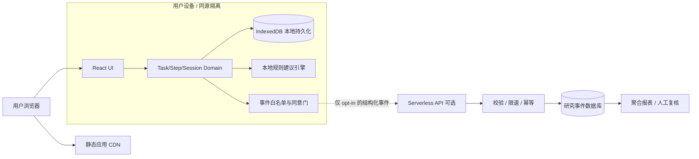
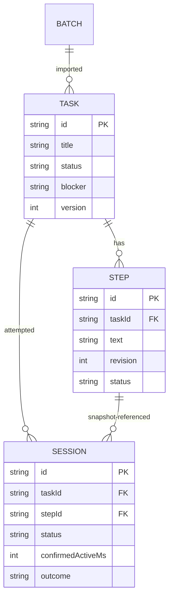

# Start-First｜后端与数据架构设计 v1.0

> **Design status**: Proposed / 尚未部署 · **日期**：2026-11-09 · **Owner**：待指定  
> **关联**：[PRD v1.0](prd-mvp-v1.0.md) · [MVP 规格](mvp-functional-spec-v1.0.md) · [算法](architecture-algorithm-v1.0.md) · [前端](architecture-frontend-v1.0.md)  
> **一句话**：**P0 业务后端为零**。Task/Step/Session 只保存在用户设备；可选后端**只负责明确同意后的研究遥测**，不得充当隐形任务存储服务。

## 1. 架构决策

### 1.1 不把 CRUD 放到服务器

用户无需账号、跨设备同步或协作；“把 TODO 发到服务端再取回”会增加隐私、延迟、费用与离线复杂度，却不直接验证产品核心假设。故 P0 使用静态 Web 前端 + IndexedDB，本地事务担任业务层。



说明：静态资源 CDN 无法保证完全不产生运营日志，应核查托管方默认访问日志；**不得将“服务器不保存任务正文”误写成“系统绝对不收集任何网络元数据”**。

### 1.2 功能由谁负责

| 模块 | 所在位置 | P0 强制 | 失败时体验 |
| --- | --- | --- | --- |
| 任务捕获、修改、归档、Step revision | 浏览器 Domain + IndexedDB | 是 | 阻止假成功，保留输入 |
| 规则建议生成与质量兜底 | 浏览器纯函数 | 是 | 手写 Step，不依赖 API |
| 短会话、回顾、恢复、状态机 | 浏览器 Domain + IndexedDB | 是 | 保存 checkpoint / 提示恢复 |
| 导出 JSON / 本地清除 | 浏览器 | 是 | 可选择保存到用户设备 |
| 事件上报与报表 | Serverless + 数据库 | **可选研究基础设施** | 核心产品可用、事件可丢弃 |
| 账号、跨设备同步、任务云备份 | 不存在 | 否，P2 | 明示“无云端恢复” |
| 在线 AI 起步建议 | 不存在 | 否，P1 | 默认永远是规则式 |

## 2. 技术选型与部署拓扑（推荐、非唯一）

- **前端托管**：静态站点 + CDN（Cloudflare Pages / Vercel Static / 同类托管均可）；主域同源 HTTPS，资源版本固定且可回滚。
- **可选实验 API**：TypeScript Serverless Functions，独立子路径 `/api/v1` 或 API 子域；只处理 JSON 结构化事件与删除请求。
- **数据库**：托管 PostgreSQL（或支持唯一约束/事务的等价关系数据库）。选择关系库是因为需要严格去重、删除、审计与按实验 cohort 聚合；无复杂事件流/消息队列必要。
- **异步**：P0 不用 Kafka/Redis/队列；少量事件直接批量入库，失败时客户端丢弃或有限重试（不阻断业务）。
- **监控**：API 失败率、延迟、拒绝次数、迁移状态、导出聚合，不记录 Task/Step 文本；错误跟踪必须经审查避免请求 body 被自动捕获。
- **环境**：`development / staging / production` 明确隔离数据源、密钥和允许来源；测试时用合成数据，禁止把真实生产事件复制到开发环境。

**禁止**：把密钥放在浏览器 bundle；用公共 CORS 代替身份校验；把用户 Task title 当分析维度；未经审查的 SDK 自动追踪所有输入。

## 3. 核心本地持久化模型（Source of Truth）

### 3.1 数据关系



建议 IndexedDB object stores：`tasks`、`steps`、`sessions`、`batches`、`consent`、`meta`、`outbox`（仅 opt-in）。所有 ID 由 `crypto.randomUUID()` 生成；`schemaVersion` 独立记录。步骤不可变修订：`stepId` 对应某一确认版本，修改创建新 Step / 新 revision，历史 Session 永远引用原 `stepId`。

**规范不变量**：
- 全库最多 1 个 `Task.status=active`；`done` 和 `archived` 不能被误认为完成情况相同。
- 全库最多 1 个 `Session.status=running`；对于 `paused`，应尽量保持“只有一个可恢复的进行中会话”的业务约束，除非用户显式结束它。
- `Step.completed` **不会**直接改变 `Task.done`；用户主动选择 `task_done` 且二次确认方可更改母任务。
- 单次批量导入需原子提交；导入失败不会出现半批任务。
- Session `ended` 不能 resume；更正 outcome 更新已有 Session，不再创建 Session。

### 3.2 原子事务与并发写入

- 一次业务变更所涉及的 stores 统一开启 `readwrite` 事务（例如结束 session + outcome pending + Step attempted），完整事务 `complete` 后方可显示“已保存”。
- 需要避免跨标签竞态。优先 `navigator.locks.request('start-first:mutations', ...)` 包裹短时间的**读→校验→写**操作；锁内执行 IndexedDB 事务，不要在事务间插入慢网络调用。
- **不能只依赖 Web Locks**：还必须在 IndexedDB 事务内检查是否已经有 running 会话；没有 Web Locks / 权限异常时采用事务内唯一“activeSession” 元记录 + CAS 版本检查，冲突返回 `CONCURRENT_SESSION` 而不是创建第二条。
- `BroadcastChannel` 仅用于告诉其他标签“数据版本已变化，请重新读取”，**不作为锁**或数据库事实来源。
- `start`、`pause`、`resume`、`end` 需要 idempotencyKey（UI 命令唯一 ID）。消费过的命令返回原结果，避免重复开始。
- 任务版本 CAS：`expectedVersion` 不一致则拒绝覆盖，显示“别处已更新，请查看新版/复制我的输入”。

### 3.3 业务仓储接口（前端本地调用，不是 HTTP）

```ts
interface LocalTaskRepository {
  createTask(input: CreateTask): Promise<Task>;
  importTasks(items: CreateTask[], batchId: string): Promise<Batch>;
  selectActiveTask(taskId: string, expectedVersion?: number): Promise<Task>;
  createStepRevision(input: ConfirmStep): Promise<Step>;
  startSession(cmd: StartSessionCmd): Promise<Session>;  // persist then UI running
  transitionSession(cmd: SessionTransitionCmd): Promise<Session>;
  recordOutcome(cmd: RecordOutcomeCmd): Promise<Session>;
  exportAll(): Promise<ExportSnapshot>;
  deleteAll(confirmed: true): Promise<void>;
}
```

`Promise` resolve 代表事务**已经完整提交**，不是“请求已经排队”。任何存储失败（QuotaExceeded、Safari 私密模式不可写、blocked upgrade）都不得假装成功。特别注意升级新数据库时，`onblocked`/旧标签持有连接需 UI 提示关闭其他标签。

## 4. 是否需要后端 API？

**普通用户使用闭环：零 API**。只有自愿参加研究或启用匿名事件统计时，才请求 API。事件服务故障不影响 Task/Step/Session。

### 4.1 同意与“匿名”的准确边界

用户安装的随机 ID 能跨事件关联，因此严格来说是**伪匿名（pseudonymous）**而不是不可识别匿名：存在潜在链路识别风险。产品文案应说“无账号的最小化使用统计”，不要保证不可重识别。

流程：
1. 用户在设置页主动打开“分享不含任务文字的使用事件”并看到字段/目的/保留周期；
2. 客户端向后端注册一个实验安装身份；服务器返回随机 `installationId` 与独立 `deletionToken`（仅客户端保存 token；服务器存 hash）。不自动写 cookie。
3. 发事件时客户端用安装 token 授权请求；服务器核验并限定该安装；拒绝带文本字段的请求。
4. 用户撤回同意，立即清空本地 outbox 且停止发送；若用户选择“删除已上传使用事件”，调用经过 token 认证的删除端点。
5. 浏览器数据已被清理且 token 丢失时，不能通过匿名 ID 无认证删除其他人的事件；需要在隐私说明中明确提供另外的人工申诉/可证明身份的流程（可能无法定位记录）。

**告知边界**：关闭统计不能撤销托管/CDN 必要的网络请求日志。需有真实可执行的隐私政策及数据保留计划后再启用后端。

### 4.2 API 合同（只在研究启用时）

统一路径 `/api/v1`；HTTPS + JSON；错误响应统一如下：

```json
{
  "error": {
    "code": "INVALID_EVENT",
    "message": "Unsupported event property",
    "requestId": "random-request-id"
  }
}
```

| Endpoint | 认证 | 目的 | 返回 |
| --- | --- | --- | --- |
| `POST /telemetry/registrations` | 无，限速 | 用户已在客户端主动同意后建立随机安装身份 | 201，`installationId`、`writeToken`、`deletionToken`、`policyVersion` |
| `POST /telemetry/events:batch` | Bearer `writeToken` | 白名单事件批量入库，最大 30 条/请求 | 202，`accepted`、`duplicate`、`rejected` |
| `POST /privacy/delete-events` | Bearer `deletionToken` | 删除当前 installation 的事件与 token | 200，`deleted`:true、`deletionReceiptId` |
| `GET /healthz` | 无 | 仅供负载监控 | 200，`status`:ok |
| `GET /admin/metrics` | **非公开** | 研究者按预注册方案查看聚合结果 | 需私有身份/权限，非 P0 公共接口 |

**幂等**：重复注册若客户端丢失响应，可重新注册新身份，但不得把第一次无事件的孤儿注册当用户活跃；写入时 `UNIQUE(installation_id, event_id)` 去重。批量请求需限制 `Content-Length`（例如 64KB）和严格 JSON schema，超过限制返回 413。

#### 注册请求与响应

```http
POST /api/v1/telemetry/registrations
Content-Type: application/json

{"policyVersion":"2026-11-09","researchPurpose":"product-improvement"}
```

```json
{
  "installationId": "uuid-v4",
  "writeToken": "opaque-random-secret",
  "deletionToken": "different-opaque-random-secret",
  "policyVersion": "2026-11-09"
}
```

**服务端无法仅凭请求独立验证用户真的勾选过同意**，所以“客户端同意门 + 服务器最小化 + 防滥用”是边界，不能包装成密码学证明。客户端持有 token，一旦同源脚本被攻破可能泄漏，应部署 CSP 并最小化第三方脚本。

#### 事件批量上报

```json
{
  "schemaVersion": 1,
  "events": [
    {
      "eventId": "random-uuid",
      "eventName": "session_ended",
      "occurredAt": "2026-11-09T02:00:00.000Z",
      "taskRandomId": "random-task-uuid",
      "sessionRandomId": "random-session-uuid",
      "attributes": {
        "confirmedActiveBucket": "60-119s",
        "estimatedTime": false,
        "outcome": "partial",
        "variant": "start-first-v1"
      }
    }
  ]
}
```

允许事件名称以[功能规格事件字典](mvp-functional-spec-v1.0.md)为准。所有 `attributes` 采用**逐事件严格白名单**，例如 `session_ended` 只许上面几个指定键及其枚举值。**不允许** title、note、stepText、email、URL、clientErrorStack、自由文本或任意 JSON blobs。

**状态码**：201 注册成功；202 事件写入成功；200 删除成功；400 schema/enum 错误；401 无效 token；409 删除/并发冲突；413 超长；429 限流；500 服务器错误。客户端遇 400/401 时不无限重试；遇 429/5xx 指数退避 1–3 次，继续失败可丢弃事件，不能阻断本地业务。

## 5. 服务端数据模型

建议 PostgreSQL（DDL 为示意，安全策略需实现时审查）：

```sql
CREATE TABLE installations (
  installation_id UUID PRIMARY KEY,
  write_token_hash TEXT NOT NULL,
  deletion_token_hash TEXT NOT NULL,
  policy_version TEXT NOT NULL,
  created_at TIMESTAMPTZ NOT NULL DEFAULT now(),
  revoked_at TIMESTAMPTZ
);

CREATE TABLE telemetry_events (
  installation_id UUID NOT NULL REFERENCES installations(installation_id)
    ON DELETE CASCADE,
  event_id UUID NOT NULL,
  event_name TEXT NOT NULL,
  occurred_at TIMESTAMPTZ NOT NULL,
  received_at TIMESTAMPTZ NOT NULL DEFAULT now(),
  schema_version INTEGER NOT NULL,
  task_random_id UUID,
  session_random_id UUID,
  attributes JSONB NOT NULL,
  PRIMARY KEY (installation_id, event_id)
);

CREATE INDEX telemetry_received_idx
  ON telemetry_events (received_at, event_name);
```

**存储限制**：只保存最小化白名单字段；对 `attributes` 校验的逻辑必须在 API 层，不能因为用了 JSONB 就收任意属性。不要存 IP、UA 指纹到事件表；如为阻止滥用而暂时处理 IP，应使用短 TTL 的边缘限流功能，且运营日志有明确保留规则。

**删除策略**：`DELETE FROM installations WHERE installation_id=?` 通过 ON DELETE CASCADE 删除关联事件；事务完成后返回收据。数据库物理备份有滞后删除风险，需要披露备份到期自动清理期限；不能说“立即从一切备份彻底删除”。

**建议性保留策略**：原始事件最长 90 天，按分析需要保留完全聚合后的无身份指标；研究提前结束或撤回授权则按实际政策删除。90 天是提案，需运营方在隐私政策中确认，不是已执行事实。

## 6. 安全、滥用与运维

### 6.1 威胁模型

| 威胁 | 攻击面 | 防御 |
| --- | --- | --- |
| 任务正文被第三方捕获 | 第三方 SDK、日志、崩溃报告 | 无第三方自动行为采集；出站请求网络测试与 CSP |
| 伪造事件/刷量 | 公网注册和事件 API | 注册/IP 短期限流、token 绑定、eventId 唯一、异常标记；不能把其视为防作弊证明 |
| 删除别人的数据 | 删除端点 | 独立高熵删除 token，服务端仅存 hash |
| Token 泄漏 | XSS、浏览器扩展 | CSP、依赖审计、无 localStorage 明文营销脚本、严格内容渲染；承认扩展风险 |
| 越权分析 | 管理报表 | 管理端认证、最小权限、审计访问、聚合阈值 |
| 高成本/可用性 | 批量伪造请求 | body 大小限制、限速、SQL 参数化、连接配额 |
| PII 意外泄漏 | 错误日志 | 请求 body 默认不记录；日志脱敏、TTL、抽检 |

### 6.2 网络与配置

- HTTPS only + HSTS，限制 CORS 为受控前端域名；`Origin` 检查仅是额外滥用门槛，**不是认证**。
- POST 请求用 `Content-Type: application/json`；严格响应安全头和缓存 `Cache-Control: no-store`；禁止在响应中回显用户任意数据。
- 后端 secrets 在部署环境保存，最小权限连接数据库；迁移执行账户与运行服务账户分离。
- API 不使用第三方广告/分析像素；所有聚合查询应避免按稀有单个用户记录输出。
- 清晰的请求追踪 `requestId` 与无任务文本的结构化服务器日志。
- 若没有明确研究需求，**直接不部署 API**，只保留接口文档与本地无事件版本。

## 7. 研究指标后端计算

与[PRD 的合格启动率](prd-mvp-v1.0.md)保持一致，但要承认计时与自报的局限。建议事件端同步必要的阶段信息以避免数据库持有原文：

- `task_created`：randomTaskId、isDifficult = true、occurredAt；无需标题。
- `session_started`：randomTaskId、randomSessionId、occurredAt。
- `session_ended`：randomSessionId、`confirmedActiveBucket`，不计背景估算时段。
- `outcome_recorded`：randomSessionId、`step_done|partial|not_started|task_done`。
- 服务端按 `installation_id + taskRandomId` 去重，并连接时间点；只计算有 consent 的同意者。
- 对于无网离线迟到的事件，使用客户端发生时间并检查异常时间差；超出合理范围标为不可靠，不静默纳入精确 24h 统计。
- `confirmedActiveBucket=60-119s` 及以上可支持 ≥60 秒代理阈值，但若分多个运行段/多次 session 需要客户端提前聚合与服务端一致口径。

**注意语义**：创建→24 小时内的合格尝试，应按 session 首次开始时间**以及该次 session 达到 60s 的时间**判断，不能仅靠 `session_ended` 是否落在 24h 内；需在前端出站事件里提供 `qualifiedAt`（首次满足代理阈值的时间，需白名单校验），或客户端发 `qualified_start` 事件。发布实验前要冻结事件契约，避免分母/分子失真。

## 8. 服务级目标与成本边界（仅提案）

| 维度 | MVP 建议目标 | 验证方式 |
| --- | --- | --- |
| 核心功能离线 | 服务端停机时**不受影响** | 断网完整 E2E |
| 事件请求延迟 | 同地区 P95 < 800ms（非功能阻断） | 合成压测；不代表上线已实现 |
| 事件写入幂等 | 同 eventId 重传不增加行数 | 数据库唯一约束 + 并发测试 |
| 隐私出站 | 未同意时 0 条遥测请求 | 网络抓包自动验收 |
| 删除完成 | 成功返回后主库记录 0 条 | DB 事务 + 自动化测试 |
| 运营成本 | 能在小规模研究中设置预算上限并报警 | 定期成本检查；不对成本做未验证承诺 |
| 任务文本泄漏 | Task/Step 正文绝不进入 API/日志 | 敏感字符串注入测试 |

## 9. 部署、迁移与回滚手册

1. 在 staging 以合成安装 ID 和事件启动 API + 数据库迁移；运行 schema、鉴权、删除测试。
2. 上线前完成数据处理说明、保留周期确认、运营负责人、管理端权限审查。
3. 使用 feature flag `TELEMETRY_ENABLED=false` 默认停用；开启实验需用户主动同意。
4. 在真实静态前端验证跨域、弱网、离线、反复授权/撤回、批次重复上报。
5. 若发现事件字段外泄/删除失败，立即停止写入 API；前端本地流程仍应可用。
6. 数据库迁移须 additive-first、可回滚应用版本；减少字段时先迁数据，再清理旧代码。
7. 保留无个人正文的监控与部署记录；事故处理必须具有通知与修复责任人。

## 10. 测试矩阵（可执行规格）

| Test | Given / When | Then |
| --- | --- | --- |
| BE-01 | 未同意，运行完整任务流程 | **0** 遥测 HTTP 请求 |
| BE-02 | 同意后发送 30 个合法事件 | 202；落库 30 条 |
| BE-03 | 同一 `eventId` 重发三次 | 仅 1 条记录 |
| BE-04 | 发送 `taskTitle` 或自由文本键 | 400；无正文写入日志 |
| BE-05 | token 丢失/错误 | 401，无跨安装访问 |
| BE-06 | deletion token 正确 | 删除此 installation 的事件 + token |
| BE-07 | 删除后旧写入 token 发事件 | 401/403；不得恢复已删数据 |
| BE-08 | 异常 body / 64KB 超长 / 高频请求 | 400 / 413 / 429；费用受限 |
| BE-09 | 后端断网 | 前端仍可捕获、计时、回顾、导出 |
| BE-10 | 主库事务失败 | 500 + 不入半批数据，客户端不假装成功 |
| BE-11 | admin URL 被非管理者访问 | 拒绝；无单用户明细输出 |
| BE-12 | offline 晚到与时钟回拨事件 | 标记有问题的数据，不制造精确指标 |

**完成标准**：与 [AC-52～76](mvp-functional-spec-v1.0.md) 关联的测试通过；若不启用研究服务，仅对“零出站事件、零正文泄漏、停服无影响”进行 P0 验收，不声称后端已部署。

## 11. 未来路线（与 P0 严格隔离）

- **P1**：受明确单独授权的在线 AI 候选接口，必须有超时、输出校验、绝不执行用户操作与规则降级。
- **P1**：可恢复 JSON 导入与本地 schema 迁移测试增强。
- **P2**：账号与跨端同步；届时需另写 identity、数据分区、权限/端到端加密可行性、冲突解决、删除与跨境处理 PRD。
- **P2**：任务管理器双向集成；不得在现有遥测 API 上偷偷复用正文。

## 12. 依据与局限

- 业务需求：[PRD v1.0](prd-mvp-v1.0.md) 与 [MVP 功能规格](mvp-functional-spec-v1.0.md)。
- 浏览器事务提交语义：[MDN — IDBTransaction complete](https://developer.mozilla.org/en-US/docs/Web/API/IDBTransaction/complete_event)。
- 多标签排它机制：[MDN — Web Locks API](https://developer.mozilla.org/en-US/docs/Web/API/Web_Locks_API)。
- 本文中的技术栈、API、数据表、SLO 和保留期限均是**推荐实施方案**，未有线上部署、压测、漏洞扫描或合规审计结果。
