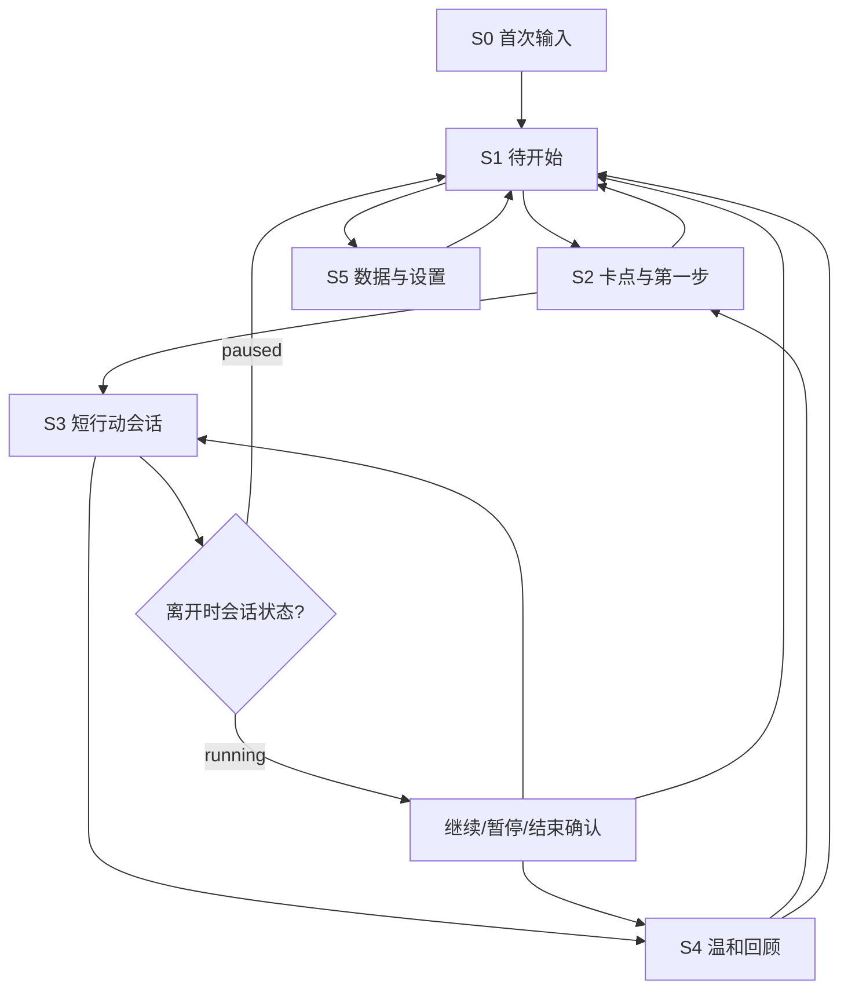
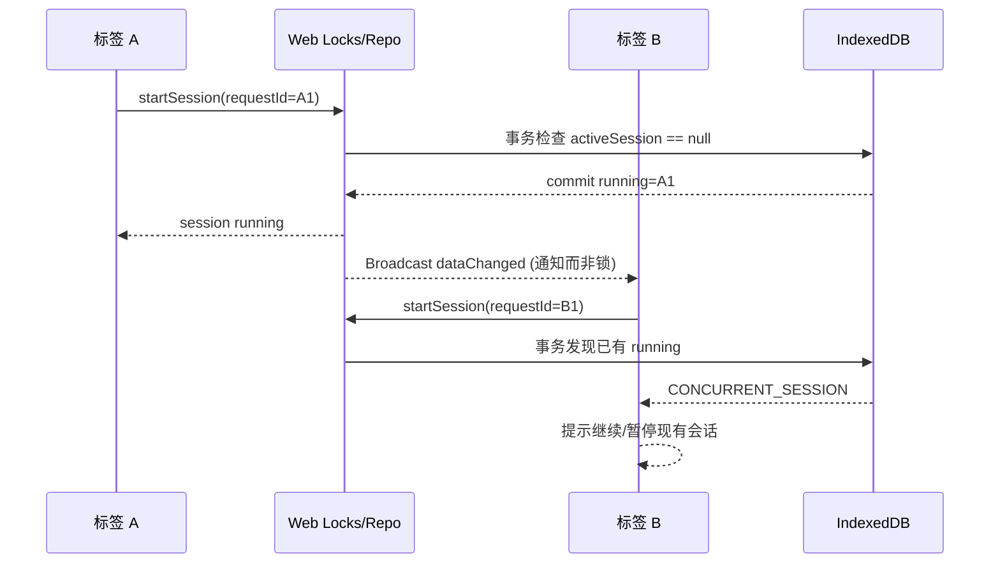

# Start-First｜前端与交互架构设计 v1.0

> **Design status**: Proposed / 尚未开发 · **日期**：2026-11-09 · **Owner**：待指定  
> **关联**：[PRD v1.0](prd-mvp-v1.0.md) · [MVP 功能规格](mvp-functional-spec-v1.0.md) · [算法](architecture-algorithm-v1.0.md) · [后端](architecture-backend-v1.0.md)  
> **目标**：移动优先、低心智负担、无需登录、离线可用的“开始一件难事”产品；界面美观不是替代可靠性和可访问性的理由。

## 1. 设计原则与范围

### 1.1 用户体验的唯一主路径

**任务捕获 → 单任务聚焦 → 选择/跳过卡点 → 确认第一小步 → 开始 2/5/10 分钟 → 回顾 → 缩小重试或返回。**

每个界面只做当前一步，不默认显示复杂标签、项目树、统计仪表盘。用户可以随时看清“现在系统保存了什么、是否正在计时、下一步是什么”。

### 1.2 前端技术建议

| 层级 | 推荐 | 原因 / 约束 |
| --- | --- | --- |
| 应用 | React + TypeScript + Vite | 简单静态部署、组件化、类型安全；不需要 Next.js SSR 或全栈运行时 |
| 页面导航 | React Router（或等价轻路由） | S0–S5 页面职责清晰；导航需处理运行中会话确认 |
| 领域状态 | 纯 TypeScript service/reducer + 显式状态机 | 业务转换集中、可测试，不把真相散落在组件 useState 中 |
| 本地数据库 | IndexedDB（可使用轻量事务封装库） | 任务/步骤/会话持久化；成功以 transaction complete 为准 |
| 交叉标签 | Web Locks + IndexedDB CAS + BroadcastChannel | 排它事务、版本检查、变更通知；BroadcastChannel 不做锁 |
| 计时 | 单调时钟 + durable checkpoints + 页面可见性处理 | 定时器只负责刷新显示，不充当事实来源 |
| 样式 | 设计 tokens + CSS variables，轻量组件 | 少配置、可访问性和响应式优先 |
| 验证 | Vitest + Testing Library + Playwright | 算法/状态机单元、组件语义、跨标签 E2E 与离线测试 |
| 部署 | HTTPS 静态站点 + CDN | P0 无服务端业务依赖；PWA install 留到 P1 |

选择框架不是产品核心优势；若团队已有成熟栈，可以替换 React/Vite，但必须保持领域接口、事务原子性和全部 AC 语义。

## 2. 页面地图与关键交互



### S0｜首次输入

**布局**：中心短标题“哪件事最难开始？”、一行输入区、主按钮“帮我开始”，次级“先看怎么用”。不做强制 onboarding、邮箱注册或个性测试。

- 首次输入自动聚焦时不得遮盖手机软键盘，320px 仍能触达 CTA。
- 保存成功后进入 S2；如果需要兼容已有任务列表，可先加入 S1 并自动选中。
- 空白、超长、数据库不可用时在输入框附近提供明示错误，保留原输入并允许复制。
- 首次成功保存后温和提示：“仅保存在此浏览器，清除浏览器数据可能丢失；可以在设置导出。”

### S1｜待开始列表（Inbox）

**布局**：顶部“今天先开始一件事”；主按钮“添加任务”；任务卡列表标题+状态；次级“粘贴多行”“数据与设置”。默认展示 inbox + 唯一 active，完成与归档折叠。

- 不强迫排序，也不把 overdue 红标作为默认视觉。
- 多行粘贴预览，逐项确认，单批最多 20 项；重复标题不自动合并。
- 选择任务前若已有 active/running，展示明确的切换/暂停对话框。
- 完成母任务需要独立明确操作，不可因为 Step 已完成而自动打勾。
- 每个任务的删除/归档等破坏性操作要有可撤销/二次确认语义。

### S2｜卡点 + 起步动作

**布局分两段**：上方显示 Task 当前标题；“是什么让你卡住了？”五个标签 + “说不清/跳过”；下方显示一个可编辑建议与“换一个建议 / 我自己写”。

- 五选一是**当前任务当次建议的上下文**，不是用户长期心理标签。
- 候选由纯本地算法产生，标注“建议，可以修改”；用户手改后再更换必须确认覆盖。
- “先准备一个文件/先写一行”一类可执行候选，不展示“必须今天完成整个任务”的宏大目标。
- 下方操作“用这一小步”确认后才能进入 S3；Step 文本保存成功后显示下一屏。
- 再次回到 S2 时默认展示用户已确认的 Step，而不是重新生成并覆盖它。
- 单步内容最大 160 字，输入校验不限制用户合理的手工动作内容（仅结构性长度和安全渲染）。

### S3｜短行动会话

**单屏只呈现当下 Step**：顶部返回与“暂停并离开”；中间醒目的第一步文字；底部时间显示和**一个主按钮**（未开始：开始；running：暂停；paused：继续）；次级“结束并回顾”“隐藏计时”。

- 时长选择 2/5/10 分钟，默认 5；开始后不允许直接修改同一 Session 的 target 时长（需要结束再新开）。
- 到时只提示“时间到了，想继续还是回顾？”；不自动完成 Step、Task，不自动退出。
- 倒计时可隐藏，声音/系统通知默认关闭；无强制屏蔽 App。
- 页面进入后台时记录 checkpoint；恢复时显式说明“你离开了一会儿，本次已按暂停恢复，是否继续？”。
- running 时返回/关闭特定导航要进行状态确认；直接关闭浏览器后可恢复状态，但无法可靠拦截所有浏览器关闭行为，因此 checkpoint 必须耐用。

### S4｜温和回顾

**主问句**：“刚才这一小步进展怎么样？”四项：第一步完成 / 做了一部分 / 还是没能开始 / 整件任务完成。

- `step_done` 时只完成 Step；母任务仍待办。
- `task_done` 二次确认后完成母任务。
- `partial` 或 `not_started`：提供“让这一步再小一点”“下次继续”“先放下”；无积分损失、红色失败条。
- 不强迫填写情绪原因；在 S4 异常关闭后回到 `outcomePending` 恢复态。
- 再次选择结果要更新同一 Session，不创建第二条会话。

### S5｜设置与数据

**优先顺序**：本地保存说明 → 导出 JSON → 删除本地数据（明确二次确认） → 自愿实验遥测开关与隐私说明 → 应用版本。

- 导出前提示用户“这是本设备数据快照，保存到自己可控的位置”；导出的 JSON 不含访问密钥或遥测 token。
- P0 **不提供 JSON 导入**，不要把导出入口宣传成“可一键恢复的备份”。
- 删除数据后，当前页面和其他打开的标签都应收到版本变化通知；无旧数据重建。
- 自愿统计开关默认关；只有用户明确同意才产生实验事件请求；撤回后清空 outbox。
- 没有启用后台服务时，可以隐藏/禁用实验开关并解释“当前未开展使用数据研究”，而不是伪造成功上报。

## 3. 文字线框（mobile-first）

### 3.1 S2 卡点及第一步

```text
┌───────────────────────────────┐
│ ← 待开始          此设备已保存 │
│                               │
│  回复客户的延期邮件             │
│                               │
│  是什么让这件事难开始？         │
│  [事情太大] [不知道怎么做]      │
│  [担心做错] [没精力] [分心]     │
│  [暂时说不清，跳过]             │
│                               │
│  建议的第一小步（可以修改）      │
│ ┌───────────────────────────┐ │
│ │ 先写两句不会发送的草稿    │ │
│ └───────────────────────────┘ │
│   换一个建议  ·  我自己写      │
│                               │
│  [    用这一小步，开始     ]   │
└───────────────────────────────┘
```

### 3.2 S3 短会话

```text
┌───────────────────────────────┐
│ ← 暂停并返回                   │
│                               │
│       现在只做这一小步          │
│                               │
│   先写两句不会发送的草稿         │
│                               │
│              04:36            │
│           隐藏计时              │
│                               │
│       [    暂停    ]           │
│        结束并回顾               │
│                               │
│  做了一点，就能重新开始。       │
└───────────────────────────────┘
```

这些是**结构线框**，非可用性测试过的最终 UI；发布前须用真实设备和屏幕阅读器验证。

## 4. 分层代码架构与建议目录

```text
src/
├── app/
│   ├── routes.tsx
│   ├── AppShell.tsx
│   └── providers/
├── features/
│   ├── capture/        # S0/S1、批量粘贴/预览
│   ├── focus/          # S2、卡点/步骤编辑
│   ├── session/        # S3、计时与控制
│   ├── review/         # S4、恢复
│   └── settings/       # S5、导出/删除/隐私
├── domain/
│   ├── task.ts
│   ├── step.ts
│   ├── session.ts
│   ├── commands.ts     # create/select/start/pause/end/recordOutcome
│   └── invariants.ts
├── algorithms/
│   ├── classifyTask.ts
│   ├── suggestStep.ts
│   └── templates/v1.0.0.json
├── persistence/
│   ├── indexedDb.ts
│   ├── repository.ts
│   ├── migrations.ts
│   ├── export.ts
│   └── crossTab.ts
├── services/
│   ├── clock.ts
│   ├── telemetry.ts
│   └── consent.ts
├── components/
│   ├── ActionButton.tsx
│   ├── Dialog.tsx
│   ├── TimerDisplay.tsx
│   ├── ErrorNotice.tsx
│   └── ScreenReaderStatus.tsx
├── styles/
│   ├── tokens.css
│   └── global.css
└── test/
    ├── fixtures/
    ├── unit/
    ├── integration/
    └── e2e/
```

**强约束**：React 组件不得直接执行数据库突变；它们只发 `command` 并订阅结果。业务规则在 domain service，存储原子性在 repository，模板在 algorithms，界面只呈现状态。这样可独立测试“点击十次开始，只产生一个 Session”。

## 5. 前端状态机与命令契约

### 5.1 UI state vs persisted domain state

- **UI state（可丢弃）**：当前输入框草稿、Modal 开关、是否隐藏计时、当前选中哪个时长、尚未确认的候选。
- **Persisted domain state（不能丢）**：Task、Step confirmed revision、Session 的 running/paused/ended、用户选择的 blocker、outcomePending、导入 batch 及 consent。
- **Derived state（从持久化推导）**：当前 activeTask、最近 Step、是否存在未结束 Session、能否开始新 Session、待完成回顾。

禁止在两个不同组件里各维护 `isRunning` 并希望其自动一致；running 来自 Session 状态和仓储查询。

### 5.2 状态转换（TypeScript 示意）

```ts
type SessionStatus = "running" | "paused" | "ended";
type Outcome = "step_done" | "partial" | "not_started" | "task_done";
type Command =
  | { type: "task.create"; requestId: string; title: string }
  | { type: "step.confirm"; requestId: string; taskId: string; text: string }
  | { type: "session.start"; requestId: string; stepId: string; targetMs: 120000 | 300000 | 600000 }
  | { type: "session.pause"; requestId: string; sessionId: string }
  | { type: "session.resume"; requestId: string; sessionId: string }
  | { type: "session.end"; requestId: string; sessionId: string }
  | { type: "session.recordOutcome"; requestId: string; sessionId: string; outcome: Outcome };
```

- 每个 command 包含一次性 `requestId`。domain service 调用 repository，在同一事务内检查 requestId 是否处理过，确保重复提交幂等。
- 组件的 `pending` 仅表示正在保存；保存后显示 `saved`；失败进入 `error` 并恢复输入。
- `session.end` 将状态置 `ended + outcomePending`，随后 `recordOutcome` 才改变 `outcome`；不能让计时器自动“标记任务已完成”。

### 5.3 多标签行为



若 Web Locks 不可用，也应由 **IndexedDB 事务写入的单一 activeSession 记录 + CAS** 阻止重复，而不是“最好只有一个”。标签之间的消息不能作为最终状态来源。跨标签竞争是 P0 发布阻断项。

## 6. 计时：精确显示 ≠ 真实投入

### 6.1 为什么不能靠 setInterval 计时

浏览器后台会节流定时器，屏幕锁定和系统睡眠可能使计时显示延迟；`setInterval(1000)` 的 tick 数不是可信时长。主状态是持久化的 `confirmedActiveMs` 和当前 foreground 运行片段，视图只按当前时间投影剩余时长。

### 6.2 推荐策略

1. `start` 时持久化 Session，再记录当前 `performance.now()` 作为同一页面生命周期内的片段起点。
2. `visibilitychange` 到 hidden、`pagehide`、用户手动暂停时 checkpoint 本片段；改为 paused，**不把后台耗时算作 confirmed active**。
3. 页面可见后由持久化状态判断：若上次意外退出且仍显示 running，则把失去监测的时间标为 unknown，展示恢复提示，而不是自动加到确认投入。
4. 页面在前台渲染倒计时可每 250–1000ms 更新；每次使用 `performance.now()` 差值，而不是简单“tick = tick + 1”。
5. 达到目标仅 `timerReached=true`，仍 running，用户选“继续 / 结束并回顾”；隐藏计时不改变状态。
6. 未能在页面终止前完成事务（浏览器强杀）时，恢复程序应从**上一次已提交 checkpoint** 恢复，未知片段不纳入 `confirmedActiveMs`，并提示这个估计边界。

### 6.3 计时伪代码

```ts
function elapsedForUi(session: Session, nowMono: number): number {
  if (session.status !== "running" || session.foregroundStartedMono == null) {
    return session.confirmedActiveMs;
  }
  return session.confirmedActiveMs +
    Math.max(0, nowMono - session.foregroundStartedMono);
}

// 页面刷新时不能重用旧 performance.now() 数值：
async function restoreSession() {
  const s = await repo.getCurrentSession();
  if (!s) return;
  if (s.status === "running") {
    await repo.markInterruptedAndPause(s.id);
    showRestoreDialog(s.id); // 不自动追加消失期间的时间
  } else if (s.outcomePending) {
    navigate("/review");
  }
}
```

**实现细节**：`foregroundStartedMono` 仅存放在**内存**，不能跨页面 reload 持久化为可信值。时间基准重置后旧 `performance.now` 不能直接相减。低频 durable checkpoint 的精度与 I/O 成本需经真实设备测试，并明确未确认时段的统计误差。

## 7. IndexedDB、保存反馈与故障恢复

### 7.1 写入 UI 四态

```text
editing -> saving -> saved
                 \-> error (数据仍在编辑框)
```

- 以 IndexedDB transaction `complete` 作为“已保存”标准，而非调用 `put()` 后立即变成绿色图标。
- 事务失败时不清空草稿；展示错误“刚才的修改还没保存，复制内容或重试”。
- Schema 升级失败：提供只读/导出救援路径，不静默重置空数据库。
- 首次保存后提示“仅保存在这台设备的此浏览器内”；不要宣称“自动备份”。
- 缓存被清理或系统回收时可能丢数据；需要用户自主导出 JSON，P0 不承诺导入恢复。

### 7.2 导出与删除

- JSON 包含 `schemaVersion`、`exportedAt`、`tasks[]`、`steps[]`、`sessions[]`，对象引用一致；不包含 token、sessionStorage 状态或研究事件 outbox。
- 对导出快照做 schema 校验后再生成 Blob；下载文件名如 `start-first-export-YYYY-MM-DD.json`。
- 删除前需再确认；成功后清空所有本地 object store 与同源快照，通知其他标签重新加载；若远端已发送研究事件，解释并提供单独“删除已上传事件”流程。
- 不要仅删除 React state，而留下 IndexedDB；也不要仅清数据库，却让另一标签的旧内存再次写入。

## 8. 组件和设计系统

### 8.1 设计 tokens（提议）

| Token | 推荐取值或策略 | 意图 |
| --- | --- | --- |
| spacing | 4px 基线，常用 8/12/16/24/32 | 节奏统一 |
| content width | mobile 100%；桌面最大 760px | 聚焦单一任务 |
| typography | 正文字号不低于 16px；正文行高约 1.5 | 长文本易读 |
| primary CTA | 全宽、触控高度建议 ≥44px | 易点击（不是 WCAG 唯一标准） |
| palette | 中性底色 + 单一强调色；不以红色标“拖延失败” | 降低压力 |
| contrast | WCAG 2.2 AA：普通文字建议 ≥4.5:1，控件边界注意 ≥3:1 | 可访问性 |
| motion | 低动态/支持 prefers-reduced-motion | 不制造额外干扰 |
| focus | 明确可见、无被遮挡的键盘 focus ring | 键盘导航 |

外观建议是默认方案，不应被解释为用户已验证的审美偏好。避免把“鼓励性插画”和庆祝动效塞满执行屏幕。

### 8.2 组件职责

| 组件 | 关键 props / 行为 | 失败或无障碍状态 |
| --- | --- | --- |
| `TaskCaptureForm` | title、onSubmit、validation | error 文案关联输入、保存中禁重复 |
| `BulkImportPreview` | rows、confirm、cancel | 20 行限制、批量撤销 |
| `BlockerSelector` | value、onChange、onSkip | radio group 语义，易于跳过 |
| `StepEditor` | candidate、userEdited、confirm | 更换建议不覆盖已手改文本 |
| `FocusTimer` | status、remaining、hidden | 键盘按钮、时间变化不过度播报 |
| `OutcomeChoice` | selected、save | 独立标注 Step/Task 完成差别 |
| `SaveStatus` | saving/saved/error | aria-live polite，不每秒刷新 |
| `DataExportPanel` | export/delete/consent | 二次确认、说明远端事件边界 |
| `ResumeDialog` | resume/pause/finish | 焦点限制与关闭后返回触发按钮 |

### 8.3 文案护栏

- “开始这一小步”而不是“彻底战胜拖延”。
- “还没能开始也没关系，想把这一步变得更小吗？”而不是“失败了，重新开始倒计时”。
- “这一步完成”绝不等价于“整件任务完成”。
- “数据仅在此浏览器保存”要真实；如添加遥测，另行说明匿名（更准确说伪匿名）最小统计范围。

## 9. 响应式和无障碍设计（WCAG 2.2 AA 目标）

- 适配 320/375/768/1440px，横屏、200% 页面缩放、手机软键盘打开。
- 所有控件能仅用键盘到达；tab 次序符合视觉顺序；模态框设置初始焦点和关闭后焦点回归。
- 优先原生 `button/input/radio` 语义；错误信息与输入 `aria-describedby` 关联。
- 主要动作有文字标签，不以图标或颜色单独传达运行/暂停/保存状态。
- 倒计时**不要每秒用 aria-live 宣告**；只对暂停、到时和结束状态发一次可感知通知。
- 支持系统字体放大、高对比和 `prefers-reduced-motion`；不强制全屏、不锁住页面滚动。
- WCAG 2.2 的 2.5.8 AA 最小指针目标是 24 × 24 CSS px（有例外）；本设计将主要触控 CTA 目标设为 **至少 44 × 44 px** 作为更友好的内部标准。
- 通过自动化规则扫描后仍需键盘和屏幕阅读器手工回归；不能把静态检查报告当完整无障碍认证。

## 10. 安全、隐私与性能

### 10.1 前端安全

- Task 与 Step 文本必须作为纯文本渲染，禁止将用户字符串拼进 `dangerouslySetInnerHTML`。
- 不把任务正文放入 URL query/hash、埋点、console.log、错误堆栈上报、localStorage 调试记录或第三方监控。
- 静态站点应启用 CSP（兼顾 Vite 资源/字体）、依赖锁定、生产构建检查和 HTTPS。
- 所有出站事件先通过严格类型白名单与 consent gate；只有用户同意后才能登记远端安装身份。
- 本地没有真正的云备份安全性；浏览器扩展、恶意脚本和设备被盗仍可能看到浏览器本地数据。产品不应宣称端到端加密。

### 10.2 性能预算（建议目标，非实测）

| 维度 | 目标 | 验证 |
| --- | --- | --- |
| 初次可交互 | 主流中档手机中首屏可操作，不等待外部 API | 模拟慢网、Web Vitals |
| 核心任务写入 | 常规设备下用户看见“已保存”之前完成事务 | 事务计时/错误注入 |
| 列表加载 | 构造 500 Task、2,000 Session 下操作流畅 | Playwright fixture |
| 计时 UI | 前台无明显漂移；后台恢复不假造 active 时间 | 5/30/60 分钟测试 |
| 离线 | 已载入静态资源时能继续本地工作 | 模拟 offline 的 E2E |
| 安装包 | P0 尽量避免大型 UI/图表依赖 | bundle analyzer、按路由拆分 |

**PWA 安装不是 P0**；不能在没有 Service Worker 的情况下承诺“首次离线打开”。P0 的离线含义是已载入的页面脱网后仍能完成任务流；若要求脱离浏览器后重新离线启动，需要单独 P1 缓存策略和更新机制。

## 11. 事件与后端的严格耦合边界

```text
UI command
  -> local repository transaction
  -> committed Domain event (不含正文)
  -> consent guard
      -> disabled: discard
      -> enabled: allowlist + queue + nonblocking send
  -> UI render saved state
```

必须先业务提交，再发送研究事件。若 API 失败，**不得**回滚成功的本地 Task 或 Session。用户撤回同意后阻止新事件并清空待发队列。Event 只能使用静态 schema，禁止任意扩展属性。

“合格启动 ≥60s”应以经过确认的前台活跃片段为依据。计时器在后台暂停，不能通过用户离开网页的分钟数虚构真实投入。独立使用场景应当允许用户停止而不作完成声明。

## 12. 测试矩阵与验收映射

| 场景 | 关联 PRD/AC | 测试类别 | 阻断条件 |
| --- | --- | --- | --- |
| 输入与批量粘贴 | F01 / AC-01～06 | 组件 + IndexedDB 集成 | 丢失条目/超限静默 |
| 单任务/聚焦切换 | F02 / AC-07～11 | domain + E2E | 两个 active / 错误覆盖 |
| 卡点选择与跳过 | F03 / AC-12～17 | 组件/无障碍 | 强制心理标签 |
| 建议编辑保护 | F04 / AC-18～26 | 纯函数 + E2E | 用户改写被覆盖 |
| 短会话/后台/刷新 | F05 / AC-27～40 | fake clock + Playwright | 重复 Session、自动完成 |
| 温和回顾 | F06 / AC-41～51 | UI + 持久化 | Step/Task 语义混淆 |
| 导出/删除/故障 | F07 / AC-52～67 | schema + 故障注入 | 假成功、正文外泄 |
| 自愿事件 | F08 / AC-68～76 | 网络拦截 + E2E | 未授权请求或撤回后继续上报 |

### 12.1 六条重点 E2E

1. **困难邮件**：输入→担心做错→改写草稿→2 分钟→部分完成，母任务依然待办，未同意无遥测。
2. **刷新与重复点击**：开始按钮 10 连点只得到一个 Session；刷新/暂停/继续不重置 ID 和状态。
3. **缩小重试**：`not_started`→更小 Step revision→新 Session；旧 Session 保留原版本。
4. **异常持久化**：quota 错误/升级失败不得假装已保存，可复制/导出救援。
5. **多标签竞争**：同时点击开始，唯一 running；其他标签收到明确冲突提示。
6. **隐私撤回**：关闭分析后 0 请求；本地删除/远端删除边界表述正确。

### 12.2 完成定义（DoD）

- [ ] 各页面均有 loading / empty / saving / saved / error / recovery 状态。
- [ ] 状态机单元测试、IndexedDB 事务集成测试、6 条 E2E 全部通过。
- [ ] 在 320px 手机、键盘、屏幕阅读器和 200% 缩放下主路径可使用。
- [ ] 不存在已知可复现的静默丢数据、两个 running Session 或正文遥测泄漏。
- [ ] 无网、后端停机、错误恢复时主产品功能不依赖服务器。
- [ ] 本地导出、完整删除、隐私授权/撤回均可正确使用。
- [ ] 完整的发布说明指出“尚无用户行为改善的实验证据”，不声称临床治疗效果。

## 13. 实施顺序（最小可交付切片）

| 阶段 | 先做什么 | 退出条件 |
| --- | --- | --- |
| FE-M0 | Domain types + repository + schemaVersion + command 幂等 | 状态机/数据测试能跑 |
| FE-M1 | S0/S1/S2：捕获、聚焦、规则 Step 建议 | 无网完成首个 Step 确认 |
| FE-M2 | S3/S4：会话计时、回顾、恢复 | 断网/刷新/计时到期流程成立 |
| FE-M3 | 跨标签、异常保存、导出/删除、隐私门 | P0 数据一致与隐私测试通过 |
| FE-M4 | 组件/无障碍/弱网 QA、产品可用性试验 | 无已知 P0 阻断，准备研究版本 |

前端项目开发不能用“第一个页面已能点击”替代工程完成；**最早的可靠闭环比提前构建 Dashboard 更重要**。

## 14. ADR、开放问题与来源

| ADR | 决策 | 未来评估 |
| --- | --- | --- |
| FE-001 | Mobile-first Web，不强制安装 | 证明需离线冷启动后再做 PWA |
| FE-002 | React+TS 仅作参考栈 | 团队实际维护能力优先 |
| FE-003 | IndexedDB 为单一业务事实源 | 跨设备账户/同步属于另一个 PRD |
| FE-004 | Web Locks + IndexedDB 事务/CAS | 浏览器兼容实测及故障回退 |
| FE-005 | 后台停顿不算 confirmed active | 需要研究更精确的测量方法时重新设计 |
| FE-006 | 不追求“分钟数精准=工作效率” | 用户质性观察与对照实验 |

**开放问题**：Safari 私密模式的受限流程如何说明；跨标签监听策略是否在各目标浏览器可靠；用户对隐藏计时/正计时的偏好；手写 Step 是否需要更强离线草稿防丢策略。需要原型测试后确定。

**参考规范**：
- [MDN — IndexedDB 事务提交](https://developer.mozilla.org/en-US/docs/Web/API/IDBTransaction/complete_event)
- [MDN — Web Locks API](https://developer.mozilla.org/en-US/docs/Web/API/Web_Locks_API)
- [MDN — Page Visibility API](https://developer.mozilla.org/en-US/docs/Web/API/Page_Visibility_API)
- [W3C — WCAG 2.2](https://www.w3.org/TR/WCAG22/)
- [Start-First MVP 功能规格](mvp-functional-spec-v1.0.md)

> 本文是技术实施方案。框架选择、性能目标、计时策略和 UI 组件尚未在真实设备和用户中验证；发布文档不意味着代码已实现或 QA 已通过。
