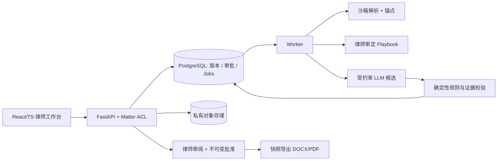

# Legal Intelligence｜技术设计文档索引（Architecture v1.0）

> **日期** 2026-11-09 · **性质** 研发设计方案（Proposed） · **产品阶段** Published research + PRD，**MVP 未实现**  
> **业务依据** [PRD v1.0](../reports/prd-v1.0.md) · [功能与验收规格](../reports/mvp-functional-spec-v1.0.md) · [原始研究](../reports/research-2026-11.md)

## 阅读顺序与文件地图

| 文档 | 核心决策 | 主要交付对象 |
| --- | --- | --- |
| **[算法与证据链设计](algorithm-architecture-v1.0.md)** | DOCX/PDF block 锚点、范围闸门、10 类审定规则、LLM 候选、确定性校验、弃答、评测集 | AI/算法工程、律师规则负责人、评测 |
| **[后端与数据架构](backend-architecture-v1.0.md)** | 模块化单体、Postgres + jobs/outbox、Matter ACL、API、幂等、版本、审批快照、删除与审计 | 后端、安全、DevOps、QA |
| **[前端交互与工程架构](frontend-architecture-v1.0.md)** | 5 个页面、合同三栏审阅台、原文定位、未决阻断、乐观锁冲突、导出、无障碍测试 | 前端、设计、产品、测试 |

## 一张总图

**安全性质：** 前端不决定法律结论；LLM 不具备直接执行外部行动的能力；权限、引文、范围与审批均在后端强制校验。该图为建议架构，不代表代码、部署或律师审核已经完成。

## 共享工程不变量（跨文档必须一致）

1. **唯一受支持场景：** 英文、可提取文本、纽约州法范围的 **Mutual B2B NDA**；合同中的法域信息与已确认上下文冲突则停止，不用默认猜测。
2. **两角色：** Preparer 可起草初步决策，Reviewer（有相应执业资格的律师）负责终版审批；权限按 tenant + matter + membership 校验。
3. **原文证据可核验：** PDF 才可能有稳定页坐标；DOCX 采用段落/表格块和字符锚点；引文由服务端切片生成，LLM 不得自造 exact_quote。
4. **“缺失”是覆盖证明，不是虚构 quote：** 对被检查规则保存 coverage_record；解析不足则标为不能评估。
5. **规则本是经律师审批的可追踪版本：** 不调用开放的判例检索生成法条、法院意见或有效性保证。
6. **状态真值在后端：** 同一当前版本所有阻断清零并经律师签核后才可导出；客户端不能旁路。
7. **版本失效：** 文档、关键上下文、规则版本或决定更改后，既有审批失去当前效力；导出只来自固定审批快照。
8. **数据最小化：** 默认私有、加密、无完整合同日志、供应商处理条件和客户授权满足前不用真实保密文档调用模型。
9. **MVP 交付物：** 审阅报告 DOCX/PDF 和建议条款 DOCX；**不是**原文件 Track Changes，不自动发函或签约。

## PRD F01–F09 追踪矩阵

| 需求编号 | 算法 | 后端 | 前端 | 关键验收 |
| --- | --- | --- | --- | --- |
| F01 事项/上传 | 文件保真门禁 | uploads + 文件沙箱 + 租户隔离 | S01/S02 | 扫描件/恶意文件拒绝 |
| F02 范围闸门 | 判定规则与弃答 | ContextSnapshot + scope transaction | S02 冲突提示 | CA/NY 不符阻断 |
| F03 解析定位 | anchors + block integrity | DocumentVersion / Anchors | S03 文本定位 | 重复段落精确跳转 |
| F04 规则本 | Playbook evaluator + coverage | 只读审定版本登记 | 规则版本、覆盖明细 | 未审定规则不可用 |
| F05 风险候选 | LLM schema + 证据/逻辑校验 | analysis run + findings | 三栏风险卡 | 虚构引用不发表 |
| F06 审阅审批 | 不对人工决策做模型替代 | decisions、snapshot、ACL | S03/S04 | 无律师批准不可导出 |
| F07 报告导出 | 不运行模型 | 审批快照导出 + hash | S05 | 与快照一致 |
| F08 隐私/审计 | 输入与日志最小化 | KMS、删除、ACL、审计 | 保密渲染 / 无明文遥测 | 0 可复现严重泄露 |
| F09 故障/质量 | 回归/金标准/弃答 | Job、重试、回滚 | 错误码 + 恢复 | 故障不变成功态 |

## 一致性验收清单（合并 PR 前）

- [ ] 约束场景与 F01–F09 一致；没有突然支持单向 NDA、OCR 或原 Word 红线。
- [ ] UI 的 role/status/error enum 来自 OpenAPI，未出现独立的前端审批判断。
- [ ] 每张非缺失类风险卡均可回放相同文档版本的真实 anchor；缺失类有 coverage_record。
- [ ] 重新上传、修改事项背景或编辑审核意见后旧 approval 不能下载新交付件。
- [ ] API、worker、对象存储下载均有 tenant/matter ACL；跨租户和同租户未授权都被测试。
- [ ] 模型提示注入、敏感数据泄漏、日志明文与导出快照篡改具有可重现的测试。
- [ ] 运行基准测试时报告样本量、错误分类与置信区间；未测试时只声明设计目标。
- [ ] 真实客户试点前完成律师资格/执业边界、DPA、数据保留和安全评审。

## 建议研发顺序与明确不做

**先实现（纵向薄切片）：** 1) 用户登录 + Matter ACL + 单份上传；2) DOCX/PDF block 锚点 + 法域闸门；3) 一个律师审定规则的完整证据卡；4) 人工决策/版本失效/审批/导出；5) 扩至 8–10 类规则与系统性回归测试。

**暂不做：** 向量数据库、自主 Agent、复杂微服务、判例检索、多租户企业细粒度策略引擎、SaaS/融资合同、原文 Track Changes、自动签名；除非真实试点证据证明其必要性。

## ADR：重要技术决策及可逆性

| ADR | 当前选择 | 可逆条件 |
| --- | --- | --- |
| ADR-001 | 模块化单体 + PostgreSQL jobs | 多 worker 负载或跨域组织明确形成瓶颈 |
| ADR-002 | 规则驱动 + 单次结构化 LLM 候选 | 律师金标准证明特定类目需更复杂模型 |
| ADR-003 | 无向量库，主要靠条款结构与精确检索 | 高质量测试显示召回增益超过复杂度和安全成本 |
| ADR-004 | 导出建议清单而非 Word 原件红线 | 律师试点证明清单无法完成核心工作 |
| ADR-005 | 律师强制批准 | 任何改动需重新评估法律服务边界和风险 |

## 文档维护规则

任何改动先更新 [MVP 验收规格](../reports/mvp-functional-spec-v1.0.md) 或登记 ADR，再同步这三份文档和 OpenAPI/测试用例。变更注明日期、负责人、影响的 Fxx 与迁移路径。**不把“设计已批准”写成“产品已发布”。**

**安全与质量参考（并非认证）：** [OWASP GenAI LLM Top 10 2026](https://github.com/GenAI-Security-Project/GenAI-LLM-Top10/blob/main/2026/README.md)、[NIST AI 600-1](https://www.nist.gov/publications/artificial-intelligence-risk-management-framework-generative-artificial-intelligence)、[WCAG 2.2](https://www.w3.org/TR/WCAG22/)。

