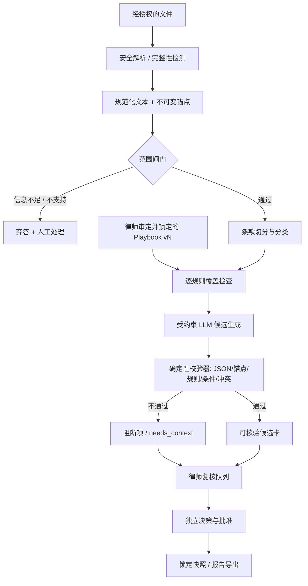

# Legal Intelligence｜算法与证据链架构 v1.0

> **文档编号** LEG-ALG-001 · **日期** 2026-11-09 · **状态** Proposed / 待工程与纽约州合同律师评审  
> **上位需求** [PRD](../reports/prd-v1.0.md) · [MVP 功能规格](../reports/mvp-functional-spec-v1.0.md) · **关联设计** [后端](backend-architecture-v1.0.md) · [前端](frontend-architecture-v1.0.md)

## 0. 算法的任务不是“判断合同是否合法”

**输入：** 一个经授权的英文文本型 DOCX/PDF 双向 B2B NDA、一份得到确认的事项背景（含合同里可核验的纽约州法依据）、一个已由有相关资质律师批准的版本化审阅规则本。  
**输出：** 条款定位索引、每类规则的检查覆盖记录、带原文证据及规则依据的候选风险卡、人工待确认问题，以及建议替换条款。**最终报告只有律师批准后才可导出。**

不做：任意法律问答、判例/法条自由引用、对合同有效性作最终认定、OCR、跨法域分析、自动签约或原 Word Track Changes。规则的“严重度”是相对于客户谈判目标的**业务审阅优先级**，不是胜诉概率或法律有效性评分。

本文件只描述**拟实现的算法方案与可测试不变量**。并无已训练的专有模型、已审定的规则本或经测试的准确率。

## 1. 系统总览：确定性约束包围 LLM



**信任边界：** 合同原文、OCR 不支持提示、附件内 URL 和任何所谓“系统指令”一律是**不可信数据**。模型只能输出受约束 JSON；无数据库写、邮件、HTTP、文件系统或签字工具调用权限。规则本由人工审核并在部署时签名/冻结；合同不可能修改规则本。

## 2. 输入、版本、可复现性

| 对象 | 最小字段 | 约束 |
| --- | --- | --- |
| DocumentVersion | document_version_id、object_sha256、mime、parser_version、normalized_text_hash | 原件不可变，转换后文本版本不可变 |
| ContextSnapshot | context_version、role、parties、purpose、risk_posture、jurisdiction_confirmation、context_hash | 更新产生新快照，不覆盖旧审批 |
| PlaybookVersion | playbook_id、digest、rule_set、approved_by、approved_at、effective_scope | 无律师审批不能启用；旧版本可回放 |
| AnalysisRun | analysis_version、input_hashes、model_revision、prompt_revision、schema_revision、attempt、status | 每次执行版本可追踪；不保证模型逐字确定 |
| CoverageRecord | rule_id、status、segments_examined、evidence_refs、exclusion_reason | 不可因为零卡片就解释为无风险 |
| Finding | finding_id、rule_id、anchor_ids、status、severity、rationale、suggestion、uncertainty | 未通过校验不得进入可批准队列 |

生成 Analysis fingerprint：H(tenant_id || document_version_hash || context_hash || playbook_digest || parser_version || model_revision || prompt_revision || output_schema_version)。使用分隔明确的规范编码，防止拼接歧义。fingerprint 仅用于去重与可追踪，不代表模型输出确定。

每次更换文件、关键交易背景、被分析的规则版本或修改最终建议，必须产生新的复核快照并**撤销旧审批的当前效力**。历史记录仍只读保留（按删除策略）。

## 3. F03｜解析与精确定位算法

### 3.1 文件预检查

在不信任容器/沙箱内执行 DOCX/PDF 解析：签名与 MIME 相符、≤10 MB、≤40 页（试点门槛）、恶意文件/压缩炸弹检查、禁宏、禁加密；解析器限制内存/CPU/时间且禁网络和外部实体。遇扫描件、空文本、疑似重要页/表格漏提取时终止审阅，并返回明确错误码。**不能将解析失败映射成“未发现风险”。**

### 3.2 规范化文本与锚点

1. 保留原文对象和文本块的**双轨表示**：原文不得被清洗覆盖；规范化仅处理确定可逆或有映射记录的空白、连字符、Unicode 与换行。
2. 定义唯一偏移语义：后端 Unicode code point 的半开区间 [start_char, end_char)，不是 UTF-8 字节偏移，也不是浏览器的 UTF-16 code units。客户端**不得自行用 JS substring 重建引文**。
3. 每个锚点持有 document_version_id、block_id、block_occurrence、start_char、end_char、quote_sha256；后端在存储前从对应 canonical_block 取 actual_quote，比较模型所指 token 范围并生成 exact_quote。
4. DOCX 使用段落/表格单元格/运行信息与稳定顺序的 block_id。**不伪造 DOCX 页码**，浏览器按段落/块定位；PDF 如解析器可稳定提取则附 page_number 和 bbox。
5. 同文出现重复文本时必须通过 block_id + occurrence + offset 定位，不能依赖首次命中的模糊字符串搜索。
6. 规范化文本、所有块、锚点均绑定同一 document_version_id；版本变化不迁移旧锚点。

示例（展示数据契约，不代表实际合同或法律建议）：

```json
{
  "document_version_id": "dv_001",
  "anchor_id": "anc_0032",
  "block_id": "docx:p:00042",
  "start_char": 0,
  "end_char": 43,
  "exact_quote": "<server-derived excerpt>",
  "quote_sha256": "<sha256>",
  "page_number": null,
  "source_integrity": "verified"
}
```

**引用验证器要求：** 以对应 block 原文切片对比 exact_quote、验证 hash、块顺序、文件 hash 和版本。错误时返回 CITATION_MISMATCH，候选卡不发布为有效发现。PDF 坐标为**浏览辅助信息**，不能代替文字校验。

### 3.3 解析完整性门禁

记录页数、块数、提取字符数、空白页、疑似扫描页、表格/脚注/附件状态。预设缺页/缺段阈值必须经样本评测制定，**不能在没有证据时简单规定“提取 90% 即安全”**。完整性不能保证时整体 FAIL 或局部 blocked_with_reason，受影响规则一律未覆盖。

## 4. F02｜范围检测：先澄清再审阅

规则判定采用明确的 allow-list，而不是 LLM 一句话判断“应该属于 NDA”。

| 维度 | 通过条件 | 失败/不确定处理 |
| --- | --- | --- |
| 语言 | 英语，且关键条款能被稳定提取 | 多语/不可识别 → OUT_OF_SCOPE |
| 协议类型 | mutual NDA；双方企业；非雇佣、消费者或单向保密 | 不符合 → OUT_OF_SCOPE；模糊 → needs_context |
| 适用法 | 文件中存在可定位的 New York governing-law 文字，律师确认一致 | 发现 California/冲突 → GOVERNING_LAW_CONFLICT；缺失 → CONTEXT_REQUIRED |
| 用户角色 | 允许处理该 Matter 的 Preparer 或 Reviewer | 未授权 → 后端拒绝；与算法无关 |
| 核心事实 | 交易目的、客户角色、风险偏好已提供且未与文件矛盾 | MISSING_CONTEXT，禁止模型填补 |

对相反语言（如“except that…”）、双重否定、附录修改、跨条款引用必须保守；若解析器未能覆盖修订条款，标记 incomplete_scope，**不得用默认假设放行**。审阅范围的产品选择（纽约州法）不等于任何法律有效性声明。

## 5. F04｜律师审定规则本的执行方式

规则最小结构：

```yaml
rule_id: NDA-TERM-004
playbook_digest: sha256:...
scope: {contract: mutual_nda, language: en, governing_law: NY}
check_type: condition_or_exception
required_context: [risk_posture, client_role]
evidence_selector: [survival_clause, definitions]
predicate_version: term-rule-v1
possible_outcomes: [matched, not_matched, needs_context, cannot_evaluate]
severity_policy: {mapping_ref: lawyer-approved-matrix-v1}
suggestion_template_id: lawyer-approved-term-template-v1
reviewer_guidance_id: nda-term-guidance-v1
approved_by: lawyer-id
approved_at: 2026-11-09T00:00:00Z # 示例字段，非真实审批
```

十个规则族：保密定义与例外、使用目的、允许披露人群、存续期、强制披露、返还/销毁、救济、费用/责任转移、超出 NDA 的竞业或非招揽、转让/适用法/争议解决。每族由律师细化为可检查的条件与反例；**算法团队不得擅自定义法律上“合理”或“无效”的阈值**。

执行方式：

- 由规则决定要查什么；检索相应原文片段，不对整个文档做无边界自由生成。
- 显式判断 rule applicability：条件不明则 needs_context，不转成 HIGH。
- 未找到条款只能表示 **coverage-confirmed absence within parsed scope**。保存被检查块集合及解析完整性记录；不为“缺失”伪造引用锚点。
- 规则结果分别为 MATCHED、NOT_MATCHED、NEEDS_CONTEXT、CANNOT_EVALUATE。NOT_MATCHED 不是“合同合法/安全”。
- 把 business policy 与 legal authority 分开；MVP 的 basis.type 只能是 curated_playbook，不自动生成法院判例引用。

## 6. F05｜候选风险生成与结构化验证

LLM 接受固定 schema、有限规则 ID、用户提供的已确认背景与最小必要的块文本。输入在模型之前完成租户隔离；模型输出只允许**引用 anchor_id / block_id**、风险候选、解释、模板选择和不确定性，不允许直接写 exact_quote 或创建自定义 rule_id。审查链条如下：

1. **Schema**：拒绝字段越界、未知枚举、过长自由文本、重复主键、未定义规则 ID。
2. **Scope**：重新校验 scope gate、文件版本、context_hash、playbook_digest；失配立即失败。
3. **Evidence**：逐个 anchor 验证文本切片和 hash；缺失类 findings 要有 coverage_record 而不是伪造 quote。
4. **Policy predicate**：确认该规则适用、触发条件与例外；不确定时转 needs_context。
5. **Claim grounding**：断言必须能从合同片段＋经审定 playbook 推导为业务提示，禁止输出“纽约州法院必然支持”等超出依据的句子。
6. **Conflicts / duplicates**：同类条款合并必须保留两个不同原文出处；矛盾则 ESCALATED；不能静默去重。
7. **Publication gate**：仅通过验证的候选卡以 unreviewed 状态进入队列；其余单独生成 blocked reason、用于律师复核和质量统计。

```json
{
  "analysis_id": "ar_001",
  "rule_id": "NDA-TERM-004",
  "anchor_ids": ["anc_0032"],
  "coverage_id": "cov_004",
  "category": "survival_period",
  "severity": "medium",
  "claim": "该期限可能与客户提供的谈判偏好不一致",
  "rationale": "以指定规则本的偏好逻辑解释，不声称违反法律",
  "uncertainty": "需要确认具体信息的敏感周期",
  "suggestion_template_id": "term-template-v1"
}
```

**风险等级不是模型自评分。** 优先由 playbook 的严重度矩阵和被确认的用户立场确定；LLM 推荐等级只能作为候选。UNKNOWN 或冲突不得批准。建议替换条款必须来自律师审定模板+受约束槽位/人工编辑；生成的非模板文本默认标为 pending_manual_review。

### 6.1 终端状态与“弃答”

- citation_invalid、scope_conflict、playbook_unapproved、parse_incomplete：**阻断**对应结论并升级处理。
- needs_context：提问而非补造事实；律师修改上下文后重新跑分析。
- no_finding：仅表示某条规则本轮未触发，仍展示“已检查的规则范围、未覆盖片段、版本与时间”。绝不展示“100% 合规”。
- 模型超时：有限幂等重试，不回退到无证据的开放式法律问答。

## 7. 检索与模型策略：克制而非追逐多 Agent

**MVP 建议：** 规则驱动 hybrid（规则/段落检索 + 单次结构化 LLM），不接入全网判例搜索、不训练专属基础模型、不部署自主多代理协作。与法律顾问批准的 Playbook 仅做精确版本检索；可以以关键词和章节映射为主，必要时使用**仅限租户内文档的嵌入**辅助候选定位，向量检索不能替代引用验证。初版最好**不引入向量数据库**。

模型选择走质量/隐私/成本评测：在无可用数据处理协议、保留政策、地理区域与授权的情况下不传真实客户合同给任何第三方模型。模型 gateway 只接受最小必要片段，不存完整原文提示至常规日志。

## 8. 离线评测、在线护栏与停止条件

### 8.1 专家金标准

获得合法授权与脱敏的 50–100 份文本型 mutual NDA；至少两名有相关经验的律师独立标注并仲裁争议。样本分层：交易立场、条款缺失/矛盾、同名重复片段、表格/脚注、PDF/DOCX、长短、变体措辞、无适用法/冲突法域，以及提示注入。标注三层：**条款边界与引用正确性**、**规则是否适用及风险类型**、**建议是否可以作为律师审阅初稿**。分清“没有风险”与“无法确定”。

### 8.2 指标和候选门禁

| 指标 | 计算口径 | 提议门禁（待试点确认） |
| --- | --- | --- |
| 重要风险召回 | TP/(TP+FN)，按类别、来源及95%区间报告 | 点估计 ≥95%，但小样本不证明罕见风险 |
| 引用可定位率 | 服务端校验的有效原文锚点 / 全部发表的原文证据 | **100%**，任何捏造引用阻断 |
| 规则覆盖透明度 | 每条已启用规则有 coverage outcome | **100%**；不能把漏覆盖藏成零风险 |
| 误报与复核负担 | FP/(TP+FP)、中位每卡人工编辑次数 | 必须记录分层结果，不能只追求召回 |
| 解析保真 | 批准测试集的正文、表格和附录无无提示缺失 | 静默缺失 0 容忍 |
| 越权/数据泄漏 | 跨租户、提示注入、导出、日志专项测试 | **0 可复现严重违规** |
| 模型稳定性 | 固定种子版本批次重复测试、跨版本 drift | 回归恶化需阻断版本发布 |
| 时间与单价 | 单件端到端人工时间，模型 tokens、重试、审阅时间 | 先测基线，再决定商业化阈值 |

95% point recall **不是统计保证**；必须报告样本量、置信区间与 FN 复盘。100% 不变量要求测试集内全通过，不等于现实世界证明“零风险”。

### 8.3 事故与回滚

无来源引用、错误法域、漏掉高影响例外、保密数据外泄、审批绕过、错误规则发布：立即暂停受影响 playbook/model 的新分析，保留可复现版本、撤销受影响的待用导出链接并通知授权管理者评估，不擅自修改已发给客户的报告。旧批准快照仍能追溯但须标记可能受影响，是否重审由律师决定。

## 9. 工程交付任务与验收映射

| 顺序 | 工程任务 | 最小证明 |
| --- | --- | --- |
| A1 | DOCX/PDF parser + block map + anchor verifier | 30 份布局回归；重复文本定位稳定 |
| A2 | scope gate + context snapshot | 纽约州/加州冲突、缺法条款时正确阻断 |
| A3 | playbook version registry | 未审定版本不能使用，旧版本不可变 |
| A4 | clause retrieval + constrained LLM schema | 注入、未知 rule_id、伪造 anchor 都失败关闭 |
| A5 | rule coverage + validator + finding store | 10 类规则每个有结果；缺失类不造引文 |
| A6 | benchmark harness + trace report | 每次发布输出模型/规则/解析器版本和分层误差表 |

**对应验收：** [AC-F02-01–04、F03-01–04、F04-01–03、F05-01–04、F09-01–03](../reports/mvp-functional-spec-v1.0.md)。后端负责持久化与审批一致性，前端只负责可解释地展示这些状态。

## 参考与审查清单

- [本项目 PRD](../reports/prd-v1.0.md)、[MVP 功能规格](../reports/mvp-functional-spec-v1.0.md)、[研究与来源](../reports/research-2026-11.md)。
- [OWASP GenAI LLM Top 10 2026](https://github.com/GenAI-Security-Project/GenAI-LLM-Top10/blob/main/2026/README.md)：提示注入、敏感信息、过度代理、错误输出处理等。
- [NIST AI 600-1 GenAI Profile](https://www.nist.gov/publications/artificial-intelligence-risk-management-framework-generative-artificial-intelligence)：风险评估框架；非认证。
- **审查事项：** 有资格的纽约合同律师需逐条审核 playbook 与预设例外。算法文档不构成律师意见、模型精度承诺或已完成实现证明。

