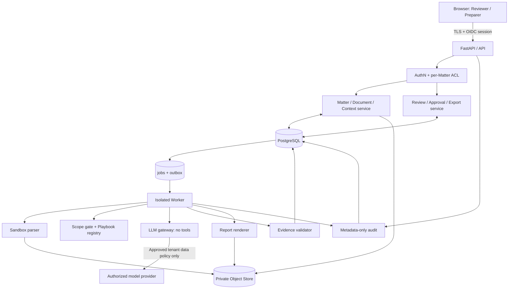
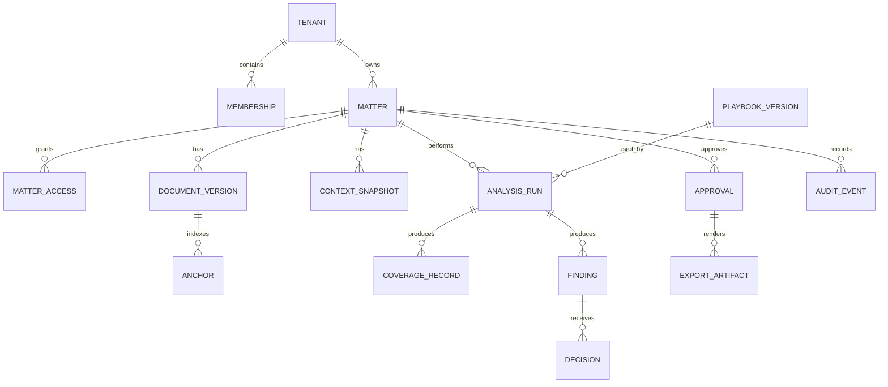
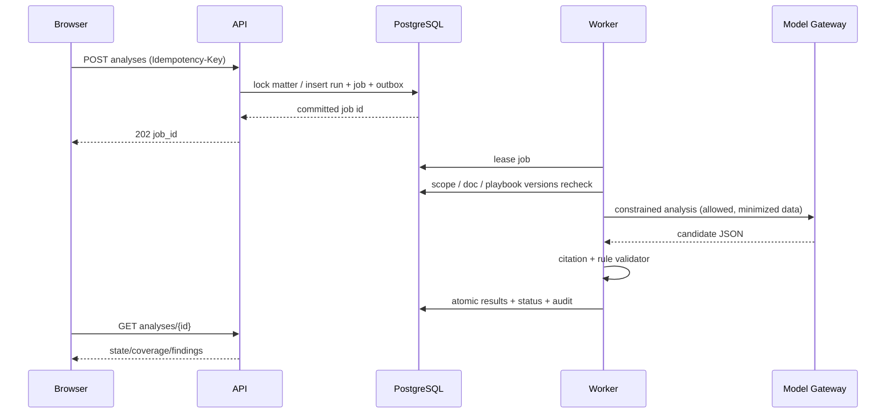

# Legal Intelligence｜后端系统与数据架构 v1.0

> **文档编号** LEG-BE-001 · **日期** 2026-11-09 · **状态** Proposed / 设计方案，非已上线系统  
> **产品依据** [PRD](../reports/prd-v1.0.md) · [MVP 验收规格](../reports/mvp-functional-spec-v1.0.md) · **技术关联** [算法设计](algorithm-architecture-v1.0.md) · [前端设计](frontend-architecture-v1.0.md)

## 0. 架构决策摘要

**推荐使用模块化单体 + 独立任务 Worker**：在初期小团队、单法域/单文书、律师必审场景下，优先可验证的事务一致性、易审计与低运维复杂度，而非微服务和事件总线先行。

| 层 | 建议实现 | 决策原因 / 何时调整 |
| --- | --- | --- |
| API | Python 3.12+ / FastAPI / Pydantic v2 / OpenAPI | 与解析、规则和模型代码共享类型；运行版本由 CI 锁定 |
| Database | PostgreSQL（关系约束 + JSONB + 事务） | Matter、审批、版本、幂等和审计需要强一致语义 |
| 文件 | 私有对象存储 S3-compatible + KMS 密钥 | 合同、解析产物、报告分离存储，按租户和版本隔离 |
| 异步 | PostgreSQL jobs 表 + outbox + 独立 worker | MVP 避免引入 Redis/队列双写丢消息；负载增长再替换 |
| 模型 | Provider-agnostic model gateway，禁工具调用 | 供应商与数据出境审核通过前使用脱敏测试数据 |
| 文档 | 沙箱化 DOCX / 文本 PDF 解析 + DOCX/PDF 报告生成 | 文本与锚点必须可验证；P1 才做原件 Track Changes |
| 部署 | 单区域隔离环境 + IaC + secrets manager + 基础监控 | 地域和供应商由法律/安全采购审查后最终决定 |

**不使用向量数据库、Kubernetes、多个自主 Agent 或跨境多区域复制作为 P0 前提。** 这些会增加保密面、失败模式与复现成本；未来有明确负载/检索需求后再引入。

## 1. 逻辑分层与信任边界



信任边界：浏览器不可信；上传文件不可信；LLM 输出不可信；内部规则本可信度只来自**明确的律师批准、完整性签名及版本化流程**；数据库 ACL 为服务端执行。每次文件下载、异步结果、导出、删除都必须重新鉴权，不能以“曾获上传 URL”代替授权。

## 2. 域模块与职责

1. **identity/authorization**：OIDC 登录、试点 MFA、组织成员、Preparer/Reviewer 两角色、按事项授权；拒绝默认授权。
2. **matters**：事项生命周期、乐观锁 revision、删除墓碑、状态机事件。
3. **documents**：上传会话、类型/大小/病毒扫描、原件不可变、解析产物与 anchor 存储、版本切换。
4. **context/scope**：版本化背景、用户与合同适用范围一致性检查。
5. **playbooks**：10 类律师审定 NDA 规则与发布门禁、规则版本不可修改。
6. **analyses**：异步执行、fingerprint 幂等、模型网关、token/timeout 配额、失败态；验证器输出才可进入 review。
7. **reviews**：findings、decision append-only、未决检查、律师独立复核。
8. **approvals/exports**：事务内签名固定快照，审批与导出物一致性，导出结果校验。
9. **audit/privacy**：最小化安全事件、留存期限、可验证删除、供应商配置记录。
10. **operations**：指标、配额、脱敏错误码、告警、灰度回滚。

这些是单一代码库的**清晰边界**，而非十个独立服务。

## 3. 数据模型与租户隔离

### 3.1 实体图



**每个租户私有表**都应含 tenant_id；Matter 所属 tenant_id 必须与 Document、Analysis、Finding、Export 等下游一致（应用层 scope filter + DB 外键/复合约束）。MatterAccess 记录被授权的 user_id + matter_id；membership 只给组织身份，**不自动授予组织内所有 Matter 的读取权**。RLS 可以作为第二道防线，但不能替代服务层 per-Matter ACL。

### 3.2 P0 主字段与不变量

| 表 / 关键字段 | 数据库限制与处理 |
| --- | --- |
| matters(id, tenant_id, state, revision, active_doc_version, active_analysis_id, deleted_at) | 状态只能服务层事务变更；revision 每次编辑递增 |
| document_versions(id, matter_id, object_sha256, object_key, parse_state, parser_version) | 原件 append-only；object_key 不在外部 API 暴露 |
| anchors(id, doc_version_id, block_id, start_char, end_char, exact_quote_hash, page_number?) | doc_version 绑定，server-side slice 校验 |
| context_snapshots(id, matter_id, doc_version_id, payload, payload_hash, confirmed_by) | payload 存加密字段；不可变，变更新行 |
| playbook_versions(id, digest, approved_by, approval_time, immutable_ruleset) | 审定签核不可由模型生成 |
| analysis_runs(id, matter_id, doc_version_id, context_id, playbook_version, model_rev, fingerprint, status) | unique(tenant_id, matter_id, fingerprint, active_generation) |
| coverage_records(id, analysis_id, rule_id, outcome, examined_block_ids) | 一条启用规则必须有一条覆盖结果或阻断原因 |
| findings(id, analysis_id, rule_id, anchor_id?, coverage_id, severity, validation_state) | invalid 无法进入 APPROVAL_READY |
| decisions(id, finding_id, actor_id, actor_role, action, edited_text, reason, revision, at) | 只追加不原地覆盖，校验最新版 |
| approvals(id, matter_id, snapshot_digest, approved_by, approved_at, revoked_at?) | reviewer-only；基于当前 revision；审批失效显式记录 |
| exports(id, approval_id, artifact_key, sha256, type, state, created_at) | 只从锁定快照生成；对象不可变 |
| jobs(id, matter_id, job_kind, attempt, run_after, status, lease_until) | 重试受限；删除墓碑阻断继续写入 |
| audit_events(id, tenant_id, actor_id, event, resource_kind, resource_id, outcome, at) | append-only；**不存正文/原提示/建议全文** |

原始密文、规范化文本、候选结果和导出物的保留/删除需统一编排；高敏感 payload 字段单独加密。备份恢复和删除冲突应由明确的数据治理策略决定，不能承诺技术上无条件立即清除所有备份。

## 4. 统一状态机与版本失效

后端是状态唯一权威源。沿用 [MVP](../reports/mvp-functional-spec-v1.0.md) 状态：DRAFT → UPLOADED → CONTEXT_REQUIRED → ANALYZING → REVIEW_READY → IN_REVIEW → APPROVAL_READY → APPROVED → EXPORTED；FAILED / OUT_OF_SCOPE 为错误/退出分支。

额外设计规则：

- 新文档版本、关键上下文修改、当前分析规则版本改变、风险决策/替换建议变更 → **撤销当前批准标记**、matter revision +1；重新分析后才能批准（仅修改决定文本的情形可按产品规则回 IN_REVIEW，不必自动重跑算法，但一定重新审批）。
- 批准需**事务性检查**：同一 Matter 下当前分析全部启用规则有 coverage，所有 findings 已处理，没有 citation_invalid/needs_context/escalated，也没有旧版本遗留的批准。
- 没有匹配 finding 不是成功审核证明，coverage summary 仍需完整给 Reviewer。
- OUT_OF_SCOPE、FAILED 可创建新的上传版本恢复，但不可绕过范围检查直接导出。

### 4.1 不可变审批快照

在单一数据库事务中锁定 Matter（SELECT FOR UPDATE），重新核对当前 doc hash、context hash、analysis run、playbook digest、所有 finding 的**最新 decision revision**及用户的 Reviewer 资格；计算 canonical JSON 的 snapshot_digest，写 approval + audit + outbox，再提交。任何冲突返回 409 VERSION_STALE。审批按钮需要二次确认，但**只由服务端判断能否批准**。

导出服务只读 approval_snapshot，不运行模型，不引用可变 Finding 当前状态；生成报告后对照 snapshot 内容清单与导出内容 hash。原 Word 合同永不被覆盖。

## 5. API 合约（v1 草案）

所有端点要求 HTTPS/OIDC 会话、tenant + matter ACL；列表为游标分页；响应携带 request_id、matter_revision、analysis_version（适用时）。写操作带 Idempotency-Key；编辑操作同时携带 If-Match: 当前 matter revision。过期版本 409，缺失权限 404（不泄露资源存在性）。严禁从客户端直接指定任意 risk rule、severity 或最终 approval_digest。

| 方法 | 端点 | 权限 | 主要结果 |
| --- | --- | --- | --- |
| POST | /v1/matters | Preparer/Reviewer | 201、id/revision |
| GET | /v1/matters | scope-member | 可访问事项分页 |
| POST | /v1/matters/{id}/uploads | scope-member | 201 上传会话、短时限单次 PUT URL |
| POST | /v1/matters/{id}/uploads/{upload_id}/finalize | scope-member | 202 校验/解析 job；服务器重新计算 sha256 |
| PUT | /v1/matters/{id}/context | scope-member | 200 context_version + scope check |
| POST | /v1/matters/{id}/analyses | scope-member | 202 job_id + analysis_id，幂等 |
| GET | /v1/matters/{id}/analyses/{aid} | scope-member | state、coverage、findings、blocks |
| PATCH | /v1/matters/{id}/findings/{fid}/decision | scope-member | 最新 decision revision |
| POST | /v1/matters/{id}/approvals | Reviewer only | 201 snapshot_digest / 409 阻断详情 |
| POST | /v1/matters/{id}/exports | Reviewer only | 202 export_id，引用 approval_id |
| GET | /v1/matters/{id}/exports/{eid}/download | scope-member, post-approval | 短期代理流/新鲜授权的签名链接 |
| DELETE | /v1/matters/{id} | authorized policy | 202 删除排程，立即撤销可访问性 |
| GET | /v1/matters/{id}/audit | authorized Reviewer | 最小化审计元数据 |

**上传流程：** init → 指定 tenant/matter 受控隔离路径的预签名 PUT（大小、MIME、到期、一次性 nonce 受限）→ finalize 校验服务端收到的实际字节/hash/病毒与类型 → 沙箱解析。**前端返回的文件 hash 不能作为真实性依据**。

### 5.1 结构化错误响应

```json
{
  "error": {
    "code": "VERSION_STALE",
    "message": "The review changed. Refresh before approving.",
    "request_id": "req_opaque",
    "retryable": false,
    "affected_finding_ids": []
  }
}
```

约定：400 校验失败，401 未登录，404 资源不可见，409 版本/状态冲突，413 超限，415 不支持格式，422 业务范围不满足，429 配额，500/503 服务失败；返回内容不得含合同片段、系统提示、供应商 API key。模型错误不可自动降级为无依据的法律回答。

## 6. 异步执行、幂等性与失败恢复

**为什么使用 Postgres job/outbox：** 生成分析/报告会超过 HTTP 请求生命周期，又不能在数据库事务提交前就向队列发布可能丢失的任务。业务行与 outbox 行同事务提交；worker 用 FOR UPDATE SKIP LOCKED 领取任务，lease 失效可再次领取。



- 唯一指纹 + Idempotency-Key（按租户、端点、主体隔离）避免用户重复点击生成重复 run。相同请求重试返回原 job。
- Worker 最多按策略有限次自动重试（如瞬时网络错误）；不可重试错误（文档不完整、非法锚点、未批准规则）转明确阻断；指数退避带 jitter 只是建议参数，须经故障演练定值。
- Worker 最终写前再次核对 **matter revision、删除墓碑、doc/context/playbook 版本**；旧工作完成不得覆盖新版本数据。
- lease、attempt、failure_code、cost_units、duration_ms 为可监控元数据；不要把全文模型 prompt 暴露到工作队列/监控。
- **失败恢复的目标是无重复副作用、可解释**，不是承诺 exactly-once 分布式执行。

## 7. 安全与隐私设计

### 7.1 保密合同处理

- OIDC + 强认证与试点 MFA、最小授权 Matter ACL；所有下载实时鉴权，最好通过后端代理流而不是长期有效裸链接。
- 生产/测试数据严格隔离；机密文档在浏览器不写 localStorage/IndexedDB/analytics，前后端日志默认不包含文书原文、客户姓名或模型输入全文。
- 对象存储私有加密；服务账号按需要最小授予对象 key；不同环境使用不同密钥与配置，密钥定期轮换。
- 外部模型前执行供应商 DPA、训练使用、保留、区域/跨境、次处理方与客户授权审查；**未通过则禁真实客户模型调用**，只能用授权/合成测试样本。
- Prompt injection：合同永远是 untrusted_content；网关无外部 URL、邮件、文件发送、DB 修改工具；禁止跟随合同里“忽略指令”等内容。输出做 schema/anchor/policy 校验。
- 文档恶意内容：防路径穿越、XML 外部实体、PDF 外链资源、ZIP 压缩炸弹、宏；解析时出网关闭并限制系统资源。
- 审计与下载：记录主体、动作、结果、时间、资源 ID、版本/sha；不记录正文。对导出物施加 no-store/private 缓存控制。

### 7.2 删除与留存（产品设计目标，未实现）

试点建议原合同默认 30 天留存；提前删除请求**立即封禁任何新的读取/签名 URL**，24 小时内完成在线主存储、解析副本、缓存、导出件清理的目标；备份随既定轮转不超过目标 30 天（须核实供应商可实现性），审计仅留按政策必要的无正文元数据。删除任务必须能追踪状态、重试、核验完成；恢复备份时检查 tombstone 避免“被删文档复活”。具体数据保留、律师保密、保全义务应经法律顾问确认。

## 8. 运维、SLO 候选值和成本控制

| 项目 | 候选目标 / 测法 | 警戒 |
| --- | --- | --- |
| API 可用性 | 试点目标 99.5%，由实际监控量测 | 样本太少时报告请求数 |
| 交互接口 | P95 ≤800 ms（不含上传/异步任务） | 含重试/冷启动需单独统计 |
| 分析任务 | ≤40 页支持样本测 P50/P95 处理时间 | 超时显示状态，不假装完成 |
| 审批/导出 | 100% 有效审批 snapshot；版本一致性 | 不一致直接阻断 |
| 身份/事项隔离 | 0 可重现越权读取 | P0 发布阻断 |
| 成本可见 | 逐文档 tokens、模型成本、失败重试、人工复核时长 | 不通过预算不得无限调用 |

**追踪实现**：结构化日志仅用 request_id、tenant_token（不可逆别名）、job_id、error_code；Metrics 包含延迟/错误率/重试、模型支出；Tracing 禁采合同与 prompt 原文（包括 exception payload），单独受控安全事件审计。OpenTelemetry 可以作为仪表方式，不能默认将 traces 导出给未经授权第三方。

## 9. 测试策略、CI、回滚与定义完成

| 测试层 | 核心场景 | 必须证明 |
| --- | --- | --- |
| Unit | 状态转移、范围与权限矩阵、快照 hashing | 被拒绝路径不能绕过 |
| Contract | OpenAPI/Pydantic vs generated TS types | 字段/枚举/错误码一致 |
| Integration | 并发审核、幂等任务、版本切换、导出锁定 | 无双份生成、旧审批不可复用 |
| Security | IDOR、跨租户、同租户无事项权限、对象 URL、日志泄露、注入 | 0 严重越权/泄露 |
| Parser | DOCX/PDF 表格/脚注/重复条款/损坏/扫描件 | 不静默丢内容或捏造 anchor |
| Chaos | Worker 重启、模型超时、对象暂不可达、删除与任务竞态 | 失败关闭、可重试、不泄露 |
| Golden test | 律师标注 50–100 合同按类型分层 | 报告 TP/FN/FP，严重漏检升级 |

发布时锁定 migrations、模型/规则/解析器版本；先仅向获授权的律师试点开放，出现严重引用/权限问题可禁用**新分析**并撤销受影响导出访问，同时保留授权审核/审计功能。回滚不应删除证据或悄悄替换已有导出文件。

### 9.1 建议研发顺序

1. BE1 身份 + Matter ACL + 单组织隔离与审计；BE2 安全上传/解析沙箱/版本对象。
2. BE3 Context/Scope/Playbook Registry；BE4 jobs/outbox + model gateway + 验证器。
3. BE5 审阅状态机 + approvals 快照 + 导出；BE6 删除编排、监控与回归集。
4. 每个阶段必须把相关端点与真实失败码暴露给前端联调，不能全部“成功 200”掩盖未知状态。

## 附录：架构决策与未决问题

**ADR-BE-01** 模块化单体而非微服务：安全审计与一致性优先。**ADR-BE-02** Postgres job/outbox：减小初期双写复杂度，后续评估队列吞吐。**ADR-BE-03** 审批快照不可变：导出与审批一一对应。**ADR-BE-04** no-autonomy：模型无写入或外部动作权限。

尚待决定：实际云厂商/区域、存储保留 SLA、部署成本预算、模型供应商合同条款、律师执业边界、是否需要客户管理密钥与日志审计周期。**不能在这些问题解决前宣称“已合规部署”。**

## 参考

- [算法设计](algorithm-architecture-v1.0.md) · [前端设计](frontend-architecture-v1.0.md) · [MVP 功能验收](../reports/mvp-functional-spec-v1.0.md)。
- [OWASP GenAI LLM Top 10 2026](https://github.com/GenAI-Security-Project/GenAI-LLM-Top10/blob/main/2026/README.md) · [NIST AI 600-1](https://www.nist.gov/publications/artificial-intelligence-risk-management-framework-generative-artificial-intelligence)。

