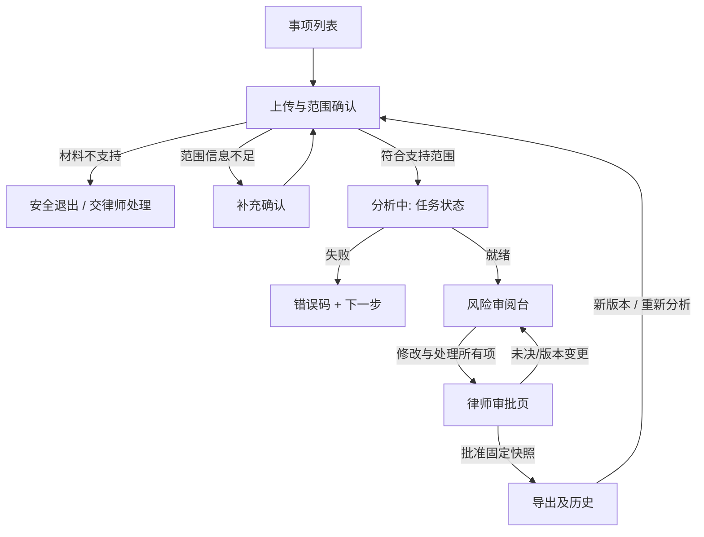

# Legal Intelligence｜前端产品工作台与交互架构 v1.0

> **文档编号** LEG-FE-001 · **日期** 2026-11-09 · **状态** Proposed / 交互与技术方案，未实现  
> **需求** [PRD](../reports/prd-v1.0.md) · [MVP 功能验收](../reports/mvp-functional-spec-v1.0.md) · **技术关联** [算法](algorithm-architecture-v1.0.md) · [后端](backend-architecture-v1.0.md)

## 0. 设计原则与首版交互边界

**前端不是“AI 聊天软件”，而是律师可以审阅、核对并批准的合同风险工作台。** 支持英文双向 B2B NDA、用户确认的纽约州法范围、律师最终审批；浏览器不能暗示已完成法律判断。所有证据验证、权限检查、状态转移和审批均由后端控制。

五项可见承诺：**每个风险有可点击原文**、**每个理由有规则版本**、**无法确定就明确说明**、**任何修改会使旧审批失效**、**导出文件对应律师确认的固定快照**。

不包括：自由问答法律 Chatbot、自动签约、自动对外发送邮件、跨法规检索、扫描 PDF OCR、原 DOCX Track Changes。**手机端仅查看状态和阅读摘要，不批准复杂法律交付件。**

## 1. 前端技术栈与状态层次

| 关注点 | 推荐技术 | 不可违反的约束 |
| --- | --- | --- |
| 应用 | React + TypeScript + Vite，模块化 route pages | 编译期严格模式，组件按审阅领域拆分 |
| 路由 | React Router | route 不是授权；服务端每个 API 校验权限 |
| 服务端状态 | TanStack Query + OpenAPI 生成的 TS API client | 禁止客户端修改后端枚举或自行计算法律结论 |
| 表单 | React Hook Form + Zod（客户端即时提示） | 后端仍是业务校验与范围闸门真值 |
| 局部状态 | React state / reducer | 仅保存 UI 选择、折叠、过滤、未提交编辑草稿 |
| 文档阅读 | 结构化 block viewer，PDF 可使用受控 text-layer 渲染器 | 不借全文 fuzzy search 替代 anchor_id 定位 |
| 组件与无障碍 | 可键盘操作的语义组件，WCAG 2.2 AA 目标 | 严重度不只靠颜色；焦点与屏幕阅读器验证 |
| 测试 | Vitest + React Testing Library + Playwright + axe | 与 API schema contract 和后端权限测试联动 |

**不需要为 MVP 引入微前端、大型可视化白板或全局多代理控制台。** 用户角色与权限由鉴权接口返回的 capabilities 表达，前端隐藏/禁用仅为了 UX，不代表安全验证已完成。

### 1.1 状态三层

- **Server canonical**：matter.status、matter.revision、active_analysis_id、finding.decision_status、approval.snapshot_digest、export.status。
- **Remote cache**：Query 缓存，只用于显示； mutation 成功后以 server response + invalidation 重新同步，不能乐观地把“已批准”渲染成成功。
- **Local ephemeral**：当前选择的 risk card、草稿编辑、scroll target、筛选与 panel 开关；离开页面时受控清除。禁止 localStorage/analytics 缓存合同原文、访问 token 或用户意见全文。

## 2. 信息架构与路由

| 页面 | 路由 | 主要目的 |
| --- | --- | --- |
| S01 Matter Library | /matters | 事项列表、创建、状态、期限、权限范围 |
| S02 Intake & Scope | /matters/:id/intake | 安全上传、解析反馈、角色/双方/目的/法域确认 |
| S03 Review Workbench | /matters/:id/review | 原件定位、规则覆盖、风险卡、人工决策与待办 |
| S04 Approval Review | /matters/:id/approval | 律师最终核对版本、未决/阻断项、二次确认 |
| S05 Exports & Audit | /matters/:id/exports | 导出进度、快照、下载与最小化操作记录 |

根导航只放 Matters / Help / Account，不把大量未来功能放进 v1。未授权事项的直接路由访问统一显示无信息泄露的不可访问页，不显示文件名、客户名称或“此事项存在”。

## 3. 全链路主要用户旅程



**成功反馈永不抢跑：** 202 ACCEPTED 代表后台任务已接收，不代表分析完成；“分析完成”不代表律师已批准；“已批准”不代表合同合法。每个阶段的文案和按钮必须区分清楚。

## 4. 页面规格（用户界面 + 失败态）

### S01｜事项列表

**默认视觉：** 标题 + “New Matter”主按钮；可筛选“Needs my review / Analyzing / Approved / Failed”；每行展示脱敏 Matter 名称、协议版本、当前状态、最后修改时间、待办数量、负责人。只展示 API 返回的有权可见行。

**状态：** 首访为空时解释“Create a matter to review a supported mutual NDA”；加载中用 skeleton；权限失效/网络失败展示 retry；删除中标记 Deleting 并禁止访问；不把后端 404 自动解读为“没有权限还是不存在”。

**交互：** 创建 Matter 使用单次提交/Idempotency-Key；重复点击不产生多个事项；危险删除需二次确认并解释主存储与备份策略；页面不保留文件原文。

### S02｜上传与范围闸门

分两步，先“Upload document”，再“Confirm review scope”。第一步支持 DOCX / 文本 PDF、最大 10 MB/40 页的试点政策提醒、上传进度与取消；文件只在提交后发送，前端可以早期提示但**服务端 MIME/病毒检测才是最终结果**。

第二步必须明确：Is this a mutual NDA?、双方是否 B2B、客户视角（disclosing/receiving/both）、purpose、risk posture、文件正文的 governing law、用户/律师确认“New York”。展示文件提取的候选 law 条款时必须能回原文，**不能预勾选或猜测纽约州法**。

| 条件 | 展示文案和行动 | 禁止行为 |
| --- | --- | --- |
| SCAN_PDF | “Scanned PDFs are not supported. Upload text-based PDF or DOCX.” | 不出现 Review 按钮 |
| GOVERNING_LAW_CONFLICT | “The agreement appears to reference a different governing law. Ask counsel to verify.” | 不继续生成风险 |
| MISSING_CONTEXT | 列出缺少的角色/目的/法域字段，聚焦首个错误 | 不默认填入客户角色 |
| OUT_OF_SCOPE | 列出支持范围和人工处理路径 | 不以自由聊天作为替代 |
| 已通过 | 展示 scope summary，允许 Start Analysis | 不称“合规/有效” |

**人工确认边界：** 法域缺失时不允许仅由 Preparer 自行“猜测是 NY”放行；需要可记录的律师确认及适用范围依据，若文书完全无 governing-law 原文仍不做适用法有效性判断（遵守 [算法范围规则](algorithm-architecture-v1.0.md)）。

### S03｜核心审阅台：三栏协作

桌面布局建议：左原文/结构树（~42%）、中风险队列（~28%）、右依据与修订（~30%）；这些比例是布局起点，需实际用户测试调节。小屏幕使用可键盘操作的分区 tab，**绝不把原文/依据隐藏得无法核对**。

```text
+-----------------------+--------------------+------------------------+
| SOURCE DOCUMENT       | REVIEW QUEUE       | BASIS / SUGGESTION     |
| v3 / anchored blocks  | 10 categories      | Rule NDA-TERM-004      |
|                       | High 2 / Medium 3  | Playbook v1 approved   |
| [paragraph selected]  | Needs context 1    | Source quote & impact  |
| highlight by anchor   | Missing coverage 1 | Uncertainty / exceptions|
|                       | [selected finding] | Original vs proposed   |
| Click -> exact block  | Filter / sort      | Accept Edit Dismiss    |
+-----------------------+--------------------+------------------------+
| Analysis version | Document digest | Pending items | Scope banner      |
+-----------------------------------------------------------------------+
```

#### 4.3.1 来源面板

- 展示可访问原文的块级结构，点击 finding 以 anchor_id 获取服务端下发的块和**已校验** exact_quote；屏幕阅读器用链接/标题说明位置，程序焦点移到高亮块。
- DOCX 用 paragraph/table cell 路径而不是虚构页码；PDF 如有可验证 text-layer bbox 可提供页码定位。
- 若 anchor 已失效或新版文件不同，显示“Evidence no longer matches this document version”，清除选中建议的可批准操作并要求刷新，**不回退到模糊字符串搜索**。

#### 4.3.2 规则覆盖与风险队列

分类展示 10 类 NDA 条款，逐类状态：CHECKED_FINDING、CHECKED_NO_FINDING、NEEDS_CONTEXT、CANNOT_EVALUATE。**CHECKED_NO_FINDING 不显示绿色“无风险”；标签为“本规则未触发提示”。**

风险卡必须呈现类型、严重程度文字、业务后果、可点的原文、依据规则及版本、条件/例外、不确定性、操作状态。严重度用于优先队列排序，不能冒充经过统计校准的“AI 置信率”。

列表的过滤/分页不能改变审批判定；即使屏幕上筛掉 unresolved 项，底部仍显示“3 items block approval”。

#### 4.3.3 建议及决策

右栏分层：**Original excerpt（只读）→ Why flagged（规则/上下文）→ Proposed wording（可编辑）→ Reviewer decision**。接受/修改/驳回/待背景/升级人工均需要可见的确认回执；驳回及重大改动要求理由。Preparer 的意见是 preliminary，不具备最终批准效力。

提交时带 If-Match matter_revision；返回 409 时弹出 non-destructive conflict panel（服务器新版本 + 本地未提交草稿），用户明确选择刷新或复制草稿后重试。不能在背景中悄悄覆盖别人的意见。

### S04｜律师审批与安全门禁

审批页展示（不可编辑）：

1. 当前 DOCX/PDF 文件 hash 前缀、document_version、context_version、analysis_version、playbook_version 与规则覆盖率。
2. 已处理的 findings 与提交人；任何 NEEDS_CONTEXT、ESCALATED、CITATION_INVALID、CANNOT_EVALUATE 列出明确链接，**不能点击批准**。
3. 需要独立核验的 disclaimer 和复核 checklist，明确“不构成自动法律意见”“建议仅供律师独立审阅”。
4. 用户必须为 Reviewer；勾选独立复核声明并执行二次确认，才发起 POST /approvals；服务器可拒绝并返回 409 的真实阻断列表。

**成功态**只能使用后端返回的 approval_id + snapshot_digest，并立即让相关查询失效重取。如果另一个标签页修改合同，或律师在确认过程文件更新，显示“Approval expired — refresh review”。前端不允许 optimistic approval。

### S05｜导出与审计

显示 Export ready / Queued / Generating / Failed / Expired 等明确状态。允许下载 review-report.docx/pdf、clause-replacements.docx，且文案说明“建议条款对照清单（**不是原件 Track Changes**）”。

每个导出展示 approval_id、approved_by（仅 authorized viewers）、快照版本、生成时间、artifact_sha256 前缀；只有后端生成并校验后才能出现下载入口。所有下载先请求鉴权过的 API，不在前端持久化下载 URL。页内审计只显示 actor/action/time/outcome 等元数据，不含机密正文。

## 5. 前后端类型契约：OpenAPI 单一真值

前端从**后端 OpenAPI schema 生成 TS 类型**，不手工复制 risk enum、error code 或 status values。以下仅示例 view DTO（字段请最终以 API 评审结果为准）。

```json
{
  "matter_id": "mat_opaque",
  "matter_revision": 12,
  "status": "IN_REVIEW",
  "active_analysis_id": "ar_001",
  "document": {
    "document_version_id": "dv_002",
    "mime_type": "application/vnd.openxmlformats-officedocument.wordprocessingml.document",
    "parser_version": "docx-parse-v1"
  },
  "scope": {
    "confirmed": true,
    "governing_law": "NY",
    "disclaimer": "Business risk review, not legal advice"
  },
  "review_summary": {
    "rule_count": 10,
    "rules_with_coverage": 10,
    "unresolved_findings": 2,
    "invalid_evidence": 0,
    "can_submit_for_approval": false
  },
  "capabilities": ["read", "comment", "edit_decision"]
}
```

**字段纪律：** anchor API 只返回对应 document_version 内真实文本与 server_verified 引用；claim 与 proposed_text 有明确来源标签。没有后端授权 capabilities，不在客户端推断 Reviewer 权限。对未知 enum 应显示 Unsupported state 并停止危险操作。

## 6. React 组件 / 目录划分

```text
src/
  app/             routes.tsx, session.ts, error-boundary.tsx
  api/             generated/, client.ts, query-keys.ts
  features/
    matters/        MatterList, NewMatterDialog
    intake/         UploadPanel, ScopeForm, ScopeConflict
    documents/      DocumentBlockViewer, AnchorNavigator
    review/         CoverageSummary, FindingQueue, FindingDetail, DecisionForm
    approval/       ApprovalChecklist, StaleVersionAlert
    exports/        ExportHistory, AuthenticatedDownload
    audit/          AuditTimeline
  components/      Button, Dialog, Status, FieldError, LiveRegion
  security/        safe-render.ts, session-lifecycle.ts
  tests/           fixtures/, e2e/, accessibility/
```

**组件拆分依据是领域责任，而不是一个界面用一个大组件。** 在前端数据状态方面，Query 管远程 Matter / Analysis / Export；表单草稿留本地，成功后 refresh；文件解析/模型生成是后端 Job 状态，前端只轮询或使用后续 SSE（P1，不作为首版依赖）。

## 7. 前端状态、错误与安全响应

| 服务端状态 | UI 行为 | 用户下一步 |
| --- | --- | --- |
| DRAFT / UPLOADED | 上传成功不等于已解析 | 等待 parse job |
| CONTEXT_REQUIRED | 明确显示缺什么以及证据 | 补齐范围字段 |
| ANALYZING | 展示任务进展但不虚构百分比 | Poll job / 安全离开 |
| REVIEW_READY / IN_REVIEW | 进入三栏台，显示待办 | 逐卡确认 |
| APPROVAL_READY | Checklist 可操作，但服务端可能并发变化 | Reviewer 二次确认 |
| APPROVED | 只读批准快照；有新编辑则失效 | 请求导出 |
| EXPORTED | 展示文件版本/hash 与新鲜下载入口 | 内部交付 |
| FAILED / OUT_OF_SCOPE | 不显示“审阅完成”；明确失败原因 | 修复、重试或人工处理 |

对于 MODEL_TIMEOUT、CITATION_MISMATCH、PLAYBOOK_UNAPPROVED、PARSE_INCOMPLETE、VERSION_STALE、REVIEW_BLOCKED、ACCESS_DENIED：统一错误组件显示用户可理解标题、短原因、request_id 及安全的下一步；不展示模型 prompt、系统栈或机密原文。不允许用户用“continue anyway”绕过 block。

### 7.1 安全、隐私与浏览器边界

- 使用 OIDC 安全会话，HttpOnly/Secure/SameSite Cookie（具体 SameSite 与 CSRF 方案由后端和部署域决定），敏感变更做 CSRF 防护；前端不把 refresh token 存 localStorage。
- 原始合同及建议文本视为不可信内容：React 默认转义文本；禁止 dangerouslySetInnerHTML 展示文档或模型输出；PDF viewer 禁脚本/外网加载，统一 CSP。
- Analytics 只采页面/功能事件与脱敏状态，不上传客户名称、条款、完整错误报文、模型输入或文件名；错误上报同样需要敏感字段过滤。
- 下载 URL 短时有效且后端会话复核；不把原文件 blob 长期挂载内存，关闭浏览器页面时取消后台请求并 revoke object URLs。
- 浏览器多标签同步通过 focus revalidation / 低频 polling；收到 401 清空敏感内存与查询缓存，跳登录而不是保留合同离线副本。

## 8. 可访问性、文案与可用性验收

**目标：WCAG 2.2 AA**（设计目标，必须实际审计）。所有核心路径用键盘独立完成，焦点可见，modal focus trap 与返回位置正确，主操作触控目标符合指标，错误通过 aria-live 告知，严重度配文字标签和图标；PDF 的纯图像视图不能成为唯一阅读方式。支持 200% 缩放不遮挡关键审批信息。

**英文关键文案示例（待法律顾问定稿）：**

| 场景 | 推荐文案 | 避免文案 |
| --- | --- | --- |
| 风险卡标题 | “Potential negotiation issue” | “Illegal clause detected” |
| 没有触发某规则 | “No issue flagged under this rule” | “No legal risk” |
| 引用失败 | “Evidence could not be verified; counsel review required” | “The AI is confident” |
| 全部待办处理 | “Ready for counsel approval” | “Automatically approved” |
| 导出 | “Reviewed report + proposed clause replacements” | “Certified contract” |

律师可用性测试：至少 5 位专业用户，分别完成 (a) 查找第 2 次重复原文，(b) 驳回一条建议并留原因，(c) 处理缺少法域/引文，(d) 发现第二标签页的版本冲突，(e) 批准并确认导出快照；建议达到 ≥4/5 无主持人救援完成每个关键任务（试点假设，不是实测）。

## 9. 端到端验收测试（Playwright）

| ID | Given / When | Then |
| --- | --- | --- |
| FE-01 | Preparer 上传文本 DOCX / 获取 202 | 显示处理中，不误标已分析 |
| FE-02 | 上传扫描 PDF | 显示 SCAN_PDF 且无 Start Review |
| FE-03 | 文件为 California 法，表单选纽约州 | 冲突阻断 + 引导律师 |
| FE-04 | 文档两处重复同一条款 | 点击特定卡只定位对应 block_id |
| FE-05 | invalid anchor 或无 coverage 的规则 | 显示 blocker，批准始终不可用 |
| FE-06 | Preparer 直接访问 Approval route | 服务端拒绝；UI 不暴露批准能力 |
| FE-07 | 两标签分别编辑同卡 | 第二份旧 If-Match 409；草稿不静默丢失 |
| FE-08 | 律师刚批准，助理修改建议 | UI 重新拉取，批准失效，下载被阻断 |
| FE-09 | 只读导出快照成功 | 显示文件 hash / approval_id，下载需重新鉴权 |
| FE-10 | 隐藏危险指令嵌入 NDA 原文 | 只作为文本渲染，不触发 URL 或脚本 |
| FE-11 | 键盘 + screen reader 从风险卡定位来源再返回 | 焦点顺序、公告、链接语义可用 |
| FE-12 | 测试埋点/异常监控 | 不含合同全文、PII 和建议正文 |

**视觉回归：** 桌面宽屏（≥1280）、普通笔记本（1024）、窄屏（768）、移动只读（390）和 200% zoom；模拟 10 条风险、超长条款、大量表格、空结果、慢网络和服务失败。

## 10. 交付计划、依赖与前端完成定义

| 顺序 | Frontend 交付 | 依赖 | 退出标准 |
| --- | --- | --- | --- |
| FE-P1 | 登录、Matter List、Upload + Scope | BE 身份/上传/状态 API | 不支持场景不出现危险下一步 |
| FE-P2 | Anchored Document Viewer + Finding Queue | BE anchor / coverage / analysis | 逐卡回原文与不确定性完整可见 |
| FE-P3 | Decision Form + Conflict Recovery | BE revisions / decisions | 409/403/422 全路径可用 |
| FE-P4 | Approval / Export / Audit | BE approval snapshot + export | 仅真实律师审批后可下载 |
| FE-P5 | Accessibility / Security / E2E | 工程与法律审查 | 关键测试/阻断项全部关闭 |

**Definition of Done：** TS strict + lint 无关键错误，OpenAPI contract test 通过，11+ 个端到端关键测试通过，WCAG 2.2 AA 工程审查记录可追踪，0 已知权限绕过或未脱敏遥测，真实律师可核验的导出成功路径。上述均是未来验证条件而非当前取得的成绩。

## 参考

- [后端 API、状态与版本契约](backend-architecture-v1.0.md) · [算法锚点与覆盖语义](algorithm-architecture-v1.0.md)。
- [W3C WCAG 2.2 Recommendation](https://www.w3.org/TR/WCAG22/) · [OWASP GenAI LLM Top 10 2026](https://github.com/GenAI-Security-Project/GenAI-LLM-Top10/blob/main/2026/README.md)。

