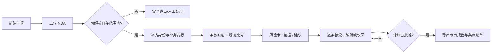

# Legal Intelligence — LLM 法律合同审阅工作台 PRD

> **文档编号** LEG-PRD-001 · **版本** v1.0 · **日期** 2026-11-09 · **状态** 产品方案 / 待客户与法律顾问验证  
> **产品阶段** Discovery → MVP 设计，不代表已开发或上线 · **负责人** 1998X / Product  
> **对应详细规格** [MVP 功能展开与验收标准](mvp-functional-spec-v1.0.md) · **研究依据** [HN × Product Hunt 法律助手调研](research-2026-11.md)

## 0. 执行摘要与决策

**一句话定位：** 帮助美国初创公司外部合同律师及其协作人员，在审阅**英文、纽约州法律管辖的双向 B2B NDA**时，将原文、风险、依据、修订建议与人工批准串成可追溯工作流，而不是给出不可核验的“AI 法律结论”。

**核心决策（MVP）：** 一个司法辖区 + 一种合同类型 + 一条完整审阅链路。以律师审核为强制关口；支持上传 DOCX / 可提取文本的 PDF → 收集交易背景 → 按规则本审阅 → 逐条证据卡与替换建议 → 人工确认 → 导出审阅报告与建议条款清单。**不承诺自动生成 Word Track Changes 红线、自动签署或诉讼策略。**

**为什么现在做：** 前期 [研究](research-2026-11.md) 中，Product Hunt 的具体评论支持“降低起草空白页成本 / 解释条款”的需求信号；Hacker News 的法律专业讨论提示法源覆盖、专业复核、保密和引用准确性是产品成败的约束。该证据只证明存在值得验证的问题，**没有证明付费意愿、准确率或产品市场契合**。

### 0.1 决策记录

| 决策 | 本版选择 | 理由 / 代价 |
| --- | --- | --- |
| 主要使用者 | 美国合同律师或受其监督的法律运营人员 | 优先保证审查质量和责任边界；限制纯消费者增长速度 |
| 首个合同 | 英文双向保密协议（Mutual NDA） | 条款相对结构化，易建立专家金标准；不适用单向 NDA |
| 地域 / 适用法 | 明示以纽约州法为准的 B2B NDA；用户确认 | 降低跨法域误用；对其他法律地区安全退出 |
| 事实与依据 | 原文证据 + 已审定版本化合同规则本（playbook） | 不让模型凭空检索法条；商业风险提示≠法律有效性结论 |
| 核心交付 | 风险审阅清单 + 可编辑替换条款 + DOCX/PDF 审阅报告 | 能闭环交付且比保真 Track Changes 易于验证 |
| 人工审核 | 必须逐条决定，最终由律师角色批准导出 | 减少无监督高风险输出；增加审阅摩擦 |
| 商业化 | 先在专家参与的付费试点验证 | 不把论坛点赞与竞品营销数据当营收证据 |

## 1. 问题定义、用户画像与价值假设

### 1.1 目标用户与 JTBD

| 用户 | 场景与任务 | 现有困难 | 期望可交付物 |
| --- | --- | --- | --- |
| P0：合同律师 / Fractional GC | 每周为创业客户审核重复出现的 NDA | 重复条款定位、整理异议、版本解释耗时；高风险遗漏代价高 | 能核对来源的审阅清单及可复制替换措辞 |
| P0：律师助理 / 法律运营 | 收材料、抽取条款、准备首轮清单 | 背景不全、文档格式差、律师批注分散 | 有状态的事项、明确待确认信息、待律师审批的工作稿 |
| P1：创业者 / 采购负责人 | 在律师介入前弄清 NDA 的谈判焦点 | 法律知识不足，难分商业偏好与法律风险 | 清楚的建议及移交清单；首版不允许其替代律师最终审批 |

**Job to be done：** “收到对手方 NDA 后，我需要尽快识别与客户立场不一致、可能产生业务后果的条款，把每个问题定位到原文并形成可由律师批准的交付物。”

### 1.2 已知证据与待证伪假设

- **已知（桌面研究）**：部分 PH 使用者认可生成初稿、条款解释，但也提到手动修改、性能或适用范围限制；HN 讨论强调权威数据、保密、验证和专业工作流。[R1]
- **假设 H1**：对高频审阅双向 NDA 的合同团队，条款级定位与规则化清单能降低包含复核和返工的端到端用时。
- **假设 H2**：清晰的证据与“无法判断”状态，比流畅的一次性聊天答复更受律师信任。
- **假设 H3**：使用者愿意为可编辑的合规审阅交付物付费，而不仅是获取免费摘要。
- **不成立的推断**：竞品评分、PH upvotes、创始人宣传的“零幻觉”，均不能作为本产品质量或商业表现证明。

## 2. 目标、非目标与成功定义

### 2.1 产品目标（试点期间）

1. 对**支持范围内**的合同形成有原文定位的风险卡，减少搜寻条款和整理意见的机械性步骤。
2. 每一项事实陈述可定位到原始文档页码 / 段落 / 字符区间；建议理由对应版本化规则条目或显式标注“需法律顾问判断”。
3. 不支持、无法解析、来源不足或适用法冲突时**主动停止风险结论**并引导人工处理。
4. 所有导出建议有人工审核状态、版本号与可审计操作记录。

### 2.2 非目标（明确排除）

- 提供面向消费者的独立执业法律意见、律师代理或法律胜诉率预测。
- 判例检索、法律引用自动生成、跨辖区或多语种有效性判断。
- 自动修改原合同并回写、Word Track Changes 红线、对外发函、自动签署或对方协商代理。
- 扫描件 OCR、图片合同、合同批量处理、邮件/CLM/CRM 插件、细粒度大型企业权限系统。
- 对 SaaS、雇佣、投融资、隐私政策等其他文书做法律审查；这些仅作为未来候选。

### 2.3 北极星指标与护栏

**北极星（试点）：** 每份被律师批准且证据完整的 NDA 审阅交付物的**端到端中位完成用时**，从材料进入至批准导出，计入人工复核 / 修改 / 返工；与同类案件纯人工基线配对比较。

| 指标 | 测量方式 | 试点假设阈值（不是实测表现） | 决策 |
| --- | --- | --- | --- |
| 关键风险召回 | 由至少 2 名律师盲审标注，分类 TP/FN；争议仲裁 | 对预定义高影响类型 ≥95% 的点估计；任何严重漏检单独评审 | 未达到则不得扩大试点 |
| 证据可定位率 | 对所有导出卡验证原文区间及规则本版本 | 100%；任何伪造引文为阻断项 | 发布阻断 |
| 导出内容完整性 | 自动对照源文档引用和已确认卡 | 100% 与审批快照一致 | 发布阻断 |
| 隔离与权限 | 跨组织访问 / 越权导出 / 模型泄露测试 | 0 次可复现的未授权访问 | 发布阻断 |
| 时间价值 | 同分层合同的人工基线 vs 产品全链路 | 中位用时降低 ≥25%（探索目标） | 未达到则调整工作流 |
| 可用性 | 5 位律师完成指定任务，无主持人救援 | ≥4/5 可成功找到原文、驳回建议、完成审批 | 低于阈值迭代 |
| 复用与支付 | 真实第二次使用、试付费订单 | 至少出现可核验的复购/付费试点，不设虚构比例 | 决定继续投资 |

**统计说明：** 50–100 份合同不足以证明所有罕见法律风险安全；需按风险类别、合同来源、模型版本分别呈现样本数与区间，并持续保留专家复核。

## 3. 核心使用旅程



### 3.1 关键交互规则

- **先校验范围再分析**：不支持的合同或法律地区不生成任何肯定式法律结论；显示原因、需要的人工动作。
- **事实与判断分栏**：左侧源文本及精确锚点，中间风险队列，右侧规则依据、反例 / 不确定性、建议替换文本。
- **不强制填满每个风险槽**：系统允许“未发现该类问题”“信息不足”“解析失败”；不将“未发现”视为“无风险”。
- **人工所有权**：助理可准备；律师可批准；输出必须标识“经某角色复核”，不声称 AI 是法律顾问。
- **默认无自动对外动作**：不邮件发送、不调用签字服务、不回写云盘原件。

## 4. 功能范围、优先级与依赖

**P0 = 对首版完整交付闭环不可缺少；P1 = 首版后可排序；P2 = 远期探索。** 每项详细合同、状态、边界和验收见 [MVP 功能规格](mvp-functional-spec-v1.0.md)。

| ID | 功能 | 优先级 | 用户可感知结果 | 前置依赖 |
| --- | --- | --- | --- | --- |
| F01 | 事项与安全上传 | P0 | 私密事项、文件限制、版本标识、扫描件阻断 | 身份、存储、恶意文件检测 |
| F02 | 背景确认 / 范围闸门 | P0 | 合同类型、双方角色、纽约州法确认、偏好采集 | 可解释范围规则 |
| F03 | 保真文本与条款定位 | P0 | 每张卡定位页/段/原文，失败不输出结论 | DOCX/PDF 解析与锚点服务 |
| F04 | 版本化审查规则本 | P0 | 8–10 类 NDA 条款检查、规则版本与维护人 | 合资格律师审定的 playbook |
| F05 | 证据化风险卡 | P0 | 原文摘录、影响、严重度、理由、状态 | F02–F04、引用验证器 |
| F06 | 人工决策与审批 | P0 | 接受 / 编辑 / 驳回 / 待律师判断，律师签核 | 角色、审核状态机 |
| F07 | 替换建议与导出 | P0 | 原文 vs 建议条款清单、可读 DOCX/PDF 报告 | F03/F05/F06、版本快照 |
| F08 | 安全、删除与审计 | P0 | 最小授权、加密、删除、无明文遥测、审计日志 | 数据处理评估、供应商合同 |
| F09 | 基础质量与失败处理 | P0 | 明确失败原因、重试、质量门禁、人工接管 | 基准样本与回归测试 |
| F10 | Word 真正红线 / Track Changes | P1 | 可在原 DOCX 上审阅修订 | 格式保真与差异算法验证 |
| F11 | SaaS 合同、其他州/法域 | P1/P2 | 扩展合同类型与覆盖范围 | 各法域专家、样本及规则治理 |
| F12 | 知识库检索、CLM、自动代理 | P2 | 跨系统工作流 | 企业安全、权限与采购验证 |

### 4.1 首版规则类目（合同商业风险，不直接宣称法律效力）

1. 保密信息定义及例外；2. 使用目的和允许用途；3. 允许披露对象与其义务；4. 保密期限/存续期；5. 强制披露与通知；6. 返还/销毁义务；7. 救济 / 禁令语言；8. 责任与费用转移；9. 非招揽/竞业等超出 NDA 目的条款；10. 转让、适用法和争议解决条款。

规则输出必须注明：**某类条款的出现 / 缺失本身不意味着违法或无效**；风险等级依客户立场、交易背景、律师审定的规则与例外而定。

## 5. 信息架构与关键页面

| 页面 | 核心组件 | 状态 / 交互要求 |
| --- | --- | --- |
| S01 事项列表 | 新建、状态、合同文件名脱敏、负责人、版本 | 无跨组织串读；仅显示本人有权事项 |
| S02 上传与范围确认 | 拖拽/选择文档、格式反馈、身份/法域/立场问题 | 文件不合格和不支持范围时停止；解释下一步 |
| S03 审阅工作台 | 左原文，中风险清单，右证据/规则/修订 | 点击卡滚动原文，孤立锚点禁止进入“可接受” |
| S04 律师审批 | 差异摘要、未决项、版本差异、审批身份 | 未决/证据失败时禁止“批准并导出” |
| S05 导出与历史 | 导出审阅报告、替换条款、审计摘要 | 每次导出固定版本；删除后按策略清理 |

**可访问性与国际化：** 产品界面首版英文，支持键盘访问、清晰错误文案、颜色之外的严重度标识；研究与需求文档为中文。移动端只保证能查看状态，不提供复杂文书审阅。

## 6. 数据与 AI 系统设计原则（非实现承诺）

```text
[文件上传] -> [恶意文件/类型校验] -> [安全原文存储]
                    |                    |
             [DOCX/PDF 解析] -> [页段锚点 + 哈希]
                    |                    |
       [范围判断 + 客户背景] -> [律师审定规则本 vN]
                    |                    |
             [候选风险提取（LLM）]
                    |
       [确定性校验：引文区间 / 范围 / 规则引用]
                    |
          [用户审阅队列 + 人工批准]
                    |
              [不可变快照 / 导出]
```

- **模型是候选生成器，不是法源。** 解析/引用验证独立于 LLM；不允许模型自造判例、法规编号、律师身份或“无风险保证”。
- **规则本是内部经律师审定的审阅准则**，包含 `rule_id`、版本、适用范围、审定人、更新时间、例外。不是自动获取的法律数据库。
- **证据对象**含 `file_hash`、`page` / `paragraph_id`、`start_offset`、`end_offset`、`exact_quote`；偏移失效则卡片退回 `needs_manual_review`。
- **输出留痕**：`matter_id`、`document_version`、`model_version`、`playbook_version`、`reviewer_id`、每条决策及时间戳。LLM 提示与输入文件不得写入普通应用日志。
- **供应商边界**：在法律顾问 / 安全负责人审定的数据处理条款、允许的区域与不训练条款落实前，不向第三方模型发送真实客户 NDA。

## 7. 信任、安全、隐私与法律边界

| 风险 | P0 控制 | 发布前证明材料 |
| --- | --- | --- |
| 法律服务边界 | 仅辅助专业人员；产品文案禁止“替代律师”“保证合法”；实际销售/运营方式先经合资格法律顾问核验 | 法律顾问签核的对外披露与适用范围 |
| 模型幻觉 / 不支持结论 | 原文精确匹配、规则本引用、无法证实时弃答/人工接管 | 盲测、对抗样本、错误分类台账 |
| 提示注入 | 合同内容当不可信数据，禁止其指示调用权限/外部工具；输出结构校验 | 注入测试与隔离演示 |
| 文件与跨租户泄露 | RBAC + server-side per-matter ACL、加密、文件恶意内容检查、隔离测试 | 渗透测试记录和 DPA / 子处理者清单 |
| 数据生命周期 | 试点默认 30 天合同保留，可按事项提前删除；删除在 24 h 内清理主存储，备份依既定策略（目标 ≤30 天） | 删除演练与恢复说明（上述均为设计目标） |
| 审计争议 | 含审阅人、模型/规则版本、导出哈希；审计日志不含整份合同 | 审计抽检、导出一致性回归 |

**规范参照，不代表合规认证：** ABA Formal Opinion 512 提醒律师关注能力、保密、监督与验证义务 [R2]；NIST AI RMF GenAI Profile 为生成式 AI 风险管理提供自愿性参考 [R3]；OWASP LLM Top 10（2026）对提示注入、敏感信息暴露及过度代理提出安全关注点 [R4]。是否构成法律服务、客户通知/同意与隐私义务应按实际业务与适用法逐项由当地律师判定。

## 8. 研发里程碑与责任分工

> 假设采用 1 名产品/设计、2 名全栈/AI 工程、0.5 名 QA/安全、定期合作律师。以下为**条件式计划**，不代表已排期或已投入资源。

| 阶段 | 目标交付 | 出口条件 |
| --- | --- | --- |
| W0（发现） | 8–12 次 SMB / 5–8 次律师访谈，确定语料授权与律师规则本负责人 | 至少 5 个真实审阅任务可复现；法域范围获顾问确认 |
| W1–2（基础） | 事项/用户隔离、上传、解析、锚点、范围闸门 | 30 份合格文件解析回归，无静默缺页 |
| W3–4（智能审阅） | 规则本、候选卡、确定性校验、人工状态机 | 50–100 份经授权且脱敏的专家数据集可盲测 |
| W5（交付） | 报告 DOCX/PDF、建议条款、审批日志、删除 | 导出完整性 / 隐私 / 版本测试通过 |
| W6（受控试点） | 10–20 个真实、获授权的律师监督事项 | 关键缺陷清零，按北极星指标复盘，决定下一步 |

### 8.1 发布门禁（Go / No-Go）

**Go** 需要：法律顾问完成角色/合规审查；原文锚点与导出 100% 通过；跨租户越权 0 可复现；无伪造或不支持引文；关键风险达到试点目标；每个导出获真实律师审批；关键失败能安全退出。**No-Go** 只要出现未修复的严重漏检、泄露、越权、自动对外执行、无审批导出、静默篡改合同或数据删除失败。

## 9. 关键待决问题与验证实验

| 待决问题 | 可证伪实验 | 决策输入 |
| --- | --- | --- |
| NDA 频率是否足以单品付费？ | 访谈＋真实付费试单；统计每客户月度 NDA 量 | 若低频，转为律师工作台增值功能 |
| 规则能否覆盖核心情景？ | 50–100 份多源 NDA 双律师盲标 + 仲裁 | 类别召回、置信区间与无法判断比例 |
| 合同来源是否质量足够？ | 文本 PDF / DOCX 版式压力测试 | 解析失败率、锚点稳定性 |
| 人工复核是否吞掉节省的时间？ | 配对对照审阅，计入解释/纠错时间 | 端到端中位差异与主观负担 |
| 客户对数据处理的可接受底线？ | 安全文档走查＋客户采购访谈 | DPA、托管区域、自托管需求 |
| 何时需要真 Word 红线？ | 对 10 位律师做导出任务测试 | “建议清单”不能满足的真实案例比例 |

## 10. 证据与引用

- **[R1] 1998X 原始调研（2026-11-08）**： [HN × Product Hunt：LLM 法律助手研究](research-2026-11.md)，原始产品与论坛链接见文末 22 项来源。
- **[R2] ABA Formal Opinion 512（2024-07-29）**：<https://www.americanbar.org/content/dam/aba/administrative/professional_responsibility/ethics-opinions/aba-formal-opinion-512.pdf>。
- **[R3] NIST AI RMF GenAI Profile, NIST AI 600-1（2024）**：<https://www.nist.gov/publications/artificial-intelligence-risk-management-framework-generative-artificial-intelligence>。
- **[R4] OWASP GenAI LLM Top 10 2026（2026-08-04 发布）**：<https://github.com/GenAI-Security-Project/GenAI-LLM-Top10>。

---

**文档性质：** 本 PRD 为可执行的**产品设计方案和待验证的 MVP 假设**，不是已实现产品规格、第三方审计结果、法律意见或承诺的商业成果。具体法律审阅规则在业务试点前必须经具有相关执业资质的法律专业人士审定。
